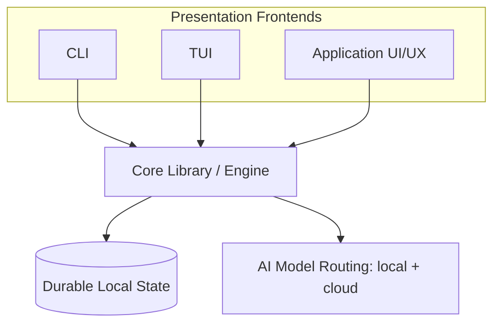
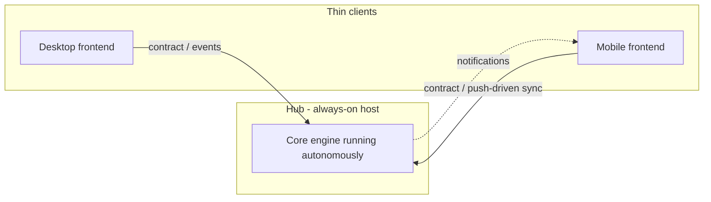

# Cronus Architecture

**Version:** 1.4.1
**Status:** Stable
**Layer:** concept

## Overview

Cronus is an autonomous multi-agent system organized as a single embeddable **core engine** consumed by interchangeable **presentation frontends**. This specification defines the technology-agnostic architecture: the layering of the product into a foundational library plus its frontends, the direction of dependencies between them, and the deployment topology that governs where autonomous work may run.

The product is built from four architectural layers:

1. **Core library (foundation)** — an embeddable library that can be linked into other projects; it holds all domain logic (agents, orchestration, memory, scheduling, model routing, state).
2. **CLI** — a command-line frontend over the core.
3. **TUI** — a terminal user-interface frontend over the core.
4. **Application (desktop/web)** — a full graphical UI/UX frontend over the core.

## Related Specifications

- [l2-technology-stack.md](l2-technology-stack.md) - Concrete technology realization of this architecture.
- [l2-core-library.md](l2-core-library.md) - Implementation of layer 1 (foundation).
- [l2-cli.md](l2-cli.md) - Implementation of layer 2 (CLI).
- [l2-tui.md](l2-tui.md) - Implementation of layer 3 (TUI).
- [l2-app-ui.md](l2-app-ui.md) - Implementation of layer 4 (application UI/UX).
- [l1-execution-sandbox.md](l1-execution-sandbox.md) - The sanctioned out-of-process boundary for untrusted/agent-run code (INV-8); a security seam, not a service split.
- [l1-multi-device-sync.md](l1-multi-device-sync.md) - Device-to-device replication converges instances of the same whole engine (INV-8), not a decomposition into services.
- [l1-background-activation.md](l1-background-activation.md) - How a host *becomes* the always-on hub INV-4 presumes: the activation modes, and the authority boundary that keeps the agent from self-activating.
- [l2-crate-topology.md](l2-crate-topology.md) - [ADDED v1.3.0] the concrete Rust realization of INV-10: an adapter crate's storage/wire representation is private to it and mapped to/from `cronus-contract` types at the seam; the domain crate never depends on an adapter's shape.

## 1. Motivation

A single autonomous agent product must reach users through several surfaces — scripts and automation (CLI), interactive terminals (TUI), and rich graphical clients (desktop/web/mobile) — without duplicating domain logic in each. Concentrating all capability in one embeddable core and treating every surface as a thin frontend yields:

- One source of truth for behavior; frontends cannot drift apart.
- Embeddability: the same core can be reused inside third-party programs.
- Testability: domain logic is verifiable without any UI.
- A clear place for the autonomous workload to live, independent of which surface launched it.

It also confronts a hard environmental reality: not every host can sustain always-on background work (see INV-4). The architecture must separate *where the autonomous engine runs* from *where the user interacts with it*.

## 2. Constraints & Assumptions

- The core library has **no dependency** on any presentation technology, windowing system, or terminal.
- Frontends depend on the core; the core never depends on a frontend (one-directional dependency).
- The same logical command is expressible across all frontends (command parity); frontends differ in presentation, not behavior.
- The autonomous, long-running workload requires a host that permits sustained background execution; some target environments do not (assumption validated by platform research — resource-constrained, uncontrolled-lifecycle clients).
- State is local-first and durable; remote/synchronized operation is an optional capability layered on top, never a prerequisite.

## 3. Core Invariants (Layer 1 only)

Rules that every Layer 2 implementation MUST NOT violate:

- **INV-1 (Embeddable core):** The core is a standalone library with zero presentation/UI dependencies and MUST be linkable into an external host program.
- **INV-2 (Logic in core only):** All product capabilities are exposed by the core through a stable programmatic contract. Frontends MUST contain presentation and input mapping only — never domain/business logic.
- **INV-3 (Frontend interchangeability / command parity):** CLI, TUI, and graphical frontends are interchangeable surfaces over the same core contract. An equivalent command issued from any frontend MUST yield equivalent behavior and outcome.
- **INV-4 (Hub-and-spoke autonomy):** The always-on autonomous workload runs only on a host capable of sustained background execution (the *hub*: desktop, server, or remote node). Hosts with constrained or externally-controlled process lifecycles act as thin *spokes* (clients) and MUST NOT be relied upon to perform persistent background work.
- **INV-5 (Durable, restartable state):** The core MUST persist its state durably and resume without loss after a process restart; sessions, memory, and task state survive restarts.
- **INV-6 (Graceful capability scaling):** A frontend MAY expose a subset of the core contract appropriate to its host environment, but MUST NOT introduce behavior that diverges from the core contract. Reduced capability is allowed; contradictory behavior is not.
- **INV-7 (Security of client data):** Secrets and user data are protected by default; the core MUST keep local secrets (e.g. credentials, tokens) out of version-controlled or exported artifacts and MUST distinguish user data from anonymized operational telemetry.
- **INV-8 (Single-deployable modular monolith):** the engine is delivered and run as **one deployable unit** — a *modular monolith* of strongly-bounded internal modules with strictly inward dependencies (INV-1/INV-2) — **not** a set of independently-deployed, network-distributed services. Cross-module communication is in-process contract/function calls, never inter-service network calls; the system MUST NOT require an orchestration platform (container orchestrator, service mesh) to run, and no subsystem is split into a separately-deployed service for scaling. The **only** sanctioned process boundaries are: (a) the frontend↔core split (a thin frontend over the core contract, INV-3); (b) confinement of untrusted/agent-run code and untrusted plugins, which run out-of-process for **security**, not scaling (composes l1-execution-sandbox); and (c) the hub↔spoke client connection (INV-4) and device-to-device replication, which connect or converge **instances of the same whole engine**, never decompose it. A subsystem MAY be kept as a self-contained module behind a clean seam to preserve a future extraction option, but in-process linking is the default and the seam is not a network boundary.
- **INV-9 (Shipped-surface honesty):** `[ADDED]` a frontend MUST NOT expose a command or affordance that is not bound to the core capability it names. When the core exposes a capability, every frontend that lists the corresponding command MUST bind it to the core contract (INV-3); when the core does not yet expose it, the command MUST NOT appear on the shipped default surface — it is hidden or explicitly marked unavailable and excluded from completion/help listings. A visible verb that merely reports "not implemented" is a **parity violation**, not reduced capability: INV-6 sanctions offering a *subset*, never advertising an unbound verb. This closes the stub-verb loophole through which a shipped surface silently drifts from the core contract.
  `[MODIFIED v1.4.0]` **Retirement is the same rule read backwards.** A verb the surface *used to* expose and no longer binds is an unbound verb, so INV-9 governs its removal as strictly as its arrival, and the two failing extremes are symmetric: **silently deleting** it breaks scripts and muscle memory with no diagnosis (the user's invocation fails as an unknown command, indistinguishable from a typo), while **aliasing it forever** freezes the grammar around names the product has outgrown and leaves two verbs for one capability, which is a parity violation of its own. The sanctioned shape is a **declared retirement**: the verb leaves the shipped default surface — absent from help and completion exactly as an unbound verb must be (above) — while a **migration path remains discoverable**, so an invocation of the retired name resolves to a message naming its **replacement**, and any retained compatibility entry point is **opt-in, explicitly marked as retired, and states what supersedes it** rather than quietly behaving like a first-class verb. A retirement is a governed rename of the surface, subject to the same identity discipline a distributed artifact's rename carries (`l1-extension-marketplace` XM-2, `l1-host-native-rendering` HNR-6): the old name is never silently re-pointed at a *different* capability.
- **INV-10 (Representation isolation at the inward seam):** `[ADDED v1.3.0]` the domain/core depends only on **shared contract types**; an adapter's **internal representation** — its storage schema/row shape, its wire DTO, the transport-specific form it speaks — is **private to the adapter** and mapped **to and from contract types at the seam**. The domain MUST NOT name, import, or depend on an adapter's representation. This is the **inward** counterpart to INV-2: INV-2 keeps *logic* from leaking *outward* into a frontend; INV-10 keeps an adapter's *data shape* from leaking *inward* into the domain. It is dependency inversion applied to **data**, the twin of the behavioral inversion the trait seams already enforce (a domain module depends on a port trait, never a concrete backend) and of the error-shape boundary (`l1-security` SEC-11, an adapter's internal error detail never crosses to the caller). The failure it forbids is the classic leak: a persistence backend's table schema, or an HTTP request's DTO, quietly *becomes* a domain type — after which the domain cannot compile without that backend, cannot be unit-tested without it, and silently re-couples to the very technology the seam existed to isolate. A representation crossing the seam is **mapped, never shared**: the adapter converts its shape to a contract type on the way in and from a contract type on the way out, so the two representations evolve independently and the domain stays backend-agnostic (composing INV-8's strongly-bounded modules and the DN-2 seam discipline). "Mapped, never shared" is a **type** boundary, not a mandate to deep-copy: because the engine is one in-process unit (INV-8), a contract type may cross the seam by reference or as a handle without the domain ever naming the adapter's concrete type — representation isolation costs a type indirection, not necessarily a copy of a large payload.

> L2 specs cannot reach RFC status until all invariants here are addressed in their "Invariant Compliance" section.

## 4. Detailed Design

### 4.1 Layer model and dependency direction



Dependencies point inward only: frontends → core → state/services. No arrow ever points from the core to a frontend. This keeps the core embeddable (INV-1) and prevents logic leaking outward (INV-2).

### 4.2 The four layers

| # | Layer | Responsibility | Depends on |
| --- | --- | --- | --- |
| 1 | Core library | Domain logic: agent orchestration, memory, scheduling/cron, model routing, Kanban state, persistence; exposes a programmatic contract | (nothing in this product) |
| 2 | CLI | Map shell commands/flags to core contract calls; render text output | Core |
| 3 | TUI | Interactive terminal rendering of core state and commands | Core |
| 4 | Application | Full graphical UI/UX (desktop/web/mobile shell) over the core contract | Core |

### 4.3 Hub-and-spoke deployment topology



The hub is any host that can legitimately run a sustained background process (a desktop OS service, a server, an SSH-reachable node). Spokes connect to the hub's core contract; a spoke MAY also embed its own core for offline/foreground-only use, but persistent autonomous operation is the hub's responsibility (INV-4).

### 4.4 Command parity

Each user-facing capability is named once and offered by every frontend that supports it; the frontend differs only in how the command is invoked and how results are rendered. Example capability set (illustrative, not exhaustive): `help`, `init`, `idea`, `plan`, `task`, `run`, `status`, `compact`, `analyze`, `memory`, `goal`, `quit`/`exit`. INV-3 requires that the same capability behaves identically regardless of the surface it is invoked from.

`[ADDED]` Parity is honest by construction (INV-9): a capability appears on a surface only once it is bound to the core contract. A capability the core has not shipped yet is absent from the surface — never presented as a verb that fails with "not implemented". The surface listing (help output, completion, menus) is therefore a truthful projection of the core contract at that release.

### 4.5 Deployment shape: modular monolith, not microservices (INV-8)

The engine is a **modular monolith** ("modulith"): one deployable unit composed of well-bounded modules that communicate in-process, deployable by a non-technical user with a single install and no orchestration platform.

```text
[REFERENCE]
Sanctioned process boundaries (and ONLY these):
  frontend  <-- IPC / ACP event stream -->  core        // INV-3; one process per surface
  core      <-- spawn, confined         -->  sandboxed agent/plugin code   // INV-8(b); SECURITY seam
  hub core  <-- ACP contract            -->  spoke client                  // INV-4; same engine, remote surface
  device A  <-- replication             -->  device B                      // SY-*; converging the SAME monolith
Everything else is an in-process module call.
```

Microservices are rejected for Cronus by construction: the product is single-user, on-device, and not horizontally scaled, so the microservice payoffs (independent scaling, independent multi-team deploy, fleet fault-isolation, per-service polyglot) do not apply, while their costs (on-box network hops, distributed-systems failure modes, an orchestration platform a non-technical operator cannot run) are pure loss. The genuine needs microservices would address here are met without distribution: **fault isolation** by supervised in-process tasks (l1-work-liveness) and self-healing (l1-doctor); the **polyglot boundary** (Rust core ↔ web UI) by the frontend↔core IPC split; **security isolation** of untrusted code by the execution sandbox. Hub-and-spoke (§4.3) and device sync are *replication/remote-surfacing of one whole engine*, not service decomposition.

## 5. Drawbacks & Alternatives

- **Single-core coupling:** all frontends break if the core contract breaks. Mitigated by treating the contract as a versioned, reviewed interface.
- **Alternative — per-surface monoliths:** building independent CLI/TUI/GUI apps avoids a shared contract but guarantees behavioral drift and triples maintenance; rejected.
- **Alternative — microservices / service-oriented engine:** decomposing the engine into independently-deployed network services is rejected (INV-8). The product is single-user and on-device; microservice benefits (independent scaling/deploy, fleet fault-isolation, per-service polyglot) do not apply, while the costs (on-box network hops, distributed-systems complexity, a required orchestration platform) directly contradict the "one install, everything under the hood, non-technical operator" concept. The modular monolith keeps clean seams (e.g. nodus as an in-process crate) so a future extraction remains possible without paying for distribution now.
- **Alternative — phone-as-server (no hub):** treating every device as an always-on node was considered and rejected because some target hosts cannot sustain background execution; hence INV-4. `[MODIFIED v1.4.1]` A phone is a spoke in the core, by the person's decision (2026-10-22): its process lifecycle is externally controlled, so nothing in the core assumes it can stay awake. Whether a phone can act as a personal server is left to an **optional extension** — a plugin, in this repository or another, that supplies a host able to sustain background execution; such a host, when it exists, runs the *same single engine bundle* as any other hub (INV-8) — it is another hub instance, not a distributed tier, and not a spoke with extra duties.

## Canonical References

| Alias | Path | Purpose |
| --- | --- | --- |
| `[STACK]` | `.design/main/specifications/l2-technology-stack.md` | Concrete technology choices realizing this architecture |
| `[CONTRIB]` | `CONTRIBUTING.md` | Intended on-disk repository and user-state layout |

## Document History

| Version | Date | Author | Notes |
| --- | --- | --- | --- |
| 1.4.1 | 2026-10-22 | Core Team | The phone-as-server alternative (§5) now matches INV-4 and the person's decision of 2026-10-22: a phone is a spoke in the core; whether it can act as a personal server is left to an optional extension (a plugin, in this repository or another) supplying a host that can sustain background execution, which would run the same engine bundle as a hub (INV-8). No invariant is added or removed. |
| 1.4.0 | 2026-08-06 | Core Team | INV-9 amended — **retirement is the same rule read backwards**. The invariant governed a verb's *arrival* (never advertise an unbound verb) and said nothing about its *departure*, though a verb the surface no longer binds is by definition unbound. Both failing extremes named and forbidden: **silent deletion** breaks scripts and muscle memory with no diagnosis (the invocation fails as an unknown command, indistinguishable from a typo), and **permanent aliasing** freezes the grammar around outgrown names and leaves two verbs for one capability — a parity violation of its own. Sanctioned shape: a **declared retirement** — the verb leaves the shipped default surface (absent from help and completion, as any unbound verb must be) while a **migration path stays discoverable**, an invocation of the retired name resolving to a message that names its replacement, and any retained compatibility entry point being **opt-in, explicitly marked retired, and stating what supersedes it** rather than behaving like a first-class verb. Subject to the same identity discipline as a distributed artifact's rename (XM-2, HNR-6): an old name is never silently re-pointed at a different capability. Clarifying amendment; INV-1…INV-8, INV-10 unchanged. |
| 1.3.0 | 2026-07-26 | Core Team | Added INV-10 (representation isolation at the inward seam) — the domain/core depends only on **shared contract types**; an adapter's **internal representation** (storage schema/row shape, wire DTO, transport-specific form) is **private to the adapter** and mapped to/from contract types at the seam, the domain never naming, importing, or depending on an adapter's shape. The **inward** counterpart to INV-2 (which keeps *logic* from leaking *outward* into a frontend): INV-10 keeps an adapter's *data shape* from leaking *inward* into the domain — dependency inversion applied to data, the twin of the behavioral trait-seam inversion (a domain module depends on a port trait never a concrete backend) and of the error-shape boundary (l1-security SEC-11). Forbids the classic leak where a persistence table schema or an HTTP DTO quietly *becomes* a domain type, after which the domain cannot compile or unit-test without that backend and silently re-couples to the technology the seam existed to isolate; a representation crossing the seam is mapped never shared (composing INV-8 strongly-bounded modules and the DN-2 seam discipline). Concretely realized in l2-crate-topology. Related Specifications extended with l2-crate-topology. |
| 1.2.0 | 2026-07-16 | Core Team | Added INV-9 (shipped-surface honesty): a frontend never ships a verb unbound to the core capability it names — unbound commands are hidden/marked unavailable, never presented as "not implemented" stubs; §4.4 extended (surface listing is a truthful projection of the core contract). Closes the stub-verb loophole INV-6 did not cover (audit finding: shipped CLI groups answering "not yet implemented" while the core library exposes the capability). |
| 1.0.0 | 2026-06-24 | Core Team | Initial spec — INV-1…INV-7; four-layer core+frontends model, inward dependency direction, hub-and-spoke deployment topology, command parity. |
| 1.1.1 | 2026-07-10 | Core Team | Cross-reference only: linked `l1-background-activation.md`, which specifies how a host becomes the always-on hub INV-4 presumes. No invariant or design change. |
| 1.1.0 | 2026-06-27 | Core Team | Added INV-8 (single-deployable modular monolith — not network-distributed microservices; sanctioned process boundaries limited to frontend↔core, security confinement of untrusted code, and hub↔spoke/device-replication of the same whole engine) and §4.5 (deployment shape rationale); §5 microservices-rejected alternative; clarified the phone-as-server case as another hub instance of one monolith. Additive; resolves the monolith-vs-microservices architecture decision. |
