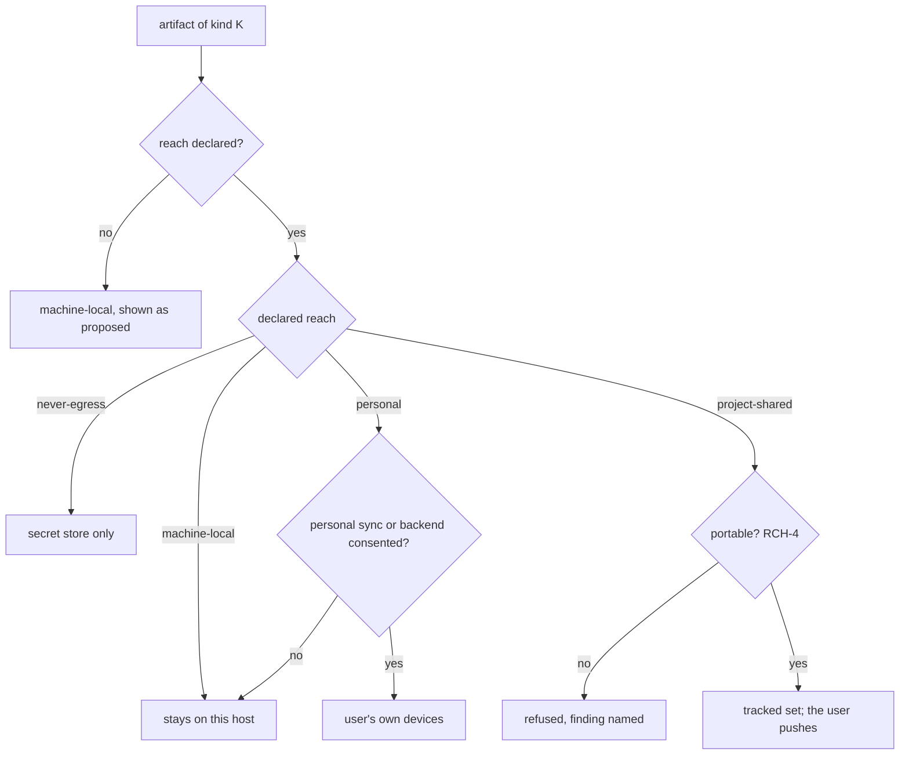
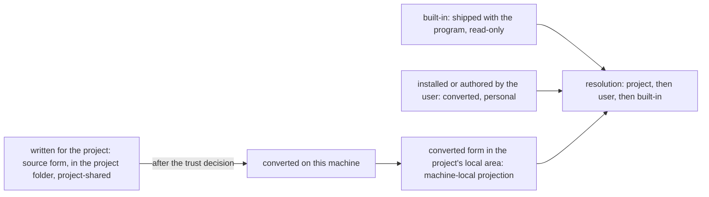

# Artifact Reach

**Version:** 1.1.1
**Status:** Stable
**Layer:** concept

## Overview

Every artifact Cronus writes for a user — configuration, commands, skills, agent definitions, workflows, plans, memory, sessions, indices, run records, keys — has a **reach**: how far it is meant to travel from the machine that produced it. Some belong to the project and should reach every developer who clones it. Some belong to the person and should follow them across their own devices, never to a colleague. Some belong to this machine and this checkout and are meaningless anywhere else. And some must never leave at all. This spec names those four reaches as a closed set, says who declares an artifact's reach, and makes every tool that copies, commits, syncs, exports or backs up decide by the declared reach rather than by where a file happens to sit.

The failure it closes runs in both directions. A project that commits too much carries one developer's sessions, memory and absolute paths into everyone's checkout — and sometimes a secret. A project that commits too little leaves each collaborator to rebuild by hand the commands, skills and agent definitions the team agreed on, so the same project behaves differently for every person who opens it.

## Related Specifications

- [l1-state-authority.md](l1-state-authority.md) - The orthogonal axis. Authority says *which copy is the truth*; reach says *how far a copy may travel*. A kind declares both, and the two never substitute for each other (RCH-3).
- [l1-storage-model.md](l1-storage-model.md) - Where state lives (tiers, scopes); STO-6 secret isolation is the never-egress reach.
- [l1-multi-device-sync.md](l1-multi-device-sync.md) - SY-10 is how a personal or project-shared artifact is allowed onto a transport; RCH-6 is the consent rule it already states, generalized to every reach.
- [l1-derived-artifact-handoff.md](l1-derived-artifact-handoff.md) - A rebuildable projection may be *offered* to a peer; it is never committed as project-shared content (RCH-3).
- [l1-code-intelligence.md](l1-code-intelligence.md) - CI-18 is the first instance of this split: the index is a local cache, its integration wiring is shared.
- [l1-development-workflow.md](l1-development-workflow.md) - DW-5: design documents and the progress ledger a specification makes part of the project's history are project-shared by declaration.
- [l1-security.md](l1-security.md) - Egress authorization and the workspace trust decision that gates arriving project-shared artifacts (RCH-5).
- [l1-deployment-neutrality.md](l1-deployment-neutrality.md) - A hosted backend for personal data is an opt-in seam, never the assumption; the personal reach does not presume one.
- [l1-onboarding.md](l1-onboarding.md) - A collaborator opening a project that already carries project-shared artifacts follows its own onboarding path (ONB-10).
- [l2-filesystem-layout.md](l2-filesystem-layout.md) - The realization: the path-level reach map (§4.7 there).

## 1. Motivation

The corpus already makes this split in four separate places, each locally and each differently:

- The project-local state root that `cronus init` creates is excluded from version control by default and opts two names back in (`settings.json`, `commands/`). Skills and agent definitions are mentioned as "committed on purpose" in one sentence and covered by no rule.
- The code index is a disposable local cache whose integration wiring is shared (CI-18).
- The development workflow's design documents and progress ledger are committed to the feature branch (DW-5).
- A user may widen the tracked set to a declared subset of office state for a remote they name (SY-10).

Each statement is right. Together they leave every other kind undecided: is a workflow the team wrote project-shared? Is a role's authored memory? A schedule? An agent definition that names a model only one developer has installed? Nothing answers, so the answer is whatever `.gitignore` happens to say — a file-path rule standing in for a decision about meaning. The same shape failed once already in this corpus, when "databases are derived indices" stood in for a per-kind authority declaration; this spec gives reach the per-kind declaration authority received.

## 2. Constraints & Assumptions

- **Confirmed (2026-10-22, the person's decision):** "the remote repository (the cloud) for other developers" means the project's own version-control remote, which collaborators clone. A Cronus-hosted cloud service is not assumed and not required (`l1-deployment-neutrality`); a hosted backend for personal data remains an opt-in seam. Not taken: a Cronus-operated sharing service.
- Reach belongs to a **kind** of artifact, not to a file or a directory, exactly as authority does.
- The reaches are closed. A kind that fits none is a design question for its owner, not a fifth reach.
- The office commits locally at most; pushing is always the user's act or a standing consent they recorded (the no-remote-git contract).
- `[ADDED v1.1.0]` **Decided by the user (2026-10-22):** the product's folder inside a project is the **team's folder** — committed, project-shared by default — and holds a declared **local area** for the office's working state, which version control excludes. Built-in artifacts ship with the program; artifacts a user installs or authors live in the user's state in the product's executable form; ordinary artifacts written for a project live in the project folder in their source form. This applies alike to skills, agent definitions and workflows (§4.5).

## 3. Core Invariants

Rules every Layer 2 implementation MUST NOT violate:

- **RCH-1 (Every kind declares a reach from a closed set):** each kind of artifact declares exactly one reach. **Project-shared**: it belongs to the project and travels with its repository to every collaborator. **Personal**: it belongs to the user and travels only to the user's own devices or a backend the user opted into, never through the project repository. **Machine-local**: it belongs to this host and this checkout and does not travel; it is rebuildable or meaningless elsewhere. **Never-egress**: it leaves the secret store for nothing — no repository, sync, backup or export. The declaration lives in the specification that owns the kind; the realization's reach map only indexes it.
- **RCH-2 (Undeclared is machine-local):** a kind whose owner has not declared a reach is treated as machine-local and shown as *proposed*. A new artifact never becomes shared by default; sharing is always a declaration someone made.
- **RCH-3 (Reach is not authority, and a projection is never project-shared content):** reach and authority class are independent properties and neither is inferred from the other — a record-authoritative session log is machine-local, a text-authoritative command file is project-shared. A projection is not committed as project content: each collaborator derives it from the shared authority. What a projection needs to be derived the same way everywhere — its wiring, its configuration — may be project-shared (CI-18); the derived bytes may be offered to a peer under derived-artifact handoff, never committed.
- **RCH-4 (A project-shared artifact is portable):** before an artifact enters the tracked set it is checked for what would make it wrong or dangerous on another machine — a secret, personal content, an absolute path, a host or user identity, a reference to a machine-local artifact. A failing artifact is refused with the finding named, never committed with a warning. A reference to something a collaborator must supply (a model, a tool, a credential) is written as a named requirement, not as a value.
- **RCH-5 (What arrives is untrusted until trusted):** a project-shared artifact that arrived from a collaborator is loaded or executed only after the workspace trust decision for that project, and an executable artifact (a command, a hook, a workflow, a skill with tool access) is never pre-approved by trust in its directory or its parent.
- **RCH-6 (Widening is consented, narrowing is honest):** moving a kind to a wider reach — machine-local to personal, or personal to project-shared — is an explicit, visible, revocable consent that names the destination, and lapses when the destination changes (SY-10). Narrowing stops future sharing and says plainly that history already pushed keeps what it carried; it never claims to unpublish.
- **RCH-7 (Tools decide by declared reach):** initialization's version-control exclusion, commit, export, sync and backup consult the declared reach of each kind, never a path, an extension or a directory name. Backup still decides inclusion by authority class (SAU-5) and excludes only never-egress; reach decides where a copy may go, authority decides whether a copy is needed.
- **RCH-8 (The split is visible):** one inspect operation lists, for the current project, which kinds are project-shared, personal, machine-local and never-egress, where each lives, and which declaration put it there; a *proposed* reach is shown as such.
- **RCH-9 (A reach change is one swept revision):** when a kind's reach changes, the owning specification, the reach map, the initialization exclusion and every tool that hard-coded the old reach change in the same revision, and a checkout made under the old reach is migrated or reported — never left to drift between collaborators.
- **RCH-10 (Three origins, each with its reach):** `[ADDED v1.1.0]` an extension-like artifact — a skill, an agent definition, a workflow — has exactly one of three origins. **Built-in**: shipped with the program, read-only, replaced on upgrade; it is part of the release and is neither committed by a project nor synced as personal data. **Installed or authored by the user**: held in the user's state, converted into the product's executable form, and personal. **Written for a project**: held in the project folder in its ordinary source form, and project-shared. Where the same name exists in more than one origin, the project's wins over the user's and the user's over the built-in, and the origin a resolved artifact came from is always reported.
- **RCH-11 (A project artifact travels as source; its executable form is derived per machine):** `[ADDED v1.1.0]` what a project shares is the source a collaborator can read and review, never the product's converted executable form. Each machine converts a project artifact for itself after the workspace trust decision (RCH-5); the converted form is a machine-local projection of the shared source (RCH-3), re-derived when the source changes, and never committed.
- **RCH-12 (The project folder is shared, its local area is not):** `[ADDED v1.1.0]` the product's folder inside a project is project-shared as a whole except one declared local area, which holds every machine-local and personal kind the office keeps for that project — sessions, memory, boards, indices, converted forms. Version control excludes the local area by a rule the product writes, and an undeclared kind is written into the local area (RCH-2). The folder carries a short readme for collaborators and a format version, so a checkout says what it is and a newer format is refused rather than misread.

> L2 specs cannot reach RFC status until all invariants here are addressed in their "Invariant Compliance" section.

## 4. Detailed Design

### 4.1 The four reaches

| Reach | Travels to | Typical kinds | Leaves the machine by |
| --- | --- | --- | --- |
| Project-shared | every collaborator of the project | committed project configuration, commands, project skills, agent definitions written for the project, workflows, the code index's wiring, design documents and progress ledger (DW-5), decision records the user opted in (SY-10) | the project's version-control remote, pushed by the user |
| Personal | the user's own devices, or a backend the user opted into | preferences, authored quick memory, user-added skills, learned memory, personal agent definitions | multi-device sync (SY-*) or the opted-in backend; never the project repository |
| Machine-local | nowhere | sessions and journals, run records, caches and every index, the engine seat and endpoint record, locks, sandboxes, snapshots, the dashboard's layout state | does not leave; a backup copy stays the user's own |
| Never-egress | nowhere, not even a backup | secrets, API keys, credentials, signing keys | does not leave the secret store |

### 4.2 Deciding a copy



### 4.3 Portability check (RCH-4)

```text
[REFERENCE]
admit_to_tracked_set(artifact):
    findings := []
    if contains_secret(artifact):            findings += secret
    if contains_absolute_path(artifact):     findings += machine_path
    if names_host_or_user(artifact):         findings += identity
    if references_machine_local(artifact):   findings += local_reference
    if contains_personal_content(artifact):  findings += personal_content
    if findings != []: refuse(artifact, findings)                  // never "commit with warning"
    requirements := external_requirements(artifact)                // models, tools, credentials by name
    record requirements beside the artifact                         // read by a collaborator's onboarding (ONB-10)
```

### 4.5 Three origins of an extension-like artifact (RCH-10…RCH-12) `[ADDED v1.1.0]`



| Origin | Form | Reach | Example |
| --- | --- | --- | --- |
| Built-in | executable, shipped | part of the release | the preset skills and role catalog |
| User | converted to the product's executable form | personal | a third-party skill the user installed; a skill the user asked the office to write |
| Project | ordinary source form | project-shared | a skill, agent definition or workflow the team wrote for this repository |
| Project, converted | derived from the project source on each machine | machine-local | the converted package a collaborator's office runs |

### 4.6 Demarcation

| Neighbour | What it owns | What this adds |
| --- | --- | --- |
| SAU-1…SAU-8 (state authority) | which copy is the truth, and the direction of recovery | how far any copy may travel |
| SY-10 (multi-device sync) | which classes a transport may carry, under which consent | the closed reach vocabulary those consents are about |
| CI-18, DW-5 | one kind's reach each | the rule both are instances of |
| Workspace trust (`l2-security` §4.8) | whether arriving project configuration is loaded | that every arriving project-shared artifact passes through it |

## 5. Drawbacks & Alternatives

- **Declaration overhead.** Every owning specification states a reach for each kind. Mitigated: it is one sentence beside the authority class most kinds already declare, and an undeclared kind is safe by RCH-2.
- **Alternative — decide by directory (everything under the project-local root is local, everything else is the project's).** Rejected: it is the rule in place today and it is why skills and agent definitions have no answer; location says where a file sits, not who it is for.
- **Alternative — share everything the office wrote, let `.gitignore` subtract.** Rejected: the failure mode is a leaked session or secret in a public history, which RCH-6 cannot undo.
- **Alternative — a hosted sharing service as the default destination.** Rejected as an assumption (§2): the project's own repository already reaches every collaborator, and a hosted default contradicts the local-first stance.

## Canonical References

| Alias | Path | Purpose |
| --- | --- | --- |
| `[AUTHORITY]` | `.design/main/specifications/l1-state-authority.md` | The orthogonal truth axis |
| `[SYNC]` | `.design/main/specifications/l1-multi-device-sync.md` | SY-10 transport eligibility and consent |
| `[LAYOUT]` | `.design/main/specifications/l2-filesystem-layout.md` | The path-level reach map (§4.7) |

## Document History

| Version | Date | Author | Notes |
| --- | --- | --- | --- |
| 1.1.1 | 2026-10-22 | Core Team | The forecast assumption is confirmed by the person (design-layer audit survey, 2026-10-22) and recorded as a decision; the runner-up is now the alternative not taken and the override hint is dropped. No requirement changed. |
| 1.1.0 | 2026-10-22 | Core Team | Added RCH-10…RCH-12 and §4.5 from the user's decisions on the open storage question. RCH-10: three origins for skills, agent definitions and workflows — built-in (shipped, read-only), user (installed or authored, converted, personal), project (source form, project-shared) — resolved project, then user, then built-in, with the origin reported. RCH-11: a project shares source, never the converted executable form; each machine converts after the trust decision and keeps the result as a machine-local projection. RCH-12: the product's folder inside a project is the team's, shared as a whole except one declared local area holding the office's working state, excluded by a product-written rule; the folder carries a collaborator readme and a format version. §2 records the decision; §4.4's demarcation becomes §4.6. |
| 1.0.0 | 2026-10-22 | Core Team | Initial concept — RCH-1…RCH-9: a closed set of four reaches (project-shared, personal, machine-local, never-egress) declared per kind by the owning specification; undeclared means machine-local and proposed; reach independent of authority, with projections never committed as project content; a portability check before an artifact enters the tracked set; arriving project artifacts untrusted until the workspace trust decision; consented widening and honest narrowing; tools deciding by declared reach; one visible inspect listing; a reach change swept in one revision. Motivated by a user request to separate what a finished product's artifacts send to the shared remote for other developers from what stays local, and by four places in the corpus (the init exclusion, CI-18, DW-5, SY-10) that each made the split for one kind and left every other kind undecided. |
