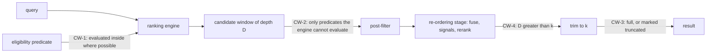

# Candidate Windows

**Version:** 1.0.0
**Status:** Stable
**Layer:** concept

## Overview

Every ranked retrieval in the office — memory recall, knowledge-base retrieval, code-index search, the application search surface — asks a ranking engine for a bounded list of candidates and then does something to that list: drops the ones the caller may not see or that are no longer live, fuses it with another list, re-orders it by further signals, trims it to the requested count. That bounded list is the **candidate window**. This spec owns the window: where eligibility is applied relative to the cut, how large a window must be when eligibility can only be applied after it, what a result says when it comes back short, and how deep a stage that re-orders candidates looks.

The failure it closes is silent. A window taken before filtering and sized by a constant returns fewer results than were asked for while eligible matches exist, and nothing reports it, because a short list looks exactly like a query with few answers. The shortfall grows with use rather than with load: superseded memories, retired documents and small collections inside a large store all add ineligible neighbours, and they cluster around exactly the items a query is looking for.

## Related Specifications

- [l1-retrieval-evaluation.md](l1-retrieval-evaluation.md) - The instrument CW-5 sets window parameters with: recall at a cutoff, measured on a labelled fixture through the production pipeline (RE-1…RE-3), variants compared on the same fixture (RE-7).
- [l1-knowledge-base.md](l1-knowledge-base.md) - KB-19 applies this contract to scoped collection retrieval; KB-15 fusion and rerank and KB-16 metadata filtering are the re-ordering and narrowing stages it governs.
- [l1-memory-model.md](l1-memory-model.md) - MEM-3 multi-signal recall fuses legs whose candidates are filtered by trust, supersession and lifecycle; each leg is a candidate window.
- [l1-code-intelligence.md](l1-code-intelligence.md) - CI-8 hybrid symbol search is a fused retrieval over two windows.
- [l1-search.md](l1-search.md) - Scope is a first-class dimension of the search surface; a scope is an eligibility predicate in the sense of CW-1.
- [l1-state-authority.md](l1-state-authority.md) - SAU-8: candidates scored by a projection derived differently from the query are not comparable, so they are not a window at all.
- [l1-quality-standards.md](l1-quality-standards.md) - QLY-11: a claim that a window parameter saves time or memory is measured like any other performance claim; CW-5 is the recall side of the same trade.

## 1. Motivation

Four retrieval paths in this codebase take the window first and filter second, and none derives the window's size:

- The knowledge store's vector and keyword legs ask their engines for `max(4·k, k + 20)` candidates and then drop the ones outside the target collections or in documents that are not ready. Its specification says `2·k`. Neither number is derived from anything.
- The memory store's lexical recall and its ranked recall ask for exactly the requested count and then drop low-trust, superseded, paused and expired entries. The ranked path then re-orders those survivors by further signals, so an item the lexical score placed one past the cut can never be promoted, however strong its other signals are.

The arithmetic is short. If a fraction *p* of the engine's nearest candidates is eligible, the number of eligible items in a window of *F* candidates behaves like a binomial count with mean *F·p* and standard deviation √(F·p·(1−p)). For a request of five, a window of twenty-five, and one eligible candidate in ten — a small collection inside a larger store — the mean is 2.5 and the request is filled roughly one time in ten. A window of about 120 fills it ninety-nine times in a hundred. With a window equal to the request, a single ineligible item anywhere in it guarantees a short answer.

The ineligible share is not random noise either. Supersession keeps the replaced version of a fact beside its replacement, and the two are near-duplicates, so the query that finds the live fact finds its dead versions at the same rank. The shortfall concentrates on the queries the store answers best.

The method comes from a published study of a large-scale load balancer that cut its memory by deriving the expected value and spread of an approximation parameter before tuning it, and found that most of what the parameter cost bought almost no accuracy. The same reasoning applied here finds the opposite error: a parameter set too low, losing accuracy silently.

## 2. Constraints & Assumptions

- A ranking engine may or may not be able to evaluate an eligibility predicate inside its own search. A relational full-text search usually can (a join); an exhaustive vector scan can when the predicate's column lives in the vector table; an approximate index generally cannot.
- *Eligibility* is any predicate that removes candidates the ranking produced: access scope, collection membership, index readiness, soft deletion, lifecycle, trust floor, supersession, expiry, structured metadata filters. It never includes a relevance floor the caller asks for: a result below the caller's own minimum score is not a missed eligible item.
- The binomial model assumes eligibility is independent of rank. It is not — eligible items may cluster near a query or far from it — so the model only sizes the **first** window. The guarantee comes from widening and exact scoring (CW-2), not from the model.
- Volumes are those of one office on one device: thousands to low millions of items per store. Nothing here assumes a distributed index.

## 3. Core Invariants

Rules every Layer 2 implementation MUST NOT violate:

- **CW-1 (Eligibility before the cut):** where the ranking engine can evaluate an eligibility predicate inside its search, the predicate is applied there, so the bound the search is given counts eligible items only. Filtering a bounded window after the engine has cut it is permitted only for a predicate the engine cannot evaluate (CW-2), never because a post-filter was easier to write.
- **CW-2 (A post-filtered window is sized, widened, and bounded honestly):** when eligibility can only be applied after the cut, the first window is sized from the requested count and the eligible share of the store under a declared miss probability — never a constant multiple of the request. A short result triggers a wider window, grown geometrically, until the request is filled, the eligible set or the engine's candidate set is exhausted, or a declared hard bound is reached. Where the eligible set is small enough that scoring it directly costs no more than the next widening, it is scored directly and exactly, with the same distance or rank function the engine uses. Every widening uses the same ranking as the first window, so widening changes how many candidates are seen, never their order.
- **CW-3 (Fill or disclose):** a retrieval returns the requested count, or every eligible match when there are fewer. A result is never shorter because ineligible candidates occupied the window. When a hard bound stops a retrieval before either, the result carries a truncation mark naming the bound, and the mark reaches whatever consumes the result: a shortfall only a log records is still silent to the caller who acts on the list.
- **CW-4 (A re-ordering stage looks deeper than it returns):** a stage that changes the order of candidates — fusing legs, multiplying by further signals, diversifying, re-ranking with a stronger model, merging scopes — receives from each input a window deeper than its own output. With a window equal to its output, such a stage can only sort what one signal already chose and can never promote an item another signal favours. The depth is a declared parameter of the stage, separate from the requested count.
- **CW-5 (Window parameters are set on the measured curve):** window size, widening factor, hard bound, re-ordering depth, and any reduction in the precision of the representation a window is scored with are set from recall measured against cost on the retrieval-evaluation fixture (RE-1, RE-7), at the point where the next increment buys less recall than a stated tolerance. The curve and the chosen point are recorded beside the default. A value before that point loses recall silently; a value past it spends time and memory on nothing. Until a surface has a fixture, its defaults are labelled estimates, never tuned values.
- **CW-6 (Partition along single membership, merge per partition):** to let an engine evaluate a predicate it otherwise cannot, an index may be partitioned along a dimension on which every item belongs to exactly one partition — its collection, its scope. A query over several partitions searches each, under CW-1, and merges by score. Partitioning never places one item in more than one partition.

> L2 specs cannot reach RFC status until all invariants here are addressed in their "Invariant Compliance" section.

## 4. Detailed Design

### 4.1 Where a window sits



### 4.2 Sizing and widening a post-filtered window (CW-2)

```text
[REFERENCE]
first_window(k, eligible, total, miss):          // miss: declared probability of a short first window
    p := eligible / total                         // eligible share of the store
    if p >= 1: return k
    z := normal_quantile(1 - miss)
    s := ( z·sqrt(p·(1-p)) + sqrt(z²·p·(1-p) + 4·p·k) ) / (2·p)
    return ceil(s²)                               // smallest F with F·p - z·sqrt(F·p·(1-p)) >= k

retrieve(query, k):
    E := eligible_set(query)                      // scope, readiness, lifecycle, trust floor, ...
    F := first_window(k, |E|, total, miss)
    if cost_exact(E) <= cost_window(F):
        return exact_top_k(E, query, k)           // small eligible set: score it directly
    loop:
        W := engine_top(query, F)                 // the same ranking on every pass
        R := [c in W where c in E]
        if |R| >= k or |W| < F:
            return take(R, k)                     // filled, or the engine ran out of candidates
        if F >= hard_bound:
            if exact_available: return exact_top_k(E, query, k)
            return take(R, k) marked truncated(hard_bound)
        F := min(F · growth, hard_bound)
```

Worked numbers, under the independence assumption: with *k* = 5, one eligible candidate in ten and a 1 % miss target, the first window is about 120 where today's constant gives 25. With three rows in ten superseded and *k* = 10, a window equal to the request fills about three times in a hundred — and less in practice, because superseded rows rank beside their replacements.

### 4.3 Re-ordering depth (CW-4)

A fusion of two legs that each contribute only *k* items cannot rank an item one leg placed at *k* + 1 and the other at 1: it never sees it. A multiplicative signal (centrality, recency, trust) applied after a lexical cut can demote, never promote. The depth *D* per input is the parameter CW-5 sets; the requested *k* only decides where the final list is cut.

### 4.4 Precision of the scored representation (CW-5)

A window can be selected with a cheaper representation than the one that orders the final list: a lower-precision vector selects the window, the full-precision vector orders it. This is a point on a measured curve, not a default. The cheaper representation shrinks every stored item and every scan; the measured question is how much recall the window loses for it at the volume the office actually holds.

### 4.5 Demarcation

| Neighbour | What it owns | What this adds |
| --- | --- | --- |
| RE-1…RE-11 (retrieval evaluation) | how ranked recall is measured | which parameters the measurement sets, and where on the curve |
| KB-15, MEM-3, CI-8 | which signals are fused | how deep each fused input must be |
| KB-4, KB-8, KB-16, MEM-6 | which candidates are eligible | where that eligibility is applied relative to the cut |
| QLY-11 (quality standards) | evidence for performance claims | the recall side of the same trade |
| SAU-8 (state authority) | whether two derivations are comparable | nothing: a window over incomparable vectors is refused before it is sized |

## 5. Drawbacks & Alternatives

- **Cost: widening repeats work.** A widened pass re-runs the engine. Mitigated by sizing the first window from the eligible share (CW-2) and by scoring a small eligible set directly; for an engine that scans exhaustively anyway, a scan restricted to the eligible set is cheaper than any window over the whole store.
- **Alternative — a large constant window.** Rejected: any constant is too small for some eligible share and wasteful for the common one, and the share is known at query time for the cost of a count.
- **Alternative — one index per combination of filter values.** Rejected: the index count grows with the product of the dimensions' cardinalities. The same published study found its memory dominated by exactly this — one structure per combination of enabled features — rather than by the size of any single structure. CW-6 allows partitioning along one single-membership dimension and merging per partition; it never multiplies.
- **Alternative — accept short results as "fewer answers".** Rejected: a short list is indistinguishable from a real shortage to every consumer, and it worsens with the age of the store rather than with anything a user does.

## Canonical References

| Alias | Path | Purpose |
| --- | --- | --- |
| `[EVAL]` | `.design/main/specifications/l1-retrieval-evaluation.md` | The fixture and metrics CW-5 sets parameters with |
| `[KB]` | `.design/main/specifications/l1-knowledge-base.md` | KB-19, the scoped-collection instance of this contract |
| `[KSTORE]` | `.design/main/specifications/l2-knowledge-store.md` | Realization of the knowledge-base windows (§4.9 there) |
| `[MSTORE]` | `.design/main/specifications/l2-memory-store.md` | Realization of the memory recall windows (§4.2 there) |

## Document History

| Version | Date | Author | Notes |
| --- | --- | --- | --- |
| 1.0.0 | 2026-10-21 | Core Team | Initial concept — CW-1…CW-6: eligibility applied inside the ranking engine's search where it can be (CW-1); a post-filtered window sized from the eligible share under a declared miss probability, widened geometrically, scored exactly when the eligible set is small (CW-2); fill or disclose, with a truncation mark that reaches the consumer (CW-3); a re-ordering stage fed deeper than it returns (CW-4); window parameters set on the measured recall-against-cost curve, defaults labelled estimates until a fixture exists (CW-5); partitioning only along a single-membership dimension (CW-6). Motivated by four retrieval paths that cut before filtering with an underived window — the knowledge store's vector and keyword legs, the memory store's lexical and ranked recall — found while applying a published study's error-before-tuning method (an approximation parameter derived from its expected value and spread) to this codebase. |
