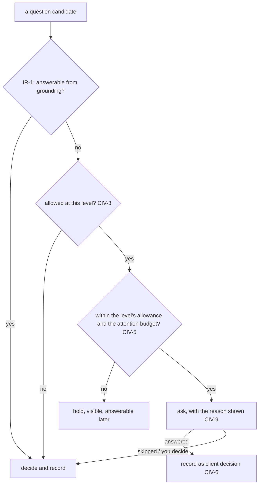

# Client Involvement

**Version:** 1.0.0
**Status:** Stable
**Layer:** concept

## Overview

How much the office involves its client is a setting the client chooses, on a short ladder from **hands-off** — the default, for a person who wants a result and no questions they cannot answer — to **expert** — a professional who wants to be asked, at the start, about the choices a specialist would care about, technology included.

The office's foundation does not move. At every level it plans, staffs and executes on its own, keeps the same quality bar and the same gates, and decides whatever the client leaves to it. The level changes only three things: which questions reach the client, how decisions and results are explained, and at which points the client is shown work for review.

## Related Specifications

- [l1-office-model.md](l1-office-model.md) - OFF-5 client as client, OFF-6 clarify only on genuine ambiguity — the hands-off level is OFF-6 as written; CIV-3 is the one admitted exception.
- [l1-intent-resolution.md](l1-intent-resolution.md) - IR-1 ground before ask, IR-2 minimal intent-level questions, IR-3 assume-and-record, IR-9 one attention budget: the level modulates these, never bypasses them (CIV-3, CIV-5).
- [l1-action-gating.md](l1-action-gating.md) - Approval tiers; a level never lowers one (CIV-2).
- [l1-directability.md](l1-directability.md) - An answer the client gives is a steer and binds as a standing constraint (CIV-6).
- [l1-honest-solicitation.md](l1-honest-solicitation.md) - The office may suggest a level; the ask is honest and the choice the client's (CIV-1, CIV-10).
- [l1-progressive-disclosure.md](l1-progressive-disclosure.md) - Depth shown when wanted; the level sets the default depth of explanations (CIV-7).
- [l1-user-model.md](l1-user-model.md) - The client's observed preferences inform a suggestion, never a switch (CIV-10).
- [l1-usage-analytics.md](l1-usage-analytics.md) - Questions asked, answered, skipped and delegated per level are local questions it answers (CIV-10).
- [l1-work-method.md](l1-work-method.md) - The level is one of the traits the orchestrator weighs when choosing review points (WMT-1).
- [l1-reasoning-spend.md](l1-reasoning-spend.md) - The effort scale is a separate axis; neither implies the other.

## 1. Motivation

The office is designed around a non-specialist client, and for that client the corpus forbids technical questions outright. A professional using the same office meets the opposite failure: the office silently picks a database, a framework or an architecture they have strong views on, and the first time they see the choice is in the delivered result. They then either redo work or stop trusting the office.

Two wrong fixes are easy. Letting the office decide per conversation whether the client "seems technical" is a guess that will interrogate the wrong person sooner or later. Removing the rule against technical questions turns every office into an interview. The client knows which kind of client they are; the office should ask them once and respect it.

## 2. Constraints & Assumptions

- **Assumption (forecast):** four levels are enough — hands-off, informed, collaborative, expert. Runner-up: a continuous slider. Override: `/magic.spec amend l1-client-involvement "continuous scale"`. Reason: each level must change something observable; a slider has positions that change nothing.
- The level is set per office, with a building-wide default; the home office follows the building default.
- Autonomy permissions (what the office may do without approval) and the effort scale are separate settings.

## 3. Core Invariants

Rules every Layer 2 implementation MUST NOT violate:

- **CIV-1 (A closed, ordered ladder the client sets):** the levels are, in order, **hands-off** (default), **informed**, **collaborative** and **expert**. The level is set by the client — per office, with a building default — on the human-write plane; the office may suggest a change but never changes it, and an agent cannot raise or lower it.
- **CIV-2 (The level changes questions, explanations and review points — nothing else):** quality standards, approval gates, budgets, security and egress rules, and autonomy permissions are identical at every level. A higher level never lets the client waive a gate by answering a question, and a lower one never removes one.
- **CIV-3 (Technical questions only at expert, only at the start or at a shaping decision):** at the expert level the office may ask about technology — stack, architecture, storage, external services — during intake or planning, and at a later decision it classifies as shaping the architecture. At every other level, and mid-work at every level, questions stay intent-level (IR-2) and technical gaps are assumed and recorded (IR-3).
- **CIV-4 (Every question can be left to the office):** at every level each question can be skipped or answered "you decide"; the office then decides as it would at hands-off and records the decision with its reason. No level makes work wait on an answer the office could reasonably decide itself, beyond the blocking cases IR-2 already admits.
- **CIV-5 (Higher levels ask more, but still within one budget):** each level declares how many non-blocking questions a planning round may carry and how often a digest is sent; every question still passes IR-1 (ground first) and the client's one attention budget across offices (IR-9). A level's allowance is a ceiling, never a target.
- **CIV-6 (An answer is a client decision):** what the client answers is recorded as their decision with its provenance and binds like a steer: later automation honours it. Where it conflicts with the quality bar or security, the office says so plainly and proposes an alternative; it neither complies silently nor overrides silently.
- **CIV-7 (Same facts, the level's words):** explanations, digests and reports are written in the register of the level — plain outcomes at hands-off, the technical reasons at expert — over one underlying record. Changing the level changes how the record is told, never what it says.
- **CIV-8 (A change of level is prospective):** raising the level does not reopen what was already decided, unless the client asks; lowering it stops new questions at once and lets pending non-blocking ones be decided by the office and recorded.
- **CIV-9 (The reason for a question is shown):** a question asked because of the level says so ("asked because this office is set to Expert"), and the level is visible in the office's settings beside the way to change it.
- **CIV-10 (Suggested from evidence, never inferred into effect):** when the client repeatedly delegates the questions their level brings, or repeatedly corrects choices the office made silently, the office may suggest another level once, with that evidence. The suggestion is honest (no pressure, symmetric yes and no) and has no effect until the client chooses.

> L2 specs cannot reach RFC status until all invariants here are addressed in their "Invariant Compliance" section.

## 4. Detailed Design

### 4.1 The ladder

| Level | Questions at intake / planning | Mid-work questions | Review points shown to the client | Register |
| --- | --- | --- | --- | --- |
| **Hands-off** (default) | only blocking intent gaps | only blocking intent gaps | the delivered result | plain outcomes |
| **Informed** | only blocking intent gaps | only blocking intent gaps | the result, plus a periodic digest of key decisions and assumptions | plain, with reasons |
| **Collaborative** | intent and product choices (scope, priorities, look and feel) | only blocking intent gaps | the plan before work starts, and increments | plain, with options |
| **Expert** | intent, product and technology choices (CIV-3) | blocking gaps; technical only at shaping decisions | the plan, the technical design, and increments | technical |

### 4.2 Where the level is read

## 5. Drawbacks & Alternatives

- **An expert client can slow an office down.** Accepted, and bounded: questions are limited to the start and to shaping decisions, each can be delegated, and gates are unchanged.
- **Alternative — infer the level from how the client writes.** Rejected (CIV-1, CIV-10): an inference wrong in either direction either interrogates a non-specialist or overrides a professional silently.
- **Alternative — keep technical questions forbidden for everyone.** Rejected: it serves the default client and fails the professional, who is equally a client.
- **Alternative — fold the level into the autonomy setting.** Rejected (CIV-2): how much the office asks and what it may do unasked are different decisions; tying them makes a professional who wants to be consulted also loosen approvals.

## Canonical References

| Alias | Path | Purpose |
| --- | --- | --- |
| `[OFFICE]` | `.design/main/specifications/l1-office-model.md` | OFF-5 / OFF-6 — the default posture |
| `[INTENT]` | `.design/main/specifications/l1-intent-resolution.md` | IR-1…IR-9 — ask-or-assume and the attention budget |
| `[GATING]` | `.design/main/specifications/l1-action-gating.md` | Gates no level lowers |

## Document History

| Version | Date | Author | Notes |
| --- | --- | --- | --- |
| 1.0.0 | 2026-10-22 | Core Team | Initial concept — CIV-1…CIV-10, from the user's backlog (involvement from a novice who should not be disturbed to a professional who is asked up front, technology included): a closed four-level ladder set by the client per office, hands-off by default; the level changes questions, explanations and review points only; technical questions only at expert and only at intake or a shaping decision; every question delegable; one attention budget; answers bind as client decisions; one record told in the level's register; prospective changes; the reason for a question shown; suggestions from evidence that never take effect alone. Amends OFF-6 and IR-2/IR-9 to admit the expert exception. Concept-only until an L2 is planned. |
