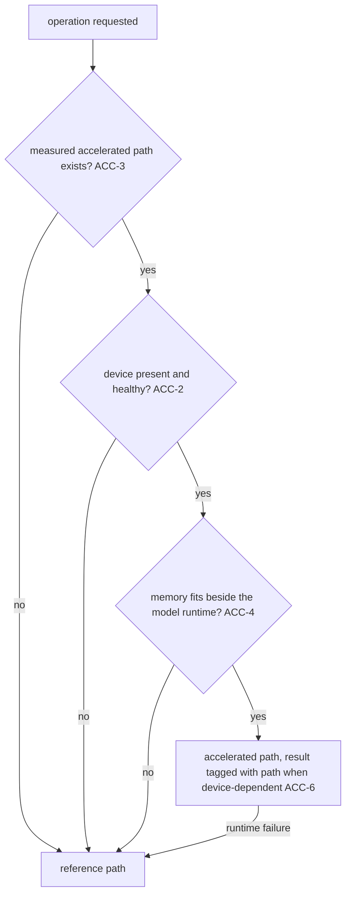

# Compute Acceleration

**Version:** 1.0.0
**Status:** Stable
**Layer:** concept

## Overview

Graphics processors and other accelerators enter Cronus by two doors, and this spec governs both with one discipline.

**Inside the product**, an accelerator may speed up work Cronus does for itself — embedding text, scoring vector candidates, indexing code, running small local models. Every such path is optional: it has a reference path on the general-purpose processor that produces the same result, it is adopted only where a measurement at the product's real volumes shows it pays, and it shares the device with the local model runtime and the person's own programs rather than taking it.

**For the client**, an office may be asked to build software that runs on a graphics processor — a renderer, a simulation, a compute kernel. The office then has to know what this machine can build and test, verify kernels against a reference within a declared tolerance, and report a check it could not run here as *unverified*, never as passed.

## Related Specifications

- [l1-model-runtime.md](l1-model-runtime.md) - MR-6/MR-7 load lifecycle and fit-gated hardware scheduling; the model runtime is the accelerator's first tenant and keeps priority (ACC-4).
- [l1-knowledge-base.md](l1-knowledge-base.md) - Embedding generations: vectors produced differently are a different generation, the rule ACC-6 applies to device-dependent results.
- [l1-process-monitor.md](l1-process-monitor.md) - Live view of accelerator use per process (ACC-2).
- [l1-doctor.md](l1-doctor.md) - Accelerator presence, driver and toolchain are observations it reports (ACC-2, ACC-8).
- [l1-quality-standards.md](l1-quality-standards.md) - QLY-11 performance evidence: a speed claim carries its measurement (ACC-3, ACC-9).
- [l1-completion-verification.md](l1-completion-verification.md) - Where verification cannot run, the honest output is *unverified*, never a completion claim — the rule ACC-7 applies to hardware-dependent checks.
- [l1-roles.md](l1-roles.md) - The specialty an office staffs for accelerator work (ACC-10).
- [l1-specialty-exemplars.md](l1-specialty-exemplars.md) - Per-specialty exemplars that grade that specialty (ACC-10).
- [l1-solution-frugality.md](l1-solution-frugality.md) - The cheapest adequate solution wins; an accelerated path is not adequate merely for being faster in principle (ACC-3).

## 1. Motivation

Accelerators are attractive and treacherous. Inside the product, a GPU path that is faster on a benchmark of a million items can be slower on the few thousand a single office holds, once transfer and setup are counted; a path that needs a particular vendor's driver silently disappears on half the machines; a path that competes with a local model for device memory can crash the model the person is waiting on; and an embedding computed on one device may not match one computed on another, quietly splitting a vector index into two incompatible halves.

For client work, the danger is honesty. A machine without a suitable GPU cannot run a kernel's real test, and the easy outcome is a green report that only means nothing ran. A kernel that differs from its reference in the last bits may be correct or broken, and without a declared tolerance nobody can say which.

## 2. Constraints & Assumptions

- **Decided by the user (2026-10-22):** both directions are in scope — accelerating Cronus's own subsystems, and offices able to build GPU software for clients.
- Many target machines have no discrete GPU; some have one without a usable driver; mobile devices expose limited compute.
- A portable, vendor-neutral compute interface exists for the product's implementation language across the desktop platforms it supports, with vendor-specific interfaces beside it; the concrete choice is the technology stack's.

## 3. Core Invariants

Rules every Layer 2 implementation MUST NOT violate:

Inside the product (ACC-1…ACC-6):

- **ACC-1 (Optional and result-preserving):** every accelerated path has a reference path on the general-purpose processor, and the two produce the same result or a result within a tolerance declared for that operation. No product capability requires an accelerator unless its own specification says so (a local model too large for the processor, under the model runtime's feasibility rules).
- **ACC-2 (Observed, never assumed):** the presence, kind and usable memory of an accelerator are detected when first needed and reported in diagnostics and the process view. Absence, a missing driver, or a failure at run time selects the reference path; this is reported once as a fact, not raised as an error.
- **ACC-3 (Adopted by measurement at real volumes):** an accelerated path is built only where a benchmark at the volumes the product actually handles — including transfer, setup and warm-up — shows a material win over the reference path on the target machines. The measurement is kept with the path; when it no longer holds, the path is a candidate for removal.
- **ACC-4 (The device is shared, and the model runtime goes first):** an accelerated path declares the device memory it needs, takes it only when it fits beside what the model runtime has loaded or scheduled, and yields under pressure. It never starves model inference by default and never fails with an out-of-memory crash — it falls back to the reference path.
- **ACC-5 (One portable path before any vendor path):** the first accelerated implementation of an operation uses a vendor-neutral interface available on every desktop platform the product supports. A vendor-specific path is added only as a measured improvement on top, never as the only accelerated path.
- **ACC-6 (A device-dependent result says where it came from):** a result that is stored as an authority or compared across time — an embedding, an index — is either identical on every path, or records the path and device that produced it so incompatible results are never mixed; for embeddings, a different path is a different generation.

For client work (ACC-7…ACC-10):

- **ACC-7 (Verified where it can be; unverified where it cannot):** an office building accelerator software runs every check it can on the machine it has, including reference execution of kernels on the general-purpose processor or a software device. A check that needs hardware this machine lacks is reported *unverified* with what it needs, never as passed and never silently skipped.
- **ACC-8 (The machine is surveyed before the plan):** before planning such work the office observes the machine's accelerator, driver and toolchain and states what can be built, run and measured here; the plan carries that, so the client is not promised a performance result the machine cannot produce.
- **ACC-9 (Tolerance and numbers are declared):** each kernel declares the numerical tolerance against its reference, and tests compare within it. Every performance statement names the device, the input size and the measured figures; a speed-up without them is not reported as one.
- **ACC-10 (A staffed specialty):** accelerator programming is a specialty an office staffs when a project needs it, graded by its own exemplars; it is not assumed of a general engineer.

> L2 specs cannot reach RFC status until all invariants here are addressed in their "Invariant Compliance" section.

## 4. Detailed Design

### 4.1 Candidate operations inside the product

| Operation | Why it might pay | What ACC-3 must show first |
| --- | --- | --- |
| Local embedding of large batches (knowledge ingestion, code indexing) | many independent vectors | the win at a typical ingestion batch, beside a loaded model |
| Exact re-scoring of a vector candidate window | dense arithmetic | the win at the window sizes the retrieval actually uses, which are small |
| Small on-device models (classification, reranking) | already accelerator-shaped | covered by the model runtime's own placement rules |
| Code-graph analysis | rarely arithmetic-bound | probably none; listed so it is measured rather than assumed |

### 4.2 Path selection

### 4.3 Client work verification lanes

| Lane | Runs on | Proves |
| --- | --- | --- |
| Reference | the general-purpose processor | the algorithm is right |
| Software device | a software implementation of the compute interface | the program drives the interface correctly |
| Hardware | a real accelerator | correctness within tolerance and performance on that device |

A lane the machine cannot provide is reported *unverified* (ACC-7).

## 5. Drawbacks & Alternatives

- **The reference path must be kept working forever.** Accepted: it is what makes every accelerated path optional and every result checkable.
- **Alternative — accelerate wherever possible.** Rejected (ACC-3): at the product's volumes many accelerated paths are slower once transfer is counted.
- **Alternative — a vendor-specific interface first.** Rejected (ACC-5): it would make acceleration a property of one vendor's machines.
- **Alternative — skip hardware-dependent client tests on machines without a GPU.** Rejected (ACC-7): a skipped test reported as a pass is the failure this spec exists to prevent.

## Canonical References

| Alias | Path | Purpose |
| --- | --- | --- |
| `[RUNTIME]` | `.design/main/specifications/l1-model-runtime.md` | Hardware-fit scheduling the accelerator shares with |
| `[STACK]` | `.design/main/specifications/l2-technology-stack.md` | The compute interface chosen for the Rust stack |
| `[ROLES]` | `.design/main/specifications/l2-role-catalog.md` | The preset specialty for accelerator work |

## Document History

| Version | Date | Author | Notes |
| --- | --- | --- | --- |
| 1.0.0 | 2026-10-22 | Core Team | Initial concept — ACC-1…ACC-10, from the user's backlog (Rust GPU programming; the user's answer: both directions). Inside the product: accelerated paths optional and result-preserving, devices observed, adoption only by measurement at real volumes, the device shared with the model runtime first, a portable path before any vendor path, device-dependent results tagged. For client work: verified where possible and *unverified* otherwise, the machine surveyed before planning, tolerances and numbers declared, a staffed specialty. Realized in part by `l2-technology-stack` (compute interface) and `l2-role-catalog` (the specialty); no accelerated product path is planned until one passes ACC-3. |
