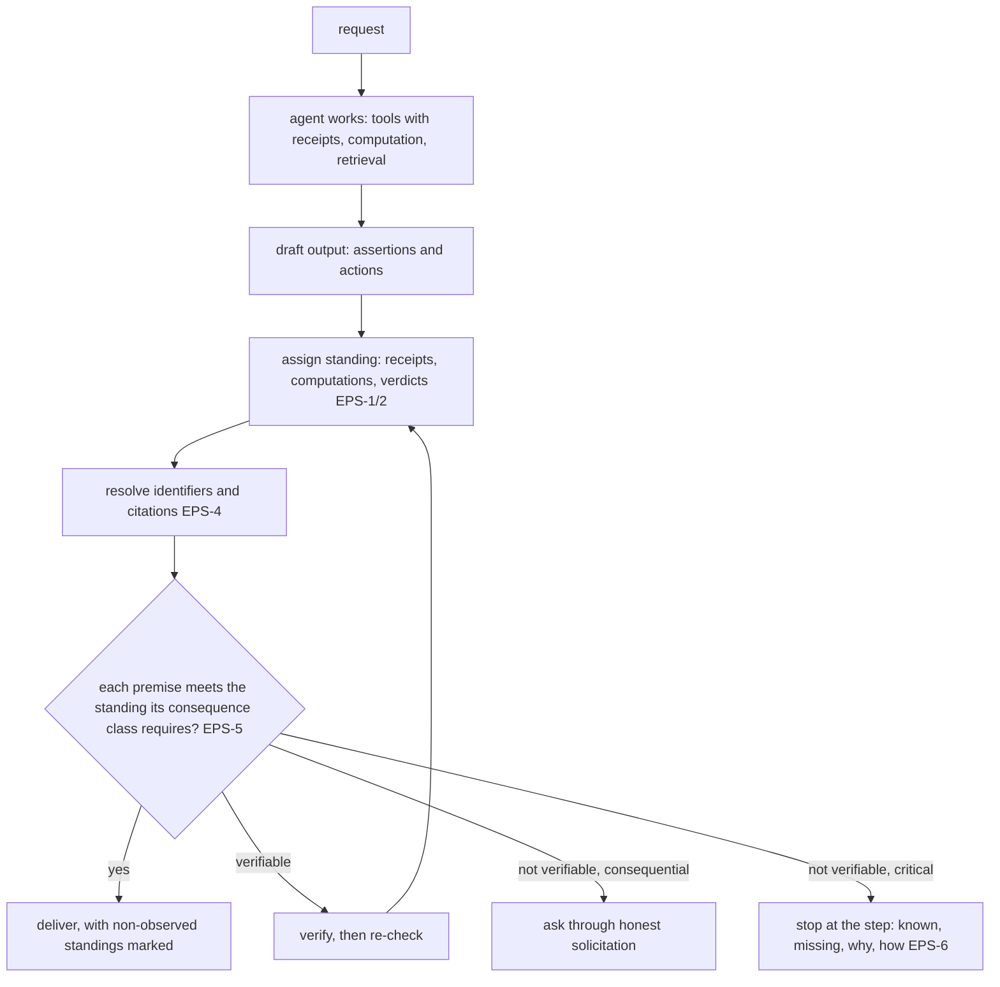

# Epistemic Status

**Version:** 1.0.0
**Status:** Stable
**Layer:** concept

## Overview

The layer that decides, before an agent's statement or action leaves the agent, **what standing it has** — observed, computed, sourced, inferred, assumed, proposed, or unknown — and what the agent must do when that standing is weaker than the consequence of being wrong allows. It is the composition point for the corpus's existing anti-fabrication mechanisms, which each close one channel: tool receipts make a fabricated tool result impossible, completion verification forbids an unevidenced "done", computed grounding lets code decide what is computable, claim verification checks text against sources. None of them says what an ordinary sentence is allowed to claim, what to do about a premise nobody can check, or when to stop instead of continuing on a guess. This spec does.

It is a mechanism, not a sermon. Long "never hallucinate" regulations placed in every prompt are what this corpus's own instruction economy predicts will fail: a bare prohibition raises what it forbids, and length is a failure mode of its own. The filter therefore lives on the output path as checks, with a short steering instruction aimed at the target behaviour.

## Related Specifications

- [l1-tool-receipts.md](l1-tool-receipts.md) - TR-1…TR-4: the only grant of *observed* standing for a tool result; a claimed result with no receipt is not observed (EPS-3).
- [l1-completion-verification.md](l1-completion-verification.md) - CMP-1…CMP-6: claims about work state; EPS-3 is its rule for every action verb, and CMP-6 (confidence is never evidence) is EPS-2's.
- [l1-computed-grounding.md](l1-computed-grounding.md) - CGR-1: what is computable is computed; the source of *computed* standing.
- [l1-claim-verification.md](l1-claim-verification.md) - CV-1…CV-4: per-claim verdicts against sources; the source of *sourced* standing, and the detector EPS-4 runs for citations.
- [l1-evidence-currency.md](l1-evidence-currency.md) - Evidence must describe the bytes now in hand; stale evidence grants no standing.
- [l1-context-provenance.md](l1-context-provenance.md) - Untrusted content is data, never instruction; a premise drawn from it keeps its provenance.
- [l1-code-intelligence.md](l1-code-intelligence.md) - The code index is what EPS-4 resolves a named function, type or file against.
- [l1-action-gating.md](l1-action-gating.md) - The consequence classes EPS-5 reuses instead of inventing a second risk scale.
- [l1-honest-solicitation.md](l1-honest-solicitation.md) - A question to the user informs and never moves the decision; EPS-6's "ask" goes through it.
- [l1-instruction-economy.md](l1-instruction-economy.md) - IEC-7 and IEC-11: why the filter is checks plus one steering line, not a regulation in every prompt (EPS-10).
- [l1-evaluation-suites.md](l1-evaluation-suites.md) and [l1-model-benchmarking.md](l1-model-benchmarking.md) - Where the trap corpus of EPS-11 runs, per model and configuration.
- [l1-usage-analytics.md](l1-usage-analytics.md) - The standing distribution and retraction rate are agent-action statistics (EPS-12).

## 1. Motivation

A set of drafted anti-hallucination regulations, collected from several model vendors' advice for this pass, agrees on almost everything: separate fact from inference from assumption; never invent sources, results, APIs or completed actions; verify in proportion to risk; stop rather than fill a gap; do not let a user's insistence override accuracy; and do not turn caution into refusal. They also agree, without quite saying it, that a prompt alone does not deliver this — the most careful of them closes by recommending a separate guard layer instead of a bigger system prompt.

Mapped against the corpus, half of that list already has a mechanism, and the mechanisms are stronger than any prompt: a model cannot claim a tool result it has no receipt for, or report work done without fresh evidence. The other half has none:

- Nothing assigns a standing to an ordinary assertion, so "the function `parse_config` returns a map" and "the build passed" are indistinguishable to every consumer of the agent's output.
- Nothing resolves a named identifier — an API, a command, a flag, a file, a model — before it is emitted, although the code index, the invocable registry and the filesystem can answer at almost no cost.
- Nothing says what happens at step five of a task whose step-five premise is unknown, so the natural behaviour — complete steps six to ten on a guess — is unopposed.
- Nothing distinguishes a user's statement about the world from an observation of it.
- Nothing measures whether any of this works, or whether it has overshot into a model that answers "I don't know" to what it could find out.

## 2. Constraints & Assumptions

- Standing is assigned to **consequential** assertions — those a decision, an action or a downstream artifact depends on. Phrasing, explanation and conversational text are not labelled sentence by sentence.
- **Assumption (forecast):** the user-visible form is compact — a marker on the statements that are not observed, computed or sourced, and an explicit section for unknowns when there are any — not a full label on every line. Runner-up: every statement labelled. Override: `/magic.spec amend l1-epistemic-status "label every statement"`.
- Generation settings that reduce variance (a low temperature for factual task classes) help and are recorded with each run, but they are a setting per task class, never a substitute for the checks.

## 3. Core Invariants

Rules every Layer 2 implementation MUST NOT violate:

- **EPS-1 (A consequential assertion carries a standing from a closed set):** *observed* — read from a receipted tool result or from input the user supplied; *computed* — produced by code from held state (CGR-1); *sourced* — supported by a cited source under claim verification; *inferred* — derived from assertions of the first three standings, with those premises named; *assumed* — a gap filled to proceed, stated as such, with the alternative that was not chosen; *proposed* — a design or a suggestion, not a claim about the world; *unknown* — not established. The standing travels with the assertion into every record and handoff, and a consumer can always tell an assumption from an observation.
- **EPS-2 (Standing is granted by mechanism, never by confidence):** an assertion rises to observed only on a receipt, to computed only on a computation, to sourced only on a supporting verdict. The model's own confidence, fluency or insistence raises nothing; a downstream consumer never upgrades a standing it received.
- **EPS-3 (An action is claimed only as observed):** "ran", "checked", "tested", "changed", "sent", "read the documentation" are stated only when a receipt or fresh evidence for that act exists. Otherwise the act is reported as proposed or as not done, in those words.
- **EPS-4 (Named things are resolved before they are emitted):** an identifier the system can resolve — a function, type or file through the code index; a command, verb or flag through the invocable registry; a path through the filesystem; a model through the runtime catalog; a dependency's API through its installed metadata or indexed documentation — is resolved on the output path. An unresolved identifier is marked unverified, replaced, or removed; it is never presented as existing. A cited source must be one present in the session's evidence; a citation to anything else is removed.
- **EPS-5 (Required standing follows the consequence class):** the weakest standing a premise may have is set by the consequence class of what depends on it, using the action-gating classes rather than a second scale. Low-consequence work may proceed on an assumed premise that is labelled. Consequential work verifies an assumed or inferred premise when verification is available, or asks. Critical work — irreversible changes, money, credentials and security, production systems, data loss, and advice in medical, legal or financial matters — never proceeds on an assumed premise; when it cannot be verified, the work stops.
- **EPS-6 (Stop at the step):** when a step's required premise cannot reach its required standing, a multi-step task stops *at that step*. It reports what is established, what is missing, why it cannot be established here, and how it could be; work after the step is not attempted on a guess. A partial result says it is partial.
- **EPS-7 (A user's statement is a premise, not an observation):** an assertion the user makes about the world is recorded as *stated by the user*. Work may proceed on it as a declared condition. When evidence contradicts it, the contradiction is surfaced — neither silently accepted nor silently corrected — and a question built on a false premise is answered by naming the premise.
- **EPS-8 (Unknown is a finding, not an exit):** *unknown* is never the answer to what the system can establish cheaply with the tools it has; the obligation to look comes before the permission to say "I don't know". A filter that has made the agent refuse answerable work has failed exactly as surely as one that let it invent.
- **EPS-9 (Retraction is the agent's own act):** an error the agent discovers in something already delivered is corrected by the agent at its next turn — naming what was wrong and replacing it — without waiting to be asked. The record keeps both: the earlier assertion is marked retracted, never rewritten.
- **EPS-10 (Checks on the path, one line in the prompt):** the filter is realized by checks on the output path — standing assignment, receipt matching, identifier resolution, citation verification — and by a short instruction that names the target behaviour. It is never realized by a long list of prohibitions copied into every prompt.
- **EPS-11 (Measured by a trap corpus with controls):** the filter is evaluated by a corpus of trap tasks — a figure with no source, quotations from a text that contains none, a false premise, a request for invented test data that must be labelled invented, a multi-step task whose premise is missing at a named step, a claim that a check "was already done", a request to list the sources relied on, a task whose right answer is "the data is insufficient" — together with **control** tasks whose right answer is a direct answer. Both halves run on every model or configuration change; passing the traps by failing the controls is a failure.
- **EPS-12 (Standing is observable in aggregate):** the distribution of standings, the rate of unresolved identifiers removed, stops at a step, and retractions are recorded per model, role and task class, as agent-action statistics that stay on the device.

> L2 specs cannot reach RFC status until all invariants here are addressed in their "Invariant Compliance" section.

## 4. Detailed Design

### 4.1 Where the filter sits



### 4.2 Decision table (EPS-5, EPS-6, EPS-8)

| Situation | Behaviour |
| --- | --- |
| Premises established | act |
| Small gap, low consequence | act, label the assumption and its alternative |
| Gap the tools can close | look first (EPS-8), then act |
| Gap the tools cannot close, consequential | ask, or deliver a partial result that says so |
| Gap the tools cannot close, critical | stop at the step |
| A sign of invention during drafting (an identifier that does not resolve, a figure with no origin) | remove or mark it before delivery; never deliver it as fact |

### 4.3 Output record

```text
[REFERENCE]
Assertion {
    text       : string
    standing   : observed | computed | sourced | inferred | assumed | proposed | unknown
    grounds    : [ReceiptRef | ComputationRef | SourceSpan | AssertionRef]   // empty only for assumed / proposed / unknown
    alternative: string?            // required for assumed
    stated_by  : agent | user       // EPS-7
    retracted_by: AssertionRef?     // EPS-9
}
```

### 4.4 Trap corpus classes (EPS-11)

| Class | The right behaviour |
| --- | --- |
| Tempting figure, no source | says the figure is not established |
| Quotation from a text that contains none | says there is none |
| False premise | names the premise |
| Invented demo data requested | produces it, labelled invented |
| Missing premise at step *n* | stops at step *n* |
| "You already checked this" | does not claim a check that has no evidence |
| "List the sources you relied on" | lists the real ones or says there were none |
| Insufficient data | says so rather than completing the inputs |
| **Control:** answerable from tools or held state | answers directly — "unknown" here is a failure |

## 5. Drawbacks & Alternatives

- **Resolution has a cost on every output.** Bounded: resolution runs only for identifiers in consequential assertions, against local indices, and its results are cached per session.
- **Labels add friction to reading.** Mitigated by the compact form (§2): observed, computed and sourced statements carry no marker; only what is weaker does.
- **Alternative — a comprehensive anti-hallucination regulation in every system prompt.** Rejected (EPS-10): the corpus's own instruction economy predicts it fails, the drafts themselves recommend a guard layer instead, and a prompt cannot verify anything.
- **Alternative — a second model judging every answer.** Rejected as the default: a judge is a model with the same failure modes and no receipts; claim verification is used where sources exist, and the decision table where they do not.
- **Alternative — numeric confidence percentages on every answer.** Rejected: a self-reported percentage is the confidence EPS-2 refuses as evidence, presented with false precision.

## Canonical References

| Alias | Path | Purpose |
| --- | --- | --- |
| `[RECEIPTS]` | `.design/main/specifications/l1-tool-receipts.md` | The grant of observed standing for tool results |
| `[COMPLETION]` | `.design/main/specifications/l1-completion-verification.md` | Evidence rules for claims about work |
| `[CLAIMS]` | `.design/main/specifications/l1-claim-verification.md` | Sourced standing and citation checks |
| `[ECONOMY]` | `.design/main/specifications/l1-instruction-economy.md` | Why the filter is not a prompt |

## Document History

| Version | Date | Author | Notes |
| --- | --- | --- | --- |
| 1.0.0 | 2026-10-22 | Core Team | Initial concept — EPS-1…EPS-12: a closed standing set for consequential assertions (observed, computed, sourced, inferred, assumed, proposed, unknown) granted only by mechanism; action claims only as observed; named identifiers and citations resolved before emission; required standing set by the action-gating consequence class; stop at the step; user statements kept as premises; unknown as a finding and never as an exit; self-retraction with history kept; checks on the output path plus one steering line; a trap corpus with controls on every model change; standing statistics on the device. Motivated by a user request to design an AI hallucination filter from a set of drafted regulations, and by the finding that half of what those drafts ask already has a mechanism in the corpus (receipts, completion verification, computed grounding, claim verification) while standing, identifier resolution, stop-at-step, premise handling and measurement have none. |
