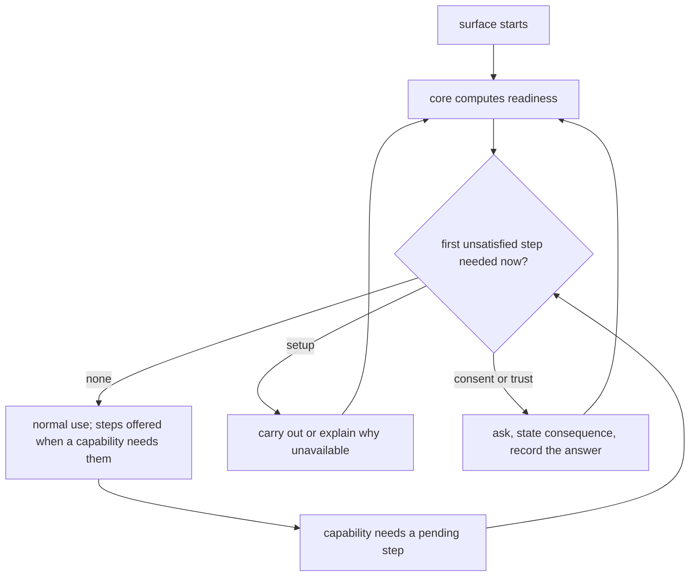

# Onboarding

**Version:** 1.1.1
**Status:** Stable
**Layer:** concept

## Overview

Onboarding is how a person goes from a freshly installed Cronus — or a freshly cloned project that already uses it — to their first piece of work done, on whichever surface they started from: the command line, the terminal interface or the desktop application. This spec defines it as a **projection of readiness the core computes**, not as a wizard each surface implements: the core observes what is set up and what is missing, the three surfaces render the same steps, and a step is asked for when a capability first needs it rather than front-loaded into a gate before anything works.

Three things are deliberately outside it. The agent's own first-session ritual (the constitution's bootstrap file) is the office getting to know its user, not the user getting the product ready. Importing an existing backlog (`l1-work-import`) is an onboarding action with its own contract. And teaching the product's concepts in order is `l1-concept-grounding`'s; onboarding follows it.

## Related Specifications

- [l1-surface-parity.md](l1-surface-parity.md) - One decision point per observable behaviour (SP-1) and one conformance corpus through real projections (SP-6): the readiness model is decided once in the core and rendered three times.
- [l1-concept-grounding.md](l1-concept-grounding.md) - An onboarding path is an ordered artifact: each step requires only what earlier steps established (GRD-4) and terminates at a destination, not at the end of the feature list (GRD-9).
- [l1-progressive-disclosure.md](l1-progressive-disclosure.md) - Depth is revealed when it is needed; ONB-3 is that rule applied to setup.
- [l1-background-activation.md](l1-background-activation.md) - BA-5 consent and BA-8 state observed from the operating system, never remembered — the model ONB-1 generalizes.
- [l1-telemetry.md](l1-telemetry.md) - TEL-1: the telemetry choice is an explicit opt-in defaulting to off; onboarding asks it at its own step (ONB-4).
- [l1-security.md](l1-security.md) - The workspace trust decision and egress authorization onboarding must route through, never around.
- [l1-artifact-reach.md](l1-artifact-reach.md) - A cloned project's project-shared artifacts carry named requirements a collaborator's onboarding reads (ONB-10).
- [l1-model-runtime.md](l1-model-runtime.md) - A local model runtime and the models a first outcome needs are the commonest missing prerequisite.
- [l1-doctor.md](l1-doctor.md) - The diagnostics whose probes the readiness model reuses rather than duplicates.
- [l1-work-import.md](l1-work-import.md) - Bringing an existing backlog in is an optional step, never a precondition.
- [l1-usage-analytics.md](l1-usage-analytics.md) - Where people leave the path is a local question this plane answers (ONB-11).

## 1. Motivation

Cronus has every piece of a first run and no first run. `cronus init` creates a state root, the doctor diagnoses an installation, background activation asks its own consent, workspace trust has its own dialog, the knowledge store explains a missing embedding server in an error suffix, and the constitution's bootstrap file guides the agent's first session. A new user meets these one failure at a time: the first semantic search fails with a connection error, the first agent turn fails because no model is pulled, the first cloned project silently ignores its committed commands because trust was never decided.

Each surface would also be tempted to grow its own wizard. Three wizards are three orders, three wordings and three ideas of "done" — the divergence `l1-surface-parity` exists to prevent, arriving through the one flow every user sees first.

## 2. Constraints & Assumptions

- **Confirmed (2026-10-22, the person's decision):** onboarding serves two arrivals — a fresh installation, and a developer opening a project that already carries Cronus artifacts — and both end at a first piece of work done. A product tour of features is not the goal. Not taken: a feature tour shown once.
- The command line remains the guaranteed path: everything onboarding does is reachable without an interactive surface.
- No step sends anything off the device unless the user names a destination in that step.

## 3. Core Invariants

Rules every Layer 2 implementation MUST NOT violate:

- **ONB-1 (Readiness is observed, never remembered):** onboarding is a projection of a readiness model the core computes from the real installation and project — whether a state root exists, whether a model runtime answers, whether the models a capability needs are present, whether the workspace trust decision and each consent have been made. No "onboarded" flag stands in for those observations; a later change (a removed model, a moved project) re-opens the step it affects.
- **ONB-2 (One core, three renderings):** the steps, their order, their requirement edges, their outcome vocabulary and their message keys live in the core; the command line, the terminal interface and the desktop application render them and add only presentation. Onboarding is part of the parity corpus: the same installation state yields the same steps and outcomes on all three.
- **ONB-3 (Nothing waits that does not need to):** a capability that works without a step stays usable before that step is done. A step is offered when a capability first needs it, with the reason in plain words; the initial path holds only what the first outcome requires.
- **ONB-4 (Each consent at its own step, never bundled):** the telemetry choice, background activation, any remote destination and the workspace trust decision are separate steps with their own consequences stated. There is no "accept all"; skipping a consent is a recorded answer equal to its safe default, and it can be revisited.
- **ONB-5 (Skippable, resumable, idempotent):** leaving at any step loses nothing already done; returning resumes at the first unsatisfied step; re-running a satisfied step changes nothing. Every step reports one of a closed set — *satisfied*, *pending*, *not applicable*, *unavailable* — and *unavailable* is never shown as *pending*.
- **ONB-6 (The path ends at a first real outcome):** the path terminates when the user has had one piece of their own work carried end to end — a request answered by a local model, a card taken through the board — not when every setting has been visited. Steps are ordered by what they require, so no step asks for a decision whose meaning an earlier step has not established.
- **ONB-7 (Non-interactive equivalence):** every step can be carried out without interaction, by flags or a declared answer file, and reaches the same readiness as the interactive path; an answer file holds choices, never secrets.
- **ONB-8 (An unavailable step explains itself):** a step that cannot be satisfied names what is missing, the exact action that supplies it, and what still works without it. A raw error, a stack trace or a bare exit code is never what a user sees at a first run.
- **ONB-9 (Private by default):** onboarding records its progress on the device and sends nothing. Probing a remote endpoint — a model provider, a version-control remote — happens only after the user has named it in a step.
- **ONB-10 (Arriving at a shared project is its own path):** opening a project that already carries project-shared artifacts asks the trust decision first, then shows the project's named requirements (models, tools, credentials) as readiness of *this* project, and reuses the user's personal setup rather than repeating it. Nothing the project ships runs before trust.
- **ONB-11 (Measured where people stop):** which step a path is left at, and which steps end *unavailable*, are local usage-analytics questions; they inform the order and wording of steps and never block or nag the user.
- **ONB-12 (Satisfied by a live check; only what passed is kept):** `[ADDED v1.1.0]` a setup step whose purpose is a working capability is satisfied only by exercising it — a model route by one real completion, an embedding model by one real embedding. A failed attempt persists nothing it tried: the configured route, model and credential stay as they were, and the step waits for the user's next choice instead of trying another candidate on its own.
- **ONB-13 (Discovery offers, it never acts):** `[ADDED v1.1.0]` onboarding may look for what is already on the machine — running local model servers and the models they hold, credentials in the environment, other agent tools' homes — and presents what it found as choices. Looking downloads nothing, installs nothing, starts nothing, persists nothing and calls no model; whether it looks at all is itself the user's first choice.
- **ONB-14 (Import from another tool is offered, staged and confirmed):** `[ADDED v1.1.0]` when another agent tool's memory, skills or settings are found, onboarding offers to bring them in; nothing is imported without confirmation, an import is staged and promoted only when complete (a failure leaves the live state untouched), imported skills enter through the conversion pipeline as the user's own, already-imported items are skipped on a rerun, and secrets are never imported implicitly.

> L2 specs cannot reach RFC status until all invariants here are addressed in their "Invariant Compliance" section.

## 4. Detailed Design

### 4.1 Readiness model

```text
[REFERENCE]
ReadinessStep {
    id         : StepId                 // stable, shared by every surface
    requires   : [StepId]               // edges: what must be satisfied first
    needed_by  : [CapabilityId]         // which capabilities wait on it (ONB-3)
    observe()  -> Outcome               // satisfied | pending | not_applicable | unavailable{missing, remedy, still_works}
    carry_out(answer?) -> Outcome       // idempotent (ONB-5); a consent step records the answer
    kind       : setup | consent | trust | first_outcome
}

readiness(installation, project?) -> [ (step, outcome) ]        // computed fresh, never cached as "done" (ONB-1)
```

Seed steps, in requirement order:

| Step | Kind | Needed by | Unavailable means |
| --- | --- | --- | --- |
| State root present | setup | everything that stores | nothing else is possible; the remedy is one command |
| Model runtime reachable | setup | agent turns, semantic search | names the expected endpoint and how to start it; lexical search and the board still work |
| Chat model present | setup | agent turns | names the model and the pull action |
| Embedding model present | setup | semantic retrieval | names the model; keyword retrieval still works |
| Workspace trust (cloned project) | trust | project commands, hooks, skills | the project's committed artifacts stay inert |
| Telemetry choice | consent | nothing local | — (skipping equals off) |
| Background activation | consent | always-on work | foreground use is unaffected |
| First outcome | first_outcome | — | the path stays open at this step |

### 4.2 Flow



### 4.3 Surfaces

| Surface | Rendering | Notes |
| --- | --- | --- |
| Command line | readiness as an inspect listing; steps carried out by the installation verbs with flags or an answer file | the guaranteed path (ONB-7) |
| Terminal interface | the same steps in its frame; consent steps through its existing question mechanism | asks only what the core asks |
| Desktop application | the same steps as a first-run surface and as inline prompts at the capability that needs them | no step exists only here |

### 4.4 Command binding `[ADDED v1.1.0]`

Studied against the onboarding of several agent tools: the most complete separates a guided **onboarding** verb from a **baseline** writer, a **doctor**, and later targeted configuration, runs inference first and keeps only a verified route; others reach first-run through their terminal interface's first launch and a login command. Cronus takes the separation and leaves out the gate: the bare command never forces onboarding (ONB-3).

| Verb | Effect class | What it does |
| --- | --- | --- |
| `cronus onboard` | install | The guided path over the readiness model: discovery as a choice (ONB-13), each step carried out or explained, consents at their own steps, the optional import (ONB-14), ending at the first outcome. Interactive by default. |
| `cronus onboard --non-interactive [--answers <file>] [--<step>-<choice> …]` | install | The same steps from flags or an answer file (ONB-7); an unanswered consent takes its safe default; an answer file never holds a secret. |
| `cronus onboard --flow quickstart \| manual \| import` | install | Quickstart asks only what the first outcome needs; manual asks every step; import starts with ONB-14. |
| `cronus status` | inspect | Readiness as a listing — each step, its outcome, the remedy for an *unavailable* one; `--json` for scripts. |
| `cronus doctor` | inspect / repair | Diagnoses and repairs an installation; an invalid configuration is sent here, never re-onboarded over. |
| `cronus init` | install | The project folder's baseline only (`l1-artifact-reach` RCH-12): writes `.cronus/` with its readme, format version and exclusion, nothing global; on a project that already has a `.cronus/` from a collaborator it hands over to the arriving-project path (ONB-10). |
| `cronus` (bare) | — | Opens the terminal interface. On a fresh installation its first view is the onboarding view; otherwise pending steps appear where a capability needs them (ONB-3). |
| `/onboard`, `/status`, `/doctor` | as above | The terminal interface's mirrors, under the same names and flags. |
| Desktop first-run view | as above | The same readiness model; a step offered inline where a capability needs it. |

`onboard` joins the installation verbs the terminal interface offers; it carries out installation state only and is refused while work it would alter is in flight, like every install verb.

## 5. Drawbacks & Alternatives

- **A core-held model is slower to build than a wizard.** Accepted: the wizard is cheaper once and three times more expensive forever (SP-9).
- **Alternative — a mandatory setup gate before first use.** Rejected (ONB-3): it blocks capabilities that need nothing and teaches the user that the product is a configuration task.
- **Alternative — a remembered "onboarding complete" flag.** Rejected (ONB-1): the installation changes underneath it, and a flag that says "done" while the embedding model is gone is exactly the confusing first failure this spec exists to remove.
- **Alternative — a guided feature tour.** Rejected as the goal (§2): it ends when the tour ends, not when the user has done anything.

## Canonical References

| Alias | Path | Purpose |
| --- | --- | --- |
| `[PARITY]` | `.design/main/specifications/l1-surface-parity.md` | One decision point, three renderings |
| `[GROUNDING]` | `.design/main/specifications/l1-concept-grounding.md` | Ordering a path by what each step requires |
| `[ACTIVATION]` | `.design/main/specifications/l1-background-activation.md` | Observed state and separate consent, the pattern ONB-1/ONB-4 generalize |

## Document History

| Version | Date | Author | Notes |
| --- | --- | --- | --- |
| 1.1.1 | 2026-10-22 | Core Team | The forecast assumption is confirmed by the person (design-layer audit survey, 2026-10-22) and recorded as a decision; the runner-up is now the alternative not taken and the override hint is dropped. No requirement changed. |
| 1.1.0 | 2026-10-22 | Core Team | The §4.3 verb TBD resolved after studying how several agent tools onboard (the user's pointer to the agent references): new §4.4 binds `cronus onboard` (guided, `--non-interactive` with an answer file, `--flow quickstart \| manual \| import`), `cronus status` (readiness listing), `cronus doctor` (repair), `cronus init` (project-folder baseline only), the bare command opening the terminal interface with its onboarding view on a fresh install, and the TUI and desktop renderings. Added ONB-12 (a step is satisfied by a live check and a failed attempt persists nothing), ONB-13 (discovery offers choices and never acts), ONB-14 (import from another tool offered, staged, confirmed, skills through conversion, no implicit secrets). The bare command deliberately does not force onboarding, unlike the studied reference, because of ONB-3. |
| 1.0.0 | 2026-10-22 | Core Team | Initial concept — ONB-1…ONB-11: readiness observed by the core and never remembered as a flag; one model rendered by the command line, terminal interface and desktop application, inside the parity corpus; steps offered when a capability needs them; each consent at its own step, never bundled; skippable, resumable and idempotent with a closed outcome set; ending at a first real outcome; non-interactive equivalence; unavailable steps that explain themselves; private by default; a separate path for arriving at a shared project; drop-off measured locally. Motivated by a user request for CLI, TUI and GUI onboarding and by the observation that the first-run pieces already exist (init, doctor, activation consent, trust dialog, the embedding guidance suffix) and meet a new user only as successive failures. |
