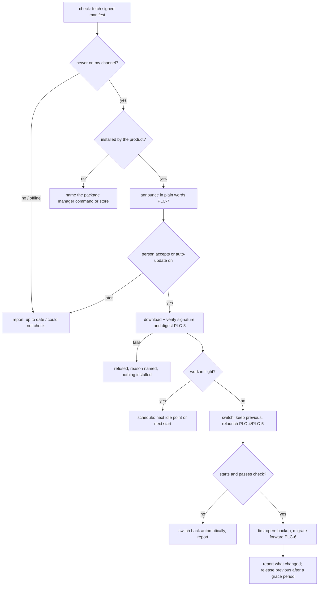

# Program Lifecycle

**Version:** 1.0.0
**Status:** Stable
**Layer:** concept

## Overview

How the program itself arrives on a machine, becomes a command the person can type in any terminal, is replaced by a newer release, can be returned to the previous one, and leaves again. It is the lifecycle of the **program tier** — the immutable half of the two-tier storage model — and it deliberately says nothing about the office's work, which lives in the state tier and outlives every one of these events.

Four promises carry it. Typing `cronus` works in a new terminal right after installation, without the person editing a search path. A newer release is checked for and announced, never forced into the middle of work, verified before it runs, and undone automatically if it fails to start. State moves forward once, after a backup, and never backwards into an older program. Removing the program removes the program, and nothing the person made.

## Related Specifications

- [l1-storage-model.md](l1-storage-model.md) - STO-1 two tiers and STO-9 forward-only versioned state: install, update and uninstall replace the program tier and never edit the state tier except through STO-9 migration (PLC-1, PLC-6).
- [l1-launch-handoff.md](l1-launch-handoff.md) - How a process becomes a running surface; an applied update is a relaunch, and the launcher grammar stays closed to extensions (PLC-4).
- [l1-background-activation.md](l1-background-activation.md) - An always-on engine registered with the operating system must be re-pointed at the new program, never left starting the old one (PLC-5).
- [l1-peer-compatibility.md](l1-peer-compatibility.md) - A hub and its spokes, or a program and its extensions, are updated at different times; PCO-14's verdict names which side to update (PLC-9).
- [l1-staged-rollout.md](l1-staged-rollout.md) - Behaviour changes inside a running program reach work gradually; this spec covers the coarser event of replacing the program, which is the person's to accept (PLC-7).
- [l1-security.md](l1-security.md) - Egress is authorized and secrets never travel; an update check carries nothing about the person (PLC-8), and the release signature is the trust root (PLC-3).
- [l1-honest-solicitation.md](l1-honest-solicitation.md) - An update announcement is an ask; it carries no countdown and no pressure (PLC-7).
- [l1-onboarding.md](l1-onboarding.md) - A first run after installation starts there; a missing command registration is a readiness step it reports (PLC-2).
- [l1-doctor.md](l1-doctor.md) - Command registration, the kept previous release and a half-applied update are observations the doctor reports and repairs (PLC-2, PLC-5).
- [l1-crash-recovery.md](l1-crash-recovery.md) - A program that dies on its first start after an update is the unclean shutdown this spec answers with a return to the previous release (PLC-5).
- [l1-remote-attachment.md](l1-remote-attachment.md) - A remote surface is a peer of the hub; it updates on its own schedule (PLC-9).

## 1. Motivation

The product has an installation layout and no account of how a release gets into it or out of it. Three gaps show today:

- **The command is not a command.** After building or unpacking the program, typing `cronus` in a fresh terminal fails with "not recognized as a name of a cmdlet, function, script file, or executable program". Every guide then begins with "add this directory to your PATH", which is exactly the technical chore a non-specialist client should never meet.
- **There is no way forward.** Nothing tells the person that a newer release exists, nothing verifies one, and nothing replaces the program safely while an office may be in the middle of work. A manual replacement over a running engine either fails on a locked file or succeeds and leaves the engine running the old code with the new files beneath it.
- **There is no way back.** A release that breaks on this machine leaves the person with nothing to run, and a state migrated by the new release cannot be read by the old one — so reinstalling the old program does not restore the old behaviour.

## 2. Constraints & Assumptions

- **Assumption (forecast):** update checks are on by default and only announce; installing a release is the person's act unless they turned automatic updates on. Runner-up: checks off by default, like telemetry. Override: `/magic.spec amend l1-program-lifecycle "checks off by default"`. Reason: a check sends no data about the person (PLC-8), while an unannounced security fix is a real harm to a non-specialist who will never look for one.
- The program may arrive by three routes: the product's own installer or archive, an operating-system package manager or store, or a source build by a developer. Only the first is updated by the product itself (PLC-10).
- One executable carries the command line, the terminal interface and the always-on engine; the desktop shell is a second artifact shipped beside it.
- Some hosts (mobile stores) own updates entirely; there the product only reports its version and what the store offers.

## 3. Core Invariants

Rules every Layer 2 implementation MUST NOT violate:

- **PLC-1 (Install, update and uninstall replace the program tier and only it):** these events write the program tier, the command registration (PLC-2) and the operating-system registration of an always-on engine — nothing in the state tier, nothing in a project folder. The one exception is a forward state migration carried out by the new program itself, under PLC-6.
- **PLC-2 (After installation the command works in a new terminal):** installation registers the program's command on the person's command search path for their account, without administrator rights by default, in the operating system's own way. Registration is idempotent, reversible, and observed rather than remembered: status and diagnostics report whether `cronus` in a new shell resolves to *this* installation, name another installation that shadows it, and say plainly that a terminal opened before installation does not see the change. Registration never rewrites a person's shell configuration outside a clearly marked block it owns.
- **PLC-3 (A release is verified before it runs):** every release is published with a manifest naming its version, channel, per-platform artifacts and their digests, signed by the release key whose public half the installed program carries. A release whose signature or digest does not verify installs nothing and is reported as refused, with the reason. Verification never falls back to an unsigned path.
- **PLC-4 (An update never interrupts work):** applying an update rebuilds the running composition, so it is refused while work it would alter is in flight, and is applied by relaunch from the engine. When work is in flight the person may schedule the update for the next idle point or the next start; nothing is killed to make room.
- **PLC-5 (Atomic, with an automatic way back):** an update is staged beside the running program and switched in one step. The previous release is kept until the new one has started and passed a health check; a new release that fails to start or fails the check is switched back without the person's help, and the failure is reported. While the previous release is kept, the person can return to it explicitly. Registrations of PLC-1 move with the switch.
- **PLC-6 (State moves forward once, after a backup, never backwards):** a new release migrates state only when it first opens it, after a backup taken for that purpose (STO-9). Returning to an older release after a migration restores that backup; an older program never reads state newer than itself (refuse-newer), and the person is told what a return costs — work done since the migration — before choosing it.
- **PLC-7 (Announced in plain words, never pressed):** a newer release is announced with what changes for the person, in their language, and whether it fixes a security problem. The announcement can be dismissed, postponed or turned off; it never counts down, never blocks a surface, and is shown once per release — again only when the person postponed it, at the time they chose. Automatic installation happens only after the person turned it on, and still obeys PLC-4.
- **PLC-8 (A check is private and fails quietly):** an update check sends only the request for the manifest — no identifier, no usage figures, no project names. Being offline, or the release host being unreachable, is a normal state reported as *could not check*, never an error and never a retry storm. Checks can be turned off entirely.
- **PLC-9 (Channels and skew are explicit):** releases belong to a channel — stable by default, pre-release by opt-in — and the program never moves the person across channels on its own. Version numbers follow the project's convention. After an update, a peer that is now older — a remote surface, an extension, another device — is told which side to update and why, never refused silently.
- **PLC-10 (Whoever installed it, updates it):** the program records how it was installed. A package-manager or store installation is never replaced by the product's own updater; the product reports that a newer release exists and the exact command or store page that installs it. A source build reports its version and does not update itself.
- **PLC-11 (Uninstall keeps what the person made):** uninstalling removes the program tier, the command registration and the engine's operating-system registration. The state tier stays unless the person explicitly asks to remove it, after a backup is offered; project folders are never touched. Every registration the program made is listed and removed — none is left pointing at files that are gone.
- **PLC-12 (One set of verbs, the command line guaranteed):** status, check, apply, return, channel choice and command registration are installation verbs of the command line, rendered by the other surfaces under the same names; each declares its effect class (inspect / install / recompose). They remain usable when the composition a richer surface depends on fails to come up — that failure is often why the person is updating.

> L2 specs cannot reach RFC status until all invariants here are addressed in their "Invariant Compliance" section.

## 4. Detailed Design

### 4.1 The events and what each touches

| Event | Program tier | Command registration | Engine registration | State tier |
| --- | --- | --- | --- | --- |
| Install | written | added (PLC-2) | only if the person enables activation | untouched (created on first run) |
| Update | staged, switched, previous kept | moved with the switch | re-pointed | migrated once by the new program (PLC-6) |
| Return to previous | switched back | moved back | re-pointed | backup restored if a migration ran |
| Uninstall | removed | removed | removed | kept unless explicitly removed |

### 4.2 The update cycle

### 4.3 Why return restores a backup

A return to the previous release is not "run the old binary again". The new release may already have migrated state the old one refuses to read. The only faithful way back is the backup taken for the migration, which means work done since then is lost — so the person is told the cost before choosing, and the automatic return of PLC-5 happens *before* the first migration whenever the new release fails to start.

## 5. Drawbacks & Alternatives

- **Keeping the previous release doubles the program's footprint for a while.** Accepted: a way back is worth one release's worth of disk; it is released after a grace period.
- **Alternative — silent automatic updates by default.** Rejected: it replaces the program under the person without their knowledge and makes a broken release everyone's problem at once. Announcing by default and installing on acceptance keeps the person in control at the cost of slower uptake.
- **Alternative — checks off by default.** The runner-up (§2). Rejected for now because a check sends nothing about the person and an unannounced security fix is the larger harm.
- **Alternative — let the updater replace package-manager installs.** Rejected (PLC-10): two owners of one installation fight, and the package manager's record ends up describing files that are no longer there.
- **Alternative — ask the person to edit their PATH.** Rejected (PLC-2): it is the first technical chore the product would impose and the first failure most people would meet.

## Canonical References

| Alias | Path | Purpose |
| --- | --- | --- |
| `[STORAGE]` | `.design/main/specifications/l1-storage-model.md` | Two tiers and forward-only migration the lifecycle preserves |
| `[LAYOUT]` | `.design/main/specifications/l2-filesystem-layout.md` | Where the program tier and the state tier live per OS |
| `[ENDPOINT]` | `.design/main/specifications/l2-engine-endpoint.md` | The work gate and the engine-owned relaunch an applied update uses |
| `[PEERS]` | `.design/main/specifications/l1-peer-compatibility.md` | Skew verdicts after one side updates |

## Document History

| Version | Date | Author | Notes |
| --- | --- | --- | --- |
| 1.0.0 | 2026-10-22 | Core Team | Initial concept — PLC-1…PLC-12, from the user's backlog (an update system; `cronus` must be a command of the operating system): install, update, return and uninstall replace the program tier only; the command registered on the person's search path without administrator rights and observed rather than remembered; signed, digest-checked releases; an update never interrupts work and is applied by relaunch from the engine; atomic switch with an automatic way back; state migrated forward once after a backup, a return restoring that backup; announced in plain words and installed on the person's acceptance by default; private checks that fail quietly; explicit channels and skew verdicts; package-manager and store installs updated by their owner; uninstall keeps the state tier and project folders. |
