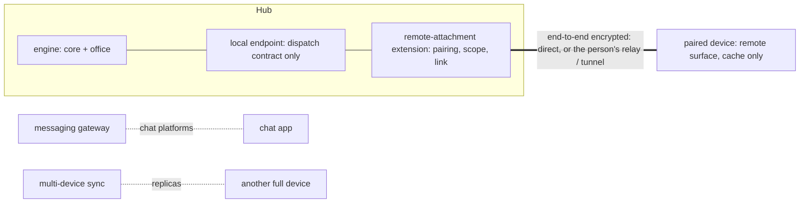

# Remote Attachment

**Version:** 1.0.0
**Status:** Stable
**Layer:** concept

## Overview

Remote attachment lets a person reach the office running on one of their machines — the **hub** — from another device: a phone on the way home, a laptop in another room, a browser on a borrowed computer. The remote device shows what the office is doing and lets the person steer it: read the board, talk to the manager, answer the questions waiting for them, approve what they allowed themselves to approve from afar. Nothing runs on the remote device; it is a surface over the hub's own state, attached as a spoke of the hub-and-spoke architecture.

It is delivered as an extension and is off until the person turns it on at the hub. It is not synchronization — the remote device holds no replica — and it is not the messaging gateway, which carries conversations through third-party chat platforms. It is the full product surface, carried over a link the person owns.

## Related Specifications

- [l1-architecture.md](l1-architecture.md) - INV-3 command parity and INV-4 hub-and-spoke: a remote surface is a spoke over the same core contract (RMA-3).
- [l2-engine-endpoint.md](l2-engine-endpoint.md) - The hub's local endpoint, which carries the dispatch contract and nothing else; remote attachment extends its reach beyond loopback without widening what it carries.
- [l1-multi-device-sync.md](l1-multi-device-sync.md) - SY-8 user-controlled relay and SY-9 explicit pairing, reused here; sync replicates state, attachment does not (RMA-11).
- [l1-messaging-gateway.md](l1-messaging-gateway.md) - MG-3 identity pairing and MG-4 continuity keyed to the person; the gateway reaches the office through chat platforms, attachment through the product's own surface (RMA-7).
- [l1-security.md](l1-security.md) - SEC-10: the agent cannot author its own reachability — turning attachment on, pairing and widening a device's scope are human acts (RMA-1, RMA-4).
- [l1-capability-reachability.md](l1-capability-reachability.md) - Installation verbs are human-only and never remotely invocable; a remote device inherits that exclusion (RMA-4).
- [l1-consent-binding.md](l1-consent-binding.md) - What a remote approval binds, and that the approval shown is the one acted on (RMA-4).
- [l1-remote-liveness-verdict.md](l1-remote-liveness-verdict.md) - How a far side's state is judged live, stale or unknown; the remote surface shows that verdict (RMA-6).
- [l1-peer-compatibility.md](l1-peer-compatibility.md) - Hub and remote client update separately; skew verdicts name the side to update (RMA-8).
- [l1-extensions.md](l1-extensions.md) - The extension model attachment is delivered through (RMA-1).
- [l1-background-activation.md](l1-background-activation.md) - An attachable hub must be running; activation is how it stays up (RMA-10).
- [l1-program-lifecycle.md](l1-program-lifecycle.md) - The remote client is a peer that updates on its own schedule (PLC-9).

## 1. Motivation

The office is built to work without its client, which is exactly why the client wants to look in while away: to see that the work moved, to answer the one question blocking it, to stop something that went wrong. Today the only remote reach is a chat platform through the messaging gateway — useful for a sentence, poor for a board, a plan or a diff, and routed through a third party.

The obvious shortcuts are each a hazard. Opening the hub's endpoint to the network exposes the dispatch contract to whoever finds the port. Building a separate mobile application with its own logic forks the product. Syncing the whole state to the phone puts a full copy of the office on the device most likely to be lost. What is needed is the hub's own surface, reached over an authenticated link, with a narrower default scope than sitting at the hub.

## 2. Constraints & Assumptions

- **Assumption (forecast):** "remote control between platforms, from other devices" means the person controls their own hub from another device; one Cronus operating another machine's desktop is not in scope. Runner-up: remote desktop control of other machines by the office. Override: `/magic.spec amend l1-remote-attachment "office operates remote machines"`.
- The hub is a host that can stay up (INV-4); the remote device may be a phone that cannot.
- There is no product-operated server; any relay is the person's own (SY-8).
- A remote device can be lost or borrowed; its access must be revocable at once from the hub.

## 3. Core Invariants

Rules every Layer 2 implementation MUST NOT violate:

- **RMA-1 (Off until the person turns it on, at the hub):** remote attachment ships as an extension and opens no listener while it is not installed and enabled. Enabling it is a human act at the hub; no agent, workflow or remote device can enable it, widen it or re-enable it after it was turned off.
- **RMA-2 (Explicit, per-device pairing, revocable at once):** a device attaches only after a pairing that both sides authenticate — a short-lived code or scannable token shown at the hub and confirmed on the device. Each paired device has a name, is listed at the hub with its last contact, and can be revoked; revocation ends its live connections immediately and invalidates its credential everywhere.
- **RMA-3 (A remote surface is a spoke):** the remote surface composes the same catalog and sends the same dispatch contract as a local one, under the same gates. It holds no domain logic and re-derives nothing. Every action it sends is attributed to the paired device as well as to the person.
- **RMA-4 (Narrower by default; widening is the person's):** a paired device starts with a declared scope — view, converse with the office, answer its questions. Approving gated actions from that device is a further grant the person makes for that device. Irreversible or destructive approvals and every installation verb are never answerable remotely, whatever the grant. The scope is enforced at the hub, never trusted from the device.
- **RMA-5 (A link the person owns, encrypted end to end):** traffic between device and hub is encrypted end to end and travels directly when the two can reach each other, otherwise through a relay or tunnel the person controls. No third party can read it; the hub never opens a port to the internet unless the person names that exposure in the step that creates it.
- **RMA-6 (Honest about distance):** the remote surface always shows whether the hub is reachable and how fresh what it shows is. Lost contact turns the view stale visibly; an action not acknowledged by the hub is shown as pending, never as done, and is not silently resent after reconnection.
- **RMA-7 (One conversation, whichever device):** a conversation is keyed to the person, not the device; one begun at the hub continues on a paired device and back, with each turn recording where it was typed.
- **RMA-8 (Skew has a verdict):** a remote client older or newer than its hub negotiates by capability; a capability one side lacks is reported with which side to update, and the rest keeps working.
- **RMA-9 (Who is attached is always visible):** the hub shows which devices are attached now and records every remote session and every remote-originated action — device, time, action, outcome — in the office's record, where the person can review it.
- **RMA-10 (No false promises about a sleeping hub):** when the hub is off or asleep, the device says so and does not queue work as if it were accepted. It can wake the hub only through a wake path the person configured; a push notification is a wake signal and never carries office content.
- **RMA-11 (A view, not a replica):** the device keeps at most a cache of what it last showed, labeled as such, bounded, and erased on revocation. It does not become a member of the replica set; carrying state between devices remains multi-device sync's job.

> L2 specs cannot reach RFC status until all invariants here are addressed in their "Invariant Compliance" section.

## 4. Detailed Design

### 4.1 Where it sits



The extension adds reach, not capability: the device can do exactly what the dispatch contract offers, filtered by the device's scope.

### 4.2 Scope ladder

| Scope | Granted | Includes |
| --- | --- | --- |
| View | at pairing | board, office view, sessions, inbox, status, cost — read only |
| Converse | at pairing | messages to the manager, answers to the office's questions, pausing and resuming the office |
| Approve | per device, by the person at the hub | answering approval gates that declare themselves remotely answerable |
| Never remote | — | installation verbs, the authority plane, irreversible or destructive approvals |

### 4.3 Pairing and revocation

```text
[REFERENCE]
pair():
  hub (human act): show one-time code / token, valid for minutes, single use
  device: present code -> mutual key exchange -> hub stores device {name, key, scope, paired_at}
revoke(device):
  hub: delete key, close live connections, record revocation
  device (next contact or never): rejected; local cache erased on rejection
```

## 5. Drawbacks & Alternatives

- **A narrower default means some trips back to the hub.** Accepted: an approval from a lost phone is the case the default exists for.
- **Alternative — expose the local endpoint on the network.** Rejected (RMA-5, RMA-2): the endpoint's token guard is a loopback guard, not an internet-facing authentication.
- **Alternative — a separate mobile application with its own logic.** Rejected (RMA-3): a second implementation of the office is a fork that drifts.
- **Alternative — sync the whole office to the phone.** Rejected (RMA-11): it makes the most-often-lost device a full copy of the office, and that is sync's problem with its own consent, not this one's.
- **Alternative — build it into the core.** Rejected (RMA-1): a product that is local-first carries no listener at all unless the person adds one.

## Canonical References

| Alias | Path | Purpose |
| --- | --- | --- |
| `[ARCH]` | `.design/main/specifications/l1-architecture.md` | INV-3 / INV-4 — parity and hub-and-spoke |
| `[ENDPOINT]` | `.design/main/specifications/l2-engine-endpoint.md` | The dispatch contract the link carries |
| `[SYNC]` | `.design/main/specifications/l1-multi-device-sync.md` | Pairing and user-controlled relay reused here |
| `[SECURITY]` | `.design/main/specifications/l1-security.md` | SEC-10 — reachability is the human's |

## Document History

| Version | Date | Author | Notes |
| --- | --- | --- | --- |
| 1.0.0 | 2026-10-22 | Core Team | Initial concept — RMA-1…RMA-11, from the user's backlog (remote control across platforms, from other devices, as a plugin): an extension off until enabled at the hub; explicit per-device pairing revocable at once; the remote surface a spoke over the same dispatch contract; a narrower default scope (view, converse) with remote approval a per-device grant and installation verbs and irreversible approvals never remote; an end-to-end encrypted link the person owns; honest staleness and pending actions; one conversation across devices; skew verdicts; attached devices and remote actions always visible; no false promises about a sleeping hub; a cache, never a replica. Concept-only until an L2 is planned. |
