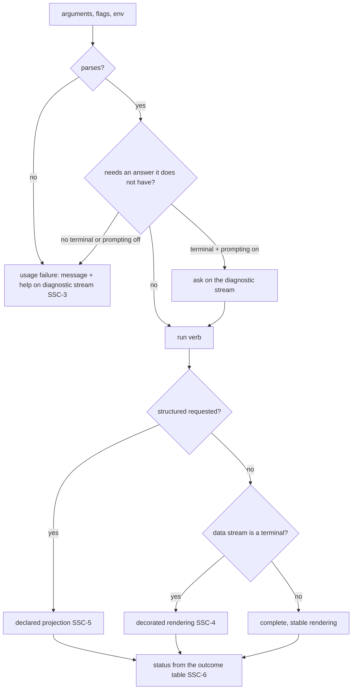

# Scripted Surface Contract

**Version:** 1.0.0
**Status:** Stable
**Layer:** concept

## Overview

What a command surface promises to the **program** that calls it, as distinct from the **person** who reads it. Every command line has two audiences at once. A person at a terminal reads the output, answers prompts and adapts when a label moves; a script, a CI job or an automated agent passes arguments, parses what comes back and branches on the exit status — and cannot adapt. The same change is cosmetic to the first and breaking to the second.

This specification names the second audience's contract — the **scripted face** — enumerates what belongs to it, and fixes the rules that keep it stable: which stream carries what, when decoration may appear, how structured output is requested, how many distinct outcomes a caller can tell apart, and what an interactive question becomes when nobody is there to answer it. It is technology-agnostic; `l2-cli` realizes it for the `cronus` command.

## Related Specifications

- [l2-cli.md](l2-cli.md) - The command-line frontend that realizes this contract (§4.2.1 there).
- [l1-launch-handoff.md](l1-launch-handoff.md) - LH-7 makes usage, composition and verb failures distinguishable; SSC-6 extends the same rule to every outcome a caller branches on.
- [l1-surface-parity.md](l1-surface-parity.md) - SP-13 separates *unrecognized*, *unavailable* and *empty*; SSC-6 gives each its own exit signal on this surface.
- [l1-record-evolution.md](l1-record-evolution.md) - Structured output read by scripts is a record with an independently-shipped reader population (REC-1); its frozen wire form is guarded as REC-12 describes. This spec owns the rest of the scripted face — streams, statuses, arguments, diagnostics.
- [l1-peer-compatibility.md](l1-peer-compatibility.md) - Boundary: PCO governs peers that **negotiate** a version. A script negotiates nothing — it was written against one release and keeps running against the next — so the scripted face cannot be bridged by a transform and is held stable instead (SSC-1).
- [l1-agent-tool-ergonomics.md](l1-agent-tool-ergonomics.md) - ATE-13/ATE-14 shape diagnostics for agent-facing tools; SSC-9 applies the same intent to a command line an agent happens to drive, without letting detection alter the contract.
- [l1-architecture.md](l1-architecture.md) - INV-3 command parity: every interactive question has a flag equivalent, which SSC-7 turns into a fail-fast rule when no terminal is present.
- [l1-context-provenance.md](l1-context-provenance.md) - CP-11: foreign text written to a terminal is neutralized there; SSC-4 decides *whether* decoration appears, CP-11 what foreign bytes may do when it does.
- [l1-composition-layering.md](l1-composition-layering.md) - LAY-5 separates an empty declaration from an absent one; SSC-8 is the same distinction at an argument.
- [l1-telemetry.md](l1-telemetry.md) - Where telemetry is on, whether the caller was a terminal, a pipe or a detected agent is an anonymous dimension (SSC-9), never content.
- [l1-foreign-agent-invocation.md](l1-foreign-agent-invocation.md) - The indefinite quiet wait on standard input is the failure SSC-7 forbids on this side of the boundary.

## 1. Motivation

A command line is usually designed for the person typing it and then discovered by scripts. From that moment two things are true: the output a script parses is an interface, and nobody wrote it down. Three failures follow.

- **Breakage by improvement.** A clearer error message, a renamed flag value, a default that "obviously" should change, a progress line moved to standard output — each reads as polish in review and breaks every pipeline that matched the old bytes. The reviewer had no list of what scripts depend on, so nothing flagged it.
- **Decoration in the pipe.** Colour codes, spinners, column truncation and pagers are written for a terminal and leak into a file or another program, where they corrupt the data they decorate.
- **One status for everything.** A caller that receives a single non-zero status cannot tell *the thing you asked about does not exist* from *you are not signed in* from *you pressed Ctrl+C* from *it is still running*. It retries what should not be retried and gives up on what would have finished.

An external general-purpose command-line tool that has served scripts for years states the rule this spec adopts: a change to what a person sees is not breaking; a change to what a script consumes is breaking, however well argued, and the list of what scripts consume is explicit.

## 2. Constraints & Assumptions

- A surface may be driven by a person at a terminal, by a pipe or file redirection, by a scheduler, or by an automated agent. It can observe whether each stream is a terminal; it cannot observe intent.
- Exit statuses are small integers whose meaning is not standardized across platforms beyond *zero is success*; the classes in SSC-6 are mapped to numbers once, by the realization.
- **Assumption (forecast):** a diagnostic that carries a stable machine code makes the code the contract and frees the wording; until diagnostics carry codes, their wording is part of the scripted face. Runner-up: wording is never part of the contract. Override: `/magic.spec amend l1-scripted-surface-contract "diagnostic text is never contract"`. Reason: scripts demonstrably match error text when nothing better exists, and declaring that dependency void does not stop the breakage it causes.

## 3. Core Invariants

Rules every Layer 2 implementation MUST NOT violate:

- **SSC-1 (The consumer decides what is breaking):** every verb has an **interactive face** — what a person at a terminal reads and answers — and a **scripted face** — what a program passes in and parses out. A change confined to the interactive face is a presentation change: a person can read a moved label or choose a different option. Any change to the scripted face is a **breaking change regardless of its merit**, and ships only when it is explicitly authorized as breaking, with the replacement named in the release note. Whether a change is an improvement is not the test; whether a consumer that cannot adapt depends on it is.

- **SSC-2 (The scripted face is enumerated, not inferred):** the scripted face of a verb is exactly: its name and group; the names of its flags and positional arguments; the set of values each accepts (narrowing that set breaks, widening it does not); its defaults on the non-interactive path; which stream each kind of output goes to (SSC-3); its non-interactive output; its structured fields — names, types and the shape of an empty result (SSC-5); its exit statuses (SSC-6); and its diagnostics — by stable code where one exists, by wording where none does. This list is captured per verb from the surface's own declaration as a generated, committed artifact, so a change to any element appears in review as a diff, not as an opinion about whether it matters.

- **SSC-3 (Data and diagnostics never share a stream, and one failure never splits across two):** results go to the data stream; progress, warnings, notices, prompts, and every message about a failure go to the diagnostic stream. A failure's message and whatever accompanies it — usage, help, a suggested next command — are written to the **same** stream, so a caller that captures one stream never receives half an explanation. A verb never merges the two streams to make its output easier to read.

- **SSC-4 (Decoration exists only where a person can see it):** colour, animation, paging, truncation to the terminal width, column headers, relative times and hyperlinks are emitted only when the receiving stream is a terminal. Output to anything else is complete, unwrapped and stable — every row, every column, absolute values. An explicit request to force or suppress colour is honoured whatever the stream. A reader that closes the stream early — a pager quit before the end, a `head` that has what it needs — is not a failure of the verb.

- **SSC-5 (Structured output is a declared projection):** a verb that offers structured output declares its **exportable field set**, and that set is discoverable from the surface itself — its help, its completion, and a request that names no field, which answers with the list. Where a verb lets the caller select fields, a field the caller names that is not in the set is a usage failure **listing the set**, never silently omitted; filtering and templating apply only to a requested structured projection, never to the human rendering. The structured content is independent of whether a terminal is attached. A verb whose record is costly to assemble or likely to grow offers selection, and then assembles only what was named: the caller's named set is its declared dependency, so adding fields never breaks it and removing one fails loudly at the request instead of silently in the parser downstream.

- **SSC-6 (Outcomes a caller branches on have distinct statuses, and none is folded into another):** at minimum the surface distinguishes, each with its own exit status: success; a malformed invocation; a composition that failed to come up; a verb that ran and failed; **cancelled by the person**; **authentication or authorization required**; and **pending** — nothing failed, but what was asked for has not finished (a check still running, an approval not yet given). A query that matched nothing is **success** with an empty result, and says so on the diagnostic stream only when a terminal is attached; a **named** object that does not exist is a failure. A status produced by a command this surface merely launches on the caller's behalf — an extension, a delegated program — is passed through unchanged. The mapping from classes to statuses is one table, part of the scripted face (SSC-2).

- **SSC-7 (Every question has an answer path that needs no terminal, and a missing answer fails fast):** any value a verb would ask for interactively can be supplied by a flag or input file (INV-3). When no terminal is attached, or prompting has been switched off by an explicit setting, a value that would have been asked for is a **usage failure naming the flag that supplies it** — never a wait on input that will not come, and never a guessed default standing in for the answer.

- **SSC-8 (Omitted and explicitly empty are different inputs):** where *the caller did not say* (leave the value as it is) and *the caller said empty, zero or false* (clear it, turn it off) mean different things, the surface keeps them apart. Collapsing an explicit empty into an omission makes a field impossible to clear; collapsing an omission into an empty value clears what the caller never mentioned.

- **SSC-9 (Caller detection adapts presentation, never the contract):** a surface MAY recognise that an automated agent is driving it, from declared environment signals checked in order of specificity and validated to a safe identifier. Recognition may change only presentation: animated progress is suppressed, and on a usage failure the **full** help — examples, the structured field set, the environment switches that apply — is written to the diagnostic stream, so the caller can correct itself in one round trip instead of two. Recognition never changes the scripted face, an outcome, a default, or any authorization: a signal any process can set is a hint about the audience, never a credential.

> L2 specs cannot reach RFC status until all invariants here are addressed in their "Invariant Compliance" section.

## 4. Detailed Design

### 4.1 The two faces of one verb

| Element | Interactive face (may change) | Scripted face (breaking to change) |
| --- | --- | --- |
| Labels, prompt wording, ordering of questions | yes | — |
| Colour, spinners, pager, width truncation, headers | yes (SSC-4) | — |
| Verb, group, flag and argument names | — | yes |
| Accepted values of a flag | widening only | narrowing |
| Defaults when no terminal is attached | — | yes |
| Which stream carries data and which carries diagnostics | — | yes (SSC-3) |
| Non-interactive output bytes | — | yes |
| Structured field names, types, empty-result shape | — | yes (SSC-5) |
| Exit status per outcome class | — | yes (SSC-6) |
| Diagnostic code | — | yes |
| Diagnostic wording | yes, when a code is present | yes, when no code is present |

### 4.2 Outcome classes

```text
[REFERENCE]
outcome            exit signal        diagnostic stream          data stream
success            zero               nothing (or a notice)      result
empty query        zero               "no matches" if terminal   empty result in the declared shape
usage failure      own non-zero       message + usage/help       nothing
composition fail   own non-zero       message + remedy           nothing
verb failure       own non-zero       message                    nothing
cancelled          own non-zero       newline if interrupted     nothing
auth required      own non-zero       message + the exact command that signs in or refreshes
pending            own non-zero       what is still pending      partial result, if declared
delegated status   passed through     whatever the delegate wrote
```

The numbers are the realization's (l2-cli); the rule here is that the rows are distinct.

### 4.3 Flow of one headless invocation



## 5. Drawbacks & Alternatives

- **Frozen wording slows clearer messages.** Accepted while diagnostics carry no codes (§2 forecast). The remedy is to add a stable code, after which wording is free — not to declare scripts that match text wrong.
- **Field selection is more ceremony than dumping everything.** Accepted where the record is costly or likely to grow; a small fixed record may be emitted whole (SSC-5 makes selection conditional, not universal).
- **Alternative — version the output format and let scripts pin it.** Rejected as the default: a script written without a pin is the common case, and it is exactly the consumer that breaks. A format version may exist beside this contract; it does not replace it.
- **Alternative — one non-zero status for every failure, details in the message.** Rejected (SSC-6): it forces every caller to parse prose to decide whether to retry, which re-creates the dependency on wording this spec is trying to make explicit.
- **Alternative — behave differently for agents (terser output, other defaults).** Rejected (SSC-9): an agent then tests one contract and runs against another, and any process can claim to be an agent.

## Canonical References

| Alias | Path | Purpose |
| --- | --- | --- |
| `[CLI-SPEC]` | `.design/main/specifications/l2-cli.md` | Realization: exit-code table, stream split, structured output |
| `[CLI-HELP]` | `crates/cli/src/cli.rs` | The exit-code taxonomy and the stream rule as currently shipped |
| `[CLI-MAIN]` | `crates/cli/src/main.rs` | Where outcomes become process exit statuses |

## Document History

| Version | Date | Author | Notes |
| --- | --- | --- | --- |
| 1.0.0 | 2026-10-22 | Core Team | Initial concept — SSC-1…SSC-9, mined from an external general-purpose command-line tool with a long-lived scripting user base: the consumer that cannot adapt decides what is breaking; the scripted face enumerated and captured as a reviewable artifact; data and diagnostics on separate streams with no failure split across both; decoration only toward a terminal; structured output as a declared, discoverable projection the caller names; distinct statuses for cancelled, authentication-required and pending beside the three failures LH-7 already separates, an empty query being success and a missing named object a failure; fail-fast instead of waiting when an answer has no terminal; omitted versus explicitly empty; agent detection that changes presentation only. Diagnostic wording is contract until a stable code exists (forecast premise). |
