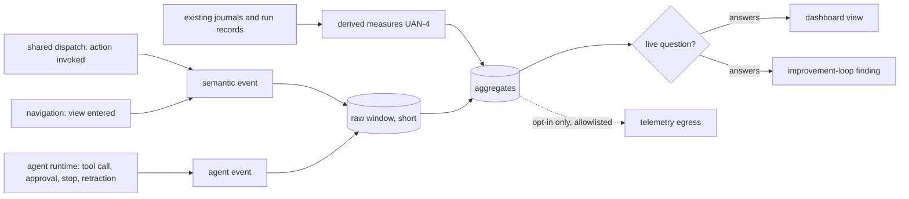

# Usage Analytics

**Version:** 1.0.0
**Status:** Stable
**Layer:** concept

## Overview

Usage analytics is the on-device plane that records **how the product is used** — which actions people invoke on which surface, where they abandon a flow, what fails and is retried — and **how the agents behave** — which tools they call and with what outcome, what they are refused, where they stop, what they retract. It exists to answer declared questions about the product, and it is built so that it can start before anyone knows exactly which questions matter: nothing is recorded without a question it answers, a question that has informed no decision expires, and its data goes with it.

It is the local source that two existing contracts lack. Telemetry governs what may *leave* the device and says nothing about what is recorded locally or why. The improvement loop turns observations into product findings but names its observation planes without one for product usage. Practice analytics coaches a session; operational health watches the running system. None of them records that a verb has never been used, or that a step loses half the people who reach it.

## Related Specifications

- [l1-telemetry.md](l1-telemetry.md) - TEL-1…TEL-5: the only path by which any of this leaves the device — opt-in, allowlisted, program data only (UAN-7).
- [l1-improvement-loop.md](l1-improvement-loop.md) - IMP-1/IMP-5: analysis output enters the loop as evidence-carrying findings; this plane is one of the observation sources it draws from (UAN-9).
- [l1-practice-analytics.md](l1-practice-analytics.md) - PA-7 honest data-gap accounting and PA-8 minimum-sample gating, which UAN-8 applies to product usage.
- [l1-artifact-derived-observation.md](l1-artifact-derived-observation.md) - ADO-11: coverage travels with every number.
- [l1-outcome-attributed-cost.md](l1-outcome-attributed-cost.md) - OAC-5 (reconstructed from existing records, never a parallel ledger) and OAC-8 (never a verdict on a person).
- [l1-operational-health.md](l1-operational-health.md) - The live health picture; this plane is retrospective and answers product questions, not alerts.
- [l1-surface-parity.md](l1-surface-parity.md) - The single dispatch door that lets one instrumentation point see every surface (UAN-2), and the parity questions usage can answer.
- [l1-epistemic-status.md](l1-epistemic-status.md) - EPS-12: the agents' standing distribution, stops and retractions are agent-action statistics recorded here.
- [l1-onboarding.md](l1-onboarding.md) - ONB-11: where people leave the first-run path.
- [l1-log-legibility.md](l1-log-legibility.md) and [l1-diagnostic-log.md](l1-diagnostic-log.md) - The logs this plane derives from where they already hold the fact, and from which it stays distinct.

## 1. Motivation

The request behind this spec says plainly that the purpose of collecting usage data is not yet clear. That is the normal state of product analytics, and the usual response — record every click now, decide later — produces a large store nobody reads, a privacy liability, and numbers that answer whatever question someone brings to them after the fact. The opposite response — record nothing until the purpose is clear — means the first real question waits months for data.

This spec takes a third path. It ships with a small set of declared questions whose decisions are obvious, records exactly what those questions need, and makes every further metric pay for itself the same way. The questions it can answer for this product:

- **What to remove or move.** A verb no one invokes on any surface is a retirement candidate under the corpus's declared-retirement rule; a verb invoked on only one surface is either a parity gap or evidence that a surface fits a task better.
- **Where people get stuck.** A flow started and not finished, an onboarding step that ends *unavailable*, an error followed by the same action retried.
- **What to make faster.** Latency per action on real use is the workload shape performance work must be measured on (QLY-11), which the benchmarks today do not have.
- **How the agents are doing.** Tool calls failing or refused by model and role, approvals asked and denied by action class, stops at a step, retractions, and the share of assumed premises — the measure of whether the hallucination filter works and whether autonomy defaults are set right.

## 2. Constraints & Assumptions

- **Assumption (forecast):** "what the user clicks" is recorded as the **semantic action** a click invokes and the **view** it opens — not as pointer coordinates, element identities or keystrokes. Every surface reaches the core through one dispatch door, so a semantic event is the same on the command line, the terminal interface and the desktop application; a raw click exists on one surface only and answers no question a semantic event cannot. Runner-up: element-level click capture on the desktop application. Override: `/magic.spec amend l1-usage-analytics "element-level capture"`.
- **Assumption (forecast):** local recording is on by default and can be switched off entirely; sending anything stays off by default under telemetry. Local recording holds no content, is visible to the user and can be wiped, which is why its default differs from sending's. Runner-up: local recording off by default. Override: `/magic.spec amend l1-usage-analytics "local recording off by default"`.
- The user is one person on their own device; analytics never compares people.

## 3. Core Invariants

Rules every Layer 2 implementation MUST NOT violate:

- **UAN-1 (Question first, and questions expire):** every recorded measure belongs to a declared question that names the decision it informs and an owner. A question carries a review date; a question that has informed no decision by its review is retired, its collection stops and its data is deleted. A measure no live question claims is not recorded.
- **UAN-2 (Semantic events at the one door):** a user interaction is recorded as the action it invokes — the action's identity, the surface, the outcome class, the duration — and navigation as the view entered. Instrumentation sits at the shared dispatch and navigation points, so one event definition serves every surface and a new surface is measured without new instrumentation.
- **UAN-3 (Never content):** an event carries no argument values, text, paths, prompts, model output, file names or identifiers of the user's own objects. Identities are those of the product's actions, views and steps.
- **UAN-4 (Derived where the record already exists):** a measure is reconstructed from records the product already keeps — invocation journals, session journals, card run records, receipts — and a dedicated counter is added only where no record holds the fact.
- **UAN-5 (Agent behaviour is its own stream):** agent actions are recorded in a vocabulary of their own — tool calls by outcome (succeeded, failed, refused, retried), stop reasons, approvals asked, granted and denied by action class, standings and retractions (EPS-12), cost per outcome — attributed to model, role and task class, never merged into user-interaction counts.
- **UAN-6 (Aggregated, with bounded retention):** raw events are kept for a short declared window and folded into aggregates; aggregates are kept longer; the user can delete either at any time, and deletion is complete.
- **UAN-7 (On the device; leaving is telemetry's decision):** analytics data stays on the device. Anything sent goes through telemetry's opt-in, allowlist and egress gate, as already-aggregated program data.
- **UAN-8 (Honest figures):** every figure carries its window, its sample size and its coverage; a figure below the minimum sample is shown as indicative or not at all. *Never used* is kept distinct from *not offered* (the action was unavailable or hidden on that surface) and from *not measured* (the window predates the question).
- **UAN-9 (Findings, never changes):** analysis produces findings for the improvement loop and views for the dashboard. It never changes the product, the user's configuration or an agent's autonomy on its own, and it never produces a verdict about a person.
- **UAN-10 (Visible):** the user can see the active questions, what each records, the retention, and the current aggregates, and can switch local recording off.

> L2 specs cannot reach RFC status until all invariants here are addressed in their "Invariant Compliance" section.

## 4. Detailed Design

### 4.1 Planes and flow



### 4.2 Event shapes

```text
[REFERENCE]
InteractionEvent { action_id | view_id, surface, outcome: ok | failed | cancelled | unavailable,
                   duration_ms, at }                                   // no arguments, no content (UAN-3)
AgentEvent       { kind: tool_call | approval | stop | retraction | standing,
                   tool_or_class, outcome, model, role, task_class, at }
Question         { id, text, decision_it_informs, owner, measures: [MeasureId], review_at, state: live | retired }
```

### 4.3 Seed questions

| Question | Decision it informs | Measures |
| --- | --- | --- |
| Which actions are never or rarely invoked, per surface? | retire, hide or move a verb (declared retirement) | invocation counts per action and surface, with *not offered* separated |
| Which actions are invoked on one surface only? | close a parity gap, or record a legitimate difference | the same counts, compared across surfaces |
| Where are flows abandoned? | reorder or reword steps, fix friction | started-not-finished invocations, onboarding step outcomes |
| Which actions fail or are retried most? | defect findings | failure and immediate-retry counts per action |
| How long do actions take in real use? | performance targets on real workload shape | duration distribution per action |
| Which tools fail or are refused, per model and role? | model choice, tool ergonomics | tool-call outcomes |
| Which action classes are denied approval? | autonomy defaults | approvals asked and denied by class |
| Is the hallucination filter working without overshooting? | filter tuning, model choice | standing distribution, unresolved identifiers removed, stops, retractions (EPS-12) |

## 5. Drawbacks & Alternatives

- **Question-first is slower to start.** Accepted: the seed set covers the decisions the product already faces, and a new question costs one declaration.
- **Semantic events miss pure layout friction** (a control people hunt for). Accepted for now: the view-entered and abandoned-flow measures catch its effect, and element-level capture stays a recorded override (§2), not a silent addition.
- **Alternative — collect everything, analyse later.** Rejected (UAN-1): an unread store is a liability with no decision attached to it.
- **Alternative — derive everything from logs.** Partly adopted (UAN-4). Rejected as the whole answer: logs are written for diagnosis, their retention and shape are wrong for counting, and a log line is not a declared measure.
- **Alternative — send usage to a vendor analytics service.** Rejected: it contradicts telemetry's opt-in and the local-first stance; anything sent at all goes through TEL.

## Canonical References

| Alias | Path | Purpose |
| --- | --- | --- |
| `[TELEMETRY]` | `.design/main/specifications/l1-telemetry.md` | The egress contract for anything that leaves |
| `[IMPROVE]` | `.design/main/specifications/l1-improvement-loop.md` | Where findings go |
| `[PARITY]` | `.design/main/specifications/l1-surface-parity.md` | The one door all surfaces dispatch through |

## Document History

| Version | Date | Author | Notes |
| --- | --- | --- | --- |
| 1.0.0 | 2026-10-22 | Core Team | Initial concept — UAN-1…UAN-10: question-first recording with expiring questions; semantic events at the shared dispatch and navigation points instead of raw clicks; no content; derived from existing records where they exist; a separate agent-behaviour stream; aggregated with bounded retention and complete deletion; on the device, with sending left to telemetry; honest figures separating never-used from not-offered and not-measured; findings and views, never automatic changes or verdicts on people; visible and switchable. Seeded with eight questions and the decisions they inform. Motivated by a user request to collect usage and agent-action statistics while stating that the purpose is not yet clear — answered by making the purpose a declared part of every measure. |
