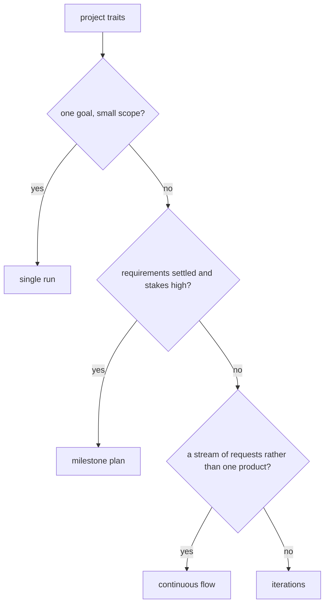

# Work Method

**Version:** 1.0.0
**Status:** Stable
**Layer:** concept

## Overview

A work method is **how an office paces and reviews its team's work** on a project: whether work flows continuously, arrives in short iterations that each end in something the client can see, follows a gated plan of milestones, or is a single run toward one goal. Agile practice gave human teams these shapes; an office of agents needs them for the same reasons — evolving requirements, early feedback, catching drift — but not the same rituals.

The orchestrator chooses the method for each project from what it observes about the project, records why, and may change it at a boundary when the project changes. The client sees results at the review points the method and their involvement level produce, never the ceremonies. Whatever the method, there is one board and one plan.

## Related Specifications

- [l1-orchestration.md](l1-orchestration.md) - ORC-3 intent → plan → tasks → board and ORC-8 briefings; the method shapes their cadence (WMT-4).
- [l1-kanban-model.md](l1-kanban-model.md) - The one board of record; a method groups and paces cards on it and never adds a second store (WMT-2).
- [l1-state-authority.md](l1-state-authority.md) - One authority per kind of state; an iteration is a grouping, not a new authority (WMT-2).
- [l1-task-graph-model.md](l1-task-graph-model.md) - Plan structure and plan-unit status that iterations and milestones group.
- [l1-client-involvement.md](l1-client-involvement.md) - The client's level is a trait the choice weighs and decides what review points reach them (WMT-1, WMT-4).
- [l1-practice-analytics.md](l1-practice-analytics.md) - PA-15 retrospectives; the method's retrospective is that mechanism, producing findings (WMT-7).
- [l1-office-archetype.md](l1-office-archetype.md) - An archetype may recommend a method for its kind of work (WMT-3).
- [l1-directability.md](l1-directability.md) - The client may steer the method; an accepted steer binds (WMT-1).
- [l1-project-support.md](l1-project-support.md) - A delivered project in support usually moves to continuous flow (WMT-6).

## 1. Motivation

The pieces of an iterative method already exist across the corpus — a board, a sprint tracking projection, briefings, retrospectives, velocity measures — but nothing decides which shape a project's work should take. Left undecided, every project gets the same shape by accident: either one long run that shows the client nothing until the end, which is the expensive way to discover a misunderstanding, or ceremonies borrowed wholesale from human teams that cost tokens and produce meetings nobody attends.

The method is also not the client's to administer. A client who came to the office for a product should not be asked whether they prefer sprints; the professional choice belongs to the manager, made visible and correctable like any other choice.

## 2. Constraints & Assumptions

- **Decided by the user (2026-10-22):** the orchestrator chooses for each project what works best with its workers; the client does not pick a methodology.
- Agents do not tire, sleep or need a fixed weekly rhythm; calendar time matters only where the client's world sets a deadline.
- The four methods below cover the projects the office takes; a new method is an amendment, not a runtime invention.

## 3. Core Invariants

Rules every Layer 2 implementation MUST NOT violate:

- **WMT-1 (Chosen per project by the orchestrator, recorded, steerable):** the orchestrator chooses a method when it plans a project, from observable traits — how settled the requirements are, the size of the scope, the kind of deliverable, the stakes, a deadline, the client's involvement level. The choice is recorded with the traits that decided it and is visible in the office; the client may steer it, and an accepted steer binds.
- **WMT-2 (One board, one plan, whatever the method):** a method shapes cadence, grouping and review points over the existing board and plan. An iteration or a milestone is a grouping of cards and plan units, never a second board, a second backlog or a second status that could disagree with the card.
- **WMT-3 (A closed catalog of methods, described as data):** the methods are **continuous flow**, **iterations**, **milestone plan** and **single run**. Each is described by the same fields — unit of planning, what ends a cycle, review point, work-in-progress policy, when a retrospective runs — so the orchestrator applies them by one mechanism. An archetype may recommend a method; adding a method is a versioned amendment.
- **WMT-4 (Ceremonies are office work, not client meetings):** planning, synchronization, review and retrospective run as office activities under the usual budgets. What reaches the client is a reviewable result at the method's review points, filtered by the client's involvement level — never a request to attend.
- **WMT-5 (Cycles are measured in work, not in weeks):** a cycle ends when its scope is done or its budget is spent. Calendar boundaries appear only where the client's world imposes them — a deadline, a launch date — and are then stated as such.
- **WMT-6 (Re-chosen at a boundary, never mid-cycle):** when a project's traits change — requirements settle, a launch moves it into support — the orchestrator may change the method at the next cycle boundary, recording why. Work in flight finishes under the method it started under.
- **WMT-7 (Retrospectives produce findings, not silent changes):** each method declares when a retrospective runs; its output enters the improvement loop as findings (PA-15) and changes practice only through the usual adoption path.
- **WMT-8 (The choice is informed by the office's own record):** throughput, cycle time, rework and first-pass acceptance are recorded per project with the method in force, so later choices rest on how methods actually performed for this kind of work in this building.
- **WMT-9 (A method changes no permission):** gates, autonomy, budgets and quality standards are the same under every method.

> L2 specs cannot reach RFC status until all invariants here are addressed in their "Invariant Compliance" section.

## 4. Detailed Design

### 4.1 The catalog

| Method | Fits | Unit of planning | A cycle ends when | Review point for the client | Retrospective |
| --- | --- | --- | --- | --- | --- |
| **Continuous flow** | support, maintenance, the organizer, a stream of small requests | a card | — (no cycle) | each delivered card, or a periodic digest | on a periodic cadence or after an incident |
| **Iterations** | a product whose requirements will move as the client sees it | an increment: a small set of cards that yields something showable | its scope is done or its budget spent | each increment | at the end of every iteration |
| **Milestone plan** | settled requirements, high stakes, a fixed deliverable | a phase with an exit gate | its gate passes | each milestone | at each milestone |
| **Single run** | a bounded task one goal can finish | the goal | the independent judge confirms the goal | the result | only when the run failed or exceeded its budget |

### 4.2 Choosing

The tree is the default reasoning, not a rule that overrides the record (WMT-8): where the office's own history shows another method serving this kind of project better, the orchestrator may choose it and records that history as the reason.

## 5. Drawbacks & Alternatives

- **A choice the client did not make may surprise them.** Mitigated: it is visible with its reasons and steerable (WMT-1).
- **Alternative — let the client pick a methodology.** Rejected by the user's decision (§2) and by the office model: it is a professional's choice.
- **Alternative — adopt Scrum's ceremonies verbatim.** Rejected (WMT-4, WMT-5): fixed-length sprints and stand-ups exist for human attention and rhythm; for agents they spend budget without the benefit.
- **Alternative — no method, just the board.** Rejected: it is what the office does today, and its default is a single long run that shows the client nothing until the end.

## Canonical References

| Alias | Path | Purpose |
| --- | --- | --- |
| `[ORCHESTRATION]` | `.design/main/specifications/l1-orchestration.md` | Planning and briefings the method paces |
| `[KANBAN]` | `.design/main/specifications/l1-kanban-model.md` | The one board every method uses |
| `[BOARD-L2]` | `.design/main/specifications/l2-kanban-board.md` | §4.8 sprint tracking projection, the iteration grouping's existing realization |

## Document History

| Version | Date | Author | Notes |
| --- | --- | --- | --- |
| 1.0.0 | 2026-10-22 | Core Team | Initial concept — WMT-1…WMT-9, from the user's backlog (agile management of the AI team; the user's answer: the orchestrator chooses per project what works best with its workers): method chosen per project by the orchestrator from observable traits, recorded and steerable; one board and one plan under every method; a closed catalog of four methods described as data; ceremonies as office work with only results reaching the client; cycles measured in work; re-chosen only at a boundary; retrospectives as findings; choices informed by the office's own record; no permission changes. Concept-only until an L2 is planned. |
