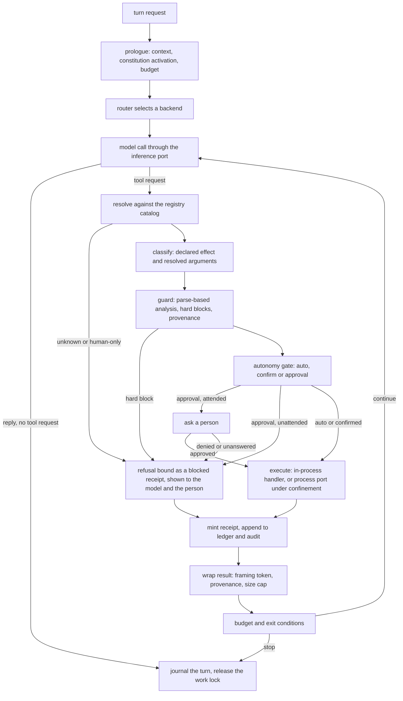

# Agent Runtime Composition

**Version:** 1.0.0
**Status:** RFC
**Layer:** implementation
**Implements:** l1-orchestration.md, l1-action-gating.md

## Overview

The composition that turns the parts the product already has — the session journal and the chat turn, the model transport and its router, the tool-receipt door, the tool guard, the autonomy gate, the execution sandbox and the invocable registry — into one runnable agent whose every tool call is resolved, classified, guarded, gated, confined, receipted and journaled, in that order, with no way round.

It specifies no new algorithm. Every stage is specified by the spec named for it. This spec owns four things only: the **order the stages are wired in**, what the runtime does when a stage is **absent** (it refuses, it does not skip), the **slices** the runtime is built in so that no slice ships a tool path ahead of the stages that must front it, and the **evidence** that the wiring is real rather than merely compiling.

It is a Request-for-Comment on purpose. It was authored in one session by one author, which is exactly the review the RFC state exists to improve on; it is not promoted to Stable by its author.

## Related Specifications

- [l2-agent-session.md](l2-agent-session.md) - The turn, the tool-call loop engine (§4.6), the two-level loop (§4.14), the runner lifecycle (§4.13) and the chat turn this runtime generalizes. Owns the loop; this spec owns what is wired into it.
- [l2-model-router.md](l2-model-router.md) - Model selection for each call. The chat turn bypasses it today; the runtime does not.
- [l2-model-runtime.md](l2-model-runtime.md) - The inference port and the loopback transport behind the router.
- [l2-model-error-recovery.md](l2-model-error-recovery.md) - Classification of a failed model call and the action taken.
- [l2-tool-receipts.md](l2-tool-receipts.md) - `ReceiptedDispatch`, the one public tool-execution path. This spec makes it the only door in the running system, not just in the library.
- [l2-tool-security.md](l2-tool-security.md) - The guard: command analysis, hard blocks, framing of untrusted content, provenance carriage.
- [l2-agent-autonomy.md](l2-agent-autonomy.md) - Typed classification, the gate, the unattended refusal, the allow-rule store.
- [l2-execution-sandbox.md](l2-execution-sandbox.md) - The process port and the confinement backends. The only place a tool may start a process.
- [l2-invocable-registry.md](l2-invocable-registry.md) - The catalog every tool is drawn from, and the `reach` declaration that keeps human-only verbs out of an agent's hands.
- [l1-capability-reachability.md](l1-capability-reachability.md) - REA-1: every capability is agent-reachable or human-only, declared once.
- [l2-agent-constitution.md](l2-agent-constitution.md) - The activation sequence (§4.10) that is a no-op seam until a session starts it.
- [l2-context-router.md](l2-context-router.md) - What the prologue injects.
- [l2-budget-engine.md](l2-budget-engine.md) - The per-call cost events and the hard stop.
- [l2-orchestration.md](l2-orchestration.md) - Delegation, goal and judge; the last slice runs on this runtime.
- [l2-mission-mode.md](l2-mission-mode.md) - Two-phase autonomous goals; built on the same door.
- [l2-engine-endpoint.md](l2-engine-endpoint.md) - The work lock a running turn holds.
- [l2-workflow-runtime.md](l2-workflow-runtime.md) - The workflow command bridge, which may hold no execution path outside the same door (§4.2 there).
- [l2-simulation-suite.md](l2-simulation-suite.md) - The usage-simulation harness whose scenarios each slice ships with.

## 1. Motivation

The product's domain tier was built logic-first: an autonomy classifier, a tool guard, a receipt module, an orchestration state machine, a mission planner, a research loop. Almost none of it is reached by anything that runs. The only runnable agent turn is `session say`: one model call to a loopback server the caller names, no tools, no subagents, no budget, no router. The classifier and the guard have no caller outside tests (one reuse gate in memory recall aside), and the receipt door is wired to a single stage of the decision path in front of it.

That arrangement is cheap today and expensive the day the first tool path is wired. The classifier decides by keyword and the guard by substring; both are described by their own specs as heuristics that must front a boundary (`l1-security` SEC-12), not be the boundary. If the first runnable tool path is bound to them, the heuristics become the boundary by default, and every later stage is retrofitted around a shape that was never meant to carry weight. The wiring order is therefore a design decision with security consequences, and it belongs in a spec before it belongs in code.

A second reason is honesty. A reader of the plan sees every domain spec ticked and the agent-facing command groups missing, and cannot tell which of the two is the truth (`l1-architecture` INV-9). The runtime composition is the missing piece that makes a ticked box mean *an agent can use this*; it needs an owner so that its absence is a recorded gap and not an assumption.

## 2. Constraints & Assumptions

- **The core is synchronous** (`l2-crate-topology` §2). The runner is worker threads and channels, as the chat turn already is. No async runtime enters any tier for this.
- **The composition root is the facade.** Pure stage logic stays in the domain tier, I/O in the adapters, and the wiring of the two in `cronus-core` (`l2-crate-topology` §4.2). Nothing here moves a boundary.
- **Confinement is Windows-first** (`l2-execution-sandbox`). Where no confinement backend can be selected, a tool that starts a process is unavailable — never offered with a weaker promise. The runtime is useful without it (slices that start no process), and says so.
- **Local-first.** The model and its endpoint are on the authority plane; a model call that leaves the device is an egress act behind the consent gate (`l1-deployment-neutrality` DN-4). The runtime adds no default egress.
- **No verb before its handler** (`l1-architecture` INV-9). A command that starts a tool-using turn is registered when, and only when, the loop behind it is wired; until then the chat turn is the only runner and is labelled as having no tools.
- **A turn is work.** It enters the work ledger and holds the shared work lock (`l2-engine-endpoint` §4.6), so a change that recomposes the engine is refused while a turn runs.
- Statements about what is wired are dated: the *As built* column of §4.2 was read from the tree on 2026-10-22 and must be re-read before a slice is decomposed.

## 3. Invariant Compliance (Layer 2 only)

| L1 Invariant | Implementation |
| --- | --- |
| ORC-5 Context-isolated execution | A delegated unit runs as its own turn with its own context and returns a summary; it reaches tools through the same door as its parent (§4.2), never through a handle the parent holds. Realized in the last slice (§4.4). |
| ORC-6 Judged autonomous termination | A goal-driven run ends as satisfied only on the independent judge's verdict (`l2-orchestration` §4.3); the runtime supplies the loop the judge is called from and refuses to let the acting model's own claim end it. Last slice. |
| ORC-7 Budget circuit-breaker | Every model call and every tool call in a turn counts against the turn's ceiling and the office's hard stop (`l2-agent-session` §4.2, `l2-budget-engine`); exhaustion ends the turn resumably. A turn started without a budget is refused, not given an unbounded one (§4.5). |
| ORC-9 Approval gate for high-impact work | A call the gate resolves to *approval* is put to a person through the surface the turn runs on and waits; if no person can answer, the call is refused visibly (AG-9 row below). |
| ORC-10 Resumable | The journal is the record (`l2-agent-session` §4.15); a turn interrupted by a restart is closed when the journal is reopened, and an unanswered tool call is closed as an interrupted, receipted `blocked` entry, never replayed. |
| ORC-11 Error containment | A failed tool call returns to the loop as a classified result (`l2-model-error-recovery`, `l2-agent-session` §4.6); it neither crashes the turn nor reaches a parent unfiltered. |
| AG-1 Friction proportional to consequence | The consequence of a call is classified from its declared effect and its resolved arguments by the typed classification of `l2-agent-autonomy`, never from the words in a command line. A runtime built on the keyword classifier is not a conforming runtime (§4.2). |
| AG-4 Read-safe frictionless, irreversible always gated, unknown fails to friction | A call whose effect is not declared is gated as unknown; a read-only in-boundary call passes with no prompt. The first slice that offers tools offers only the latter (§4.4). |
| AG-7 Every gate decision is auditable | Each decision is bound into the call's receipt with the refusing stage named, and recorded in the journal (`l2-tool-receipts` §4.4). A call refused at any stage takes the `blocked` branch and is never bound as `ok`. |
| AG-9 A gate is only a gate where the answer can be given | A turn knows whether it is attended. Where a call needs a prompt the surface cannot show — an unattended run, a surface with no prompt channel — the call is refused with a visible, receipted refusal; it is neither run nor silently dropped (§4.3). |
| AG-10 What steered an act is a consequence axis at privileged sinks | The provenance carried on the call's arguments (`l2-tool-security` provenance carriage) is an input to the gate. Until the carriage exists, a privileged sink is not offered to the runtime (§4.5). |

Rows for AG-2, AG-3, AG-5, AG-6, AG-8 and AG-11 are carried by `l2-agent-autonomy` and `l2-tool-security`; restating them here would duplicate the owner.

## 4. Detailed Design

### 4.1 The pipeline

Two properties of the figure carry the design. A refusal is not a different path: it reaches the same receipt and the same journal as a success, so the model and the person see what was refused and by which stage. And there is exactly one node that executes anything.

### 4.2 One door, fixed order, fail closed

Tools execute only through `ReceiptedDispatch::invoke` (`l2-tool-receipts`). In the running system that is not a convention of the library; it is a property the composition enforces: the tool surface the runner offers is built from handlers registered behind that door, and no handler is reachable by another route — not from the loop, not from a hook, not from the workflow command bridge (`l2-workflow-runtime` §4.2 says the same of itself).

The stages in front of the door run in the fixed order below. **A stage that is absent makes the tool classes that need it unavailable. It is never skipped, and it is never replaced by a weaker stand-in.**

| Stage | Owner | As built on 2026-10-22 | If absent |
| --- | --- | --- | --- |
| Resolve against the catalog, `reach` honoured | `l2-invocable-registry` | The catalog and the `reach` field exist; the agent-facing projection that drops human-only verbs is recorded Pending there | No tool is offered |
| Classify by declared effect and resolved arguments | `l2-agent-autonomy` | A keyword classifier, with callers only in tests and one reuse gate; no execution-context parameter | Every call is gated as *unknown* (AG-4) |
| Guard: command analysis, hard blocks, framing, provenance | `l2-tool-security` | A substring-based guard whose guardrail stage is documented fail-open; no caller | Process-starting and external-effect tools are unavailable |
| Gate and approval | `l2-agent-autonomy` | Domain logic only; no approval channel on any surface; no allow-rule store | Every non-read call is refused (§4.3) |
| Confinement for anything that starts a process | `l2-execution-sandbox` | No process port; nothing spawns through a boundary | Process-starting tools are unavailable (`Unenforceable`) |
| Receipt | `l2-tool-receipts` | Built; the policy stage is the only stage wired in front of it | A call cannot execute |
| Model selection | `l2-model-router` | Built in the domain tier; the chat turn does not consult it | The runtime does not start a tool turn |
| Failure classification and recovery | `l2-model-error-recovery` | Built in the domain tier; not wired into the chat turn | A failed model call ends the turn with its stop reason |

Every entry in the last column has the same shape: an absent stage removes capability and says so; it does not lower a guarantee. This is `l2-execution-sandbox`'s refusal rule (`Unenforceable{axis}`) applied to the whole composition.

### 4.3 Attended and unattended turns

A turn carries one fact the gate needs and nothing else may supply: whether a person can answer a prompt *on this turn's surface right now*. A terminal session with the prompt line focused is attended; a scheduled run, a turn started by an automation, a turn in a surface with no prompt channel, and a turn whose person has gone away are not.

- An *approval* or *confirm* outcome on an attended turn is put to the person on the turn's own surface, waits, and is bound into the receipt with who answered.
- The same outcome on an unattended turn is a **visible refusal**: a receipted `blocked` result that names the stage and says the action needs a person. It is shown to the model so the loop can take another route, and to the person in the journal when they return. It is never run, never queued silently, and never converted to an allowance (AG-9).
- A standing allow-rule (`l2-agent-autonomy`) lowers a tier only where a human ratified it for that resolved call; it never applies to a call whose arguments were steered by untrusted content (AG-10) and never to an unattended turn's first use of a privileged sink.

### 4.4 Build slices

The runtime is built in slices, each of which ships behind the stages in §4.2 that its tools need, each with its usage-simulation scenario (RULES C30), and each leaving the product honest about what it cannot yet do.

| Slice | Adds | Needs in front of it | Observable result |
| --- | --- | --- | --- |
| R0 — the chat turn through the router | The turn's model becomes a router decision with a recorded reason (RTG-7) and a bounded budget; a model setting replaces the required `--model`; the constitution's activation sequence is bound to session start | The router wired to the inference port; the model setting; the budget | `session say` keeps its behaviour, gains routing and a budget, and its compliance rows (`l2-agent-session` RTG-2, RTG-7) become true |
| R1 — read-only tools | Registry invocables whose declared effect is read-only and in-boundary, offered to the model; results framed and receipted | Resolve, typed classification, the receipt door fully fronted by the gate, framing; no confinement (nothing is spawned) | A turn can list cards or search memory and cite a verifying receipt; a human-only verb named by the model is refused |
| R2 — state-changing tools | Tools that write the office's own state, through gate and approval | Everything in R1, plus the approval channel on at least one surface and the unattended refusal | A turn can add a card after the person approves; the same turn unattended is refused visibly |
| R3 — process-starting tools | Tools that run a command or start a tool server | Everything in R2, plus the guard's command analysis and a selectable confinement backend | A turn can run a build command confined to its workspace; on a host with no backend the tool is absent and the catalog says why |
| R4 — delegation | Subagents, the goal loop with its judge, mission mode and deep research, all on the same door | Everything in R2 (R3 where their tools need it) and the orchestration state machine wired as its spec describes | A goal runs to a judged end or a budget stop, and every call in every delegated unit is receipted |

The plan orders the whole runtime after the guard-and-gate realization and the sandbox work; R0 has no technical dependency on either and may be pulled forward if the model setting is specified first. A slice is decomposed into tasks only when it is taken, and its *As built* statements are re-read first (§2).

### 4.5 What the runtime refuses to do

| Situation | The runtime |
| --- | --- |
| A turn is requested with no budget | Refuses to start; it does not substitute an unbounded one (ORC-7) |
| The model names a tool that is not in the offered catalog, or a human-only verb | Returns a receipted refusal naming the reason; never executes and never silently drops the request |
| The model asks for a tool while no stage fronting that tool's class is wired | The class is not offered; if named anyway, the refusal says the class is unavailable and why |
| A tool's declared effect is missing | Gated as unknown (AG-4); a tool shipped without a declaration is a defect of the tool's registration, found by the registry's own checks |
| The gate's decision cannot be put to anyone | A visible refusal (§4.3) |
| A tool result is larger than the cap, or a tool use is still unanswered when the turn ends | Summarized with its untrusted-content wrapper kept (`l2-agent-session` §4.6), or closed as an interrupted, receipted `blocked` entry (§4.13); neither is fed back as if it were an ordinary result |
| A privileged sink is requested and no provenance carriage exists | The sink is not offered (AG-10) |
| The model reports an action with no verifying receipt | The statement is flagged as unverified in the journal, not accepted as done (TR-4) |

### 4.6 Surfaces

The runtime is reached through the registry like everything else: one handler, projected by every surface that lists it (`l2-invocable-registry` SP-1, SP-11). Which command starts a tool-using turn — a flag on `session say` or a verb of its own — is decided in the slice that first offers a tool (R1) and is bound to a handler before it is listed. <!-- TBD: whether a tool-using turn is `session say --tools` or a separate verb; decide in R1 with the registry's naming rules in view, and not before the handler exists -->

Until R1 lands, the chat turn's help and its journal entries say that it has no tools. A surface never advertises an agent capability the runtime cannot honour.

### 4.7 The declared effect

The gate classifies by *declared effect* (`l2-agent-autonomy`, typed classification). The registry descriptor carries identity, locus, binders, stability and `reach`; it does not yet carry an effect class. The slice that first offers a non-read-only tool (R2) owns adding the effect declaration to the descriptor as an amendment to `l2-invocable-registry`, with the closed set of classes the gate consumes; R1 may offer only tools whose registration says *read-only* in a form the registry already checks. <!-- TBD: the closed set of effect classes and where the declaration lives — an amendment to the registry's descriptor owned by R2, to be specified before R2 is decomposed -->

### 4.8 Verification

A runtime is verified by what it refuses as much as by what it does. Each slice carries:

- **A stage-order test.** A tool call reaches the receipt door only after every stage in §4.2 that its class needs; removing a stage from the composition makes the class unavailable, not weaker (a negative test per stage).
- **A one-door test.** No handler is reachable except through the door: a source-tree assertion that the registered handlers are constructed only by the composition, as `l2-tool-receipts` TR-1 already asserts for the library.
- **A refusal corpus.** Human-only verbs, an unknown tool, an unattended approval, an oversize result and a fabricated narration each produce the visible, receipted outcome §4.5 names.
- **A usage-simulation scenario** that fixes the person's intent and never the route (`l2-simulation-suite`), run against the real binary in a disposable world; any defect it finds is pinned by a cheap deterministic test before its finding closes.
- **For R3,** the escape corpus of `l2-execution-sandbox` re-run through the runtime's path rather than the library's.

## 5. Drawbacks & Alternatives

- **A composition spec sits above specs that already describe the loop.** The risk is duplication; the mitigation is that this spec owns only the order, the refusals, the slices and the evidence, and names the owner of every stage. A paragraph here that restates a stage's behaviour is a defect of this spec.
- **The slices delay a working agent.** Accepted: the first slice that matters is read-only tools, which need typed classification and the framing, not the sandbox, and R0 may run earlier. What is refused is a shortcut that makes the heuristics the boundary.
- **Alternative — grow `session say` a tool at a time.** The path of least resistance, and rejected: the first tool would be bound to the keyword classifier and the substring guard, and the stages in front of the door would be retrofitted around that shape.
- **Alternative — a separate agent process.** Rejected: the core is one deployable (`l1-architecture` INV-8), and a turn is work in the engine's own ledger.
- **Alternative — skip the approval channel and run only read-only tools.** Viable as a stopping point, and what R1 is; it is not the destination, because an agent that can only read cannot do the office's work.
- **Confinement is Windows-first.** On another host the process-starting slice is unavailable until a backend exists there. This is the honest cost of refusing to degrade.
- **The runtime is the largest unbuilt composition in the product.** The risk is a plan that holds it forever, the way a held phase tends to become permanent. Naming its slices, its preconditions and its evidence is the mitigation; the build itself waits on the stages in front of it.

## Canonical References

| Alias | Path | Purpose |
| --- | --- | --- |
| `[SESSION]` | `.design/main/specifications/l2-agent-session.md` | The loop, the runner lifecycle and the chat turn |
| `[RECEIPTS]` | `.design/main/specifications/l2-tool-receipts.md` | The one execution door |
| `[GUARD]` | `.design/main/specifications/l2-tool-security.md` | Command analysis, framing, provenance |
| `[AUTONOMY]` | `.design/main/specifications/l2-agent-autonomy.md` | Typed classification, the gate, allow-rules |
| `[SANDBOX]` | `.design/main/specifications/l2-execution-sandbox.md` | Process port and confinement |
| `[REGISTRY]` | `.design/main/specifications/l2-invocable-registry.md` | Catalog, reach, handlers |
| `[ROUTER]` | `.design/main/specifications/l2-model-router.md` | Model selection |

## Document History

| Version | Date | Notes |
| --- | --- | --- |
| 1.0.0 | 2026-10-22 | Initial RFC, authored from the design-layer audit and the person's decision to design the agent runtime now and build it after the guard-and-gate and sandbox work. The composition of the shipped parts into one runnable agent: one execution door, a fixed stage order, fail-closed refusal when a stage is absent, attended versus unattended turns, five build slices (R0 chat through the router, R1 read-only tools, R2 state-changing tools, R3 process-starting tools, R4 delegation), and the evidence each slice carries. Two items are left as marked TBDs with owners (the surface shape, the declared-effect classes). Held at RFC pending a review by someone other than its author. |
