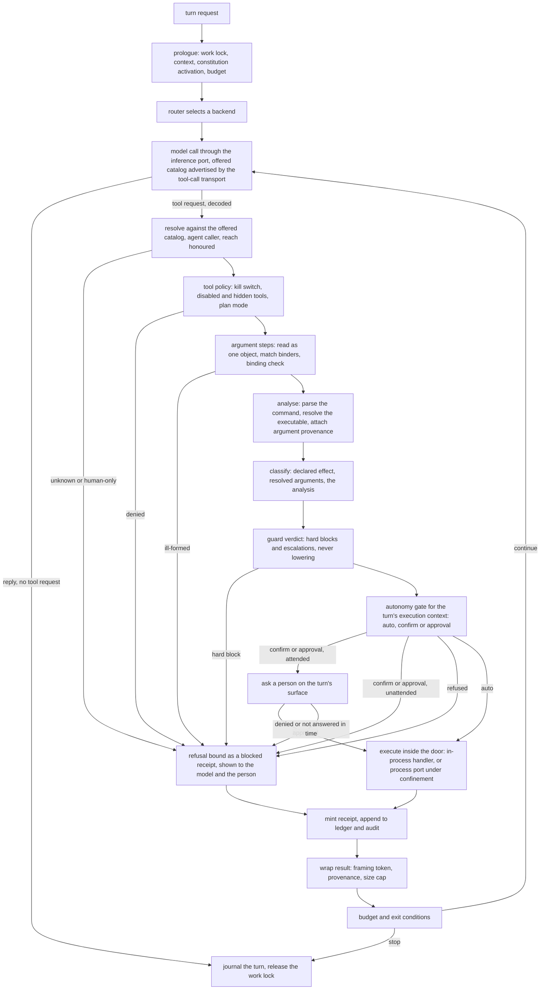

# Agent Runtime Composition

**Version:** 1.2.0
**Status:** Stable
**Layer:** implementation
**Implements:** l1-orchestration.md, l1-action-gating.md

## Overview

The composition that turns the parts the product already has — the session journal and the chat turn, the model transport and its router, the tool-receipt door, the tool policy, the tool guard, the autonomy gate, the execution sandbox and the invocable registry — into one runnable agent whose every tool call is advertised and decoded, resolved, checked against policy, analysed, classified, guarded, gated, confined, receipted and journaled, in that order, with no way round.

It specifies no new algorithm. Every stage is specified by the spec named for it; the one stage that had only a concept specification, the tool-call transport, now has its implementation spec (`l2-tool-call-transport`) and is unbuilt. This spec owns four things only: the **order the stages are wired in**, what the runtime does when a stage is **absent** (it refuses, it does not skip), the **slices** the runtime is built in so that no slice ships a tool path ahead of the stages that must front it, and the **evidence** that the wiring is real rather than merely compiling.

It was authored as a Request-for-Comment in one session by one author and promoted only after an independent review that checked its statements about the tree against the code (Document History, 1.1.0). Version 1.2.0 settles the three questions that review left to the first tool-using slice: the transport's implementation, where the effect declaration lives, and the command that starts a tool-using turn.

## Related Specifications

- [l2-agent-session.md](l2-agent-session.md) - The turn, the tool-call loop engine (§4.6), the two-level loop (§4.14), the runner lifecycle (§4.13) and the chat turn this runtime generalizes. Owns the loop; this spec owns what is wired into it.
- [l2-model-router.md](l2-model-router.md) - Model selection for each call. The chat turn bypasses it today; the runtime does not.
- [l2-model-runtime.md](l2-model-runtime.md) - The inference port and the loopback transport behind the router.
- [l1-tool-call-transport.md](l1-tool-call-transport.md) - TCT-1…TCT-11: how offered tools are advertised to a model and its tool requests decoded and answered.
- [l2-tool-call-transport.md](l2-tool-call-transport.md) - `[ADDED v1.2.0]` The implementation of the above: the logical events, the advertised catalog, capability and selection, the native and encoded transports, typed results for malformed calls. Nothing in it is built; its first slice (W1) is what R1 waits for (§4.2).
- [l2-model-error-recovery.md](l2-model-error-recovery.md) - Classification of a failed model call and the action taken.
- [l2-tool-receipts.md](l2-tool-receipts.md) - `ReceiptedDispatch`, the one public tool-execution path. This spec makes it the only door in the running system, not just in the library.
- [l2-tool-security.md](l2-tool-security.md) - The tool policy (§4.5 there), and the guard: command analysis, hard blocks, framing of untrusted content, provenance carriage.
- [l2-agent-autonomy.md](l2-agent-autonomy.md) - Typed classification, the gate, the unattended refusal, the allow-rule store.
- [l2-execution-sandbox.md](l2-execution-sandbox.md) - The process port and the confinement backends. The only place a tool may start a process.
- [l2-invocable-registry.md](l2-invocable-registry.md) - The catalog every tool is drawn from, and the reach and declared-effect declaration (§4.2.1 there) that keeps human-only verbs out of an agent's hands and tells the gate what a tool does.
- [l1-capability-reachability.md](l1-capability-reachability.md) - REA-1: every capability is agent-reachable or human-only, declared once.
- [l2-agent-constitution.md](l2-agent-constitution.md) - The activation sequence (§4.10) that is a no-op seam until a session starts it.
- [l2-context-router.md](l2-context-router.md) - What the prologue injects.
- [l2-budget-engine.md](l2-budget-engine.md) - The per-call cost events and the hard stop.
- [l2-orchestration.md](l2-orchestration.md) - Delegation, goal and judge; the last slice runs on this runtime.
- [l2-mission-mode.md](l2-mission-mode.md) - Two-phase autonomous goals; built on the same door.
- [l2-engine-endpoint.md](l2-engine-endpoint.md) - The work lock a running turn holds.
- [l2-workflow-runtime.md](l2-workflow-runtime.md) - The workflow command bridge, which may hold no execution path outside the same door (§4.2 there).
- [l2-simulation-suite.md](l2-simulation-suite.md) - The usage-simulation harness whose scenarios each slice ships with.
- [l2-crate-topology.md](l2-crate-topology.md) - The synchronous core (§2) and the facade as the composition root (§4.2) this composition is placed in.
- [l1-architecture.md](l1-architecture.md) - INV-8 (one deployable) and INV-9 (no verb before its handler), both relied on below.
- [l1-security.md](l1-security.md) - SEC-12: a heuristic fronts a boundary and is never the boundary — the reason the wiring order matters.
- [l1-deployment-neutrality.md](l1-deployment-neutrality.md) - DN-4: a model call that leaves the device is a consented egress act.

## 1. Motivation

The product's domain tier was built logic-first: an autonomy classifier, a tool guard, a receipt module, an orchestration state machine, a mission planner, a research loop. Almost none of it is reached by anything that runs. The only runnable agent turn is `session say`: one model call, to the loopback model server the environment names, for a model the caller names — no tools, no subagents, no budget, no router. The classifier and the guard have no caller outside tests (one reuse gate in memory recall aside), and the receipt door is wired to a single stage of the decision path in front of it.

That arrangement is cheap today and expensive the day the first tool path is wired. The classifier decides by keyword and the guard by substring; both are described by their own specs as heuristics that must front a boundary (`l1-security` SEC-12), not be the boundary. If the first runnable tool path is bound to them, the heuristics become the boundary by default, and every later stage is retrofitted around a shape that was never meant to carry weight. The wiring order is therefore a design decision with security consequences, and it belongs in a spec before it belongs in code.

A second reason is honesty. A reader of the plan sees every domain spec ticked and the agent-facing command groups missing, and cannot tell which of the two is the truth (`l1-architecture` INV-9). The runtime composition is the missing piece that makes a ticked box mean *an agent can use this*; it needs an owner so that its absence is a recorded gap and not an assumption.

## 2. Constraints & Assumptions

- **The core is synchronous** (`l2-crate-topology` §2). The runner is worker threads and channels, as the chat turn already is. No async runtime enters any tier for this.
- **The composition root is the facade.** Pure stage logic stays in the domain tier, I/O in the adapters, and the wiring of the two in `cronus-core` (`l2-crate-topology` §4.2). Nothing here moves a boundary.
- **Confinement is per platform** (`l2-execution-sandbox` §4.1), and its realization starts with the development platform's backend. Where no confinement backend can be selected on the host, a tool that starts a process is unavailable — never offered with a weaker promise. The runtime is useful without it (slices that start no process), and says so.
- **Local-first.** The model and its endpoint are on the authority plane; a model call that leaves the device is an egress act behind the consent gate (`l1-deployment-neutrality` DN-4). The runtime adds no default egress.
- **No verb before its handler** (`l1-architecture` INV-9). A command that starts a tool-using turn is registered when, and only when, the loop behind it is wired; until then the chat turn is the only runner and is labelled as having no tools.
- **A turn is work.** It enters the work ledger and holds the shared work lock (`l2-engine-endpoint` §4.6), so a change that recomposes the engine is refused while a turn runs.
- Statements about what is wired are dated: the *As built* column of §4.2 was read from the tree on 2026-10-22, re-checked against the code by the independent review on 2026-10-23, and must be re-read before a slice is decomposed.

## 3. Invariant Compliance (Layer 2 only)

| L1 Invariant | Implementation |
| --- | --- |
| ORC-5 Context-isolated execution | A delegated unit runs as its own turn with its own context and returns a summary; it reaches tools through the same door as its parent (§4.2), never through a handle the parent holds. Realized in the last slice (§4.4). |
| ORC-6 Judged autonomous termination | A goal-driven run ends as satisfied only on the independent judge's verdict (`l2-orchestration` §4.3); the runtime supplies the loop the judge is called from and refuses to let the acting model's own claim end it. Last slice. |
| ORC-7 Budget circuit-breaker | Every turn runs under the iteration and token ceilings of `l2-agent-session` §4.2 — its defaults where the caller names none, refunds only as that section allows — and, where an office spend policy is set, under its hard stop (`l2-budget-engine`); exhaustion ends the turn resumably. A request that would remove the ceiling is refused, never honoured (§4.5). |
| ORC-9 Approval gate for high-impact work | A call the gate resolves to *approval* is put to a person through the surface the turn runs on and waits; if no person can answer, the call is refused visibly (AG-9 row below). |
| ORC-10 Resumable | The journal is the record (`l2-agent-session` §4.15); a turn interrupted by a restart is closed when the journal is reopened, as the chat turn already does. A tool call left unanswered is closed in the journal as interrupted — *not run* if it never reached the door, *outcome unknown* if its execution had begun — and never replayed. The previous run's receipts cannot be re-verified after a restart (`l2-tool-receipts` TR-5), so the closure is a journal entry, not a new receipt for an old act. Resuming a goal-driven run from that closed journal is `l2-orchestration`'s (§4.3 there). |
| ORC-11 Error containment | A failed tool call returns to the loop as a classified result (`l2-model-error-recovery`, `l2-agent-session` §4.6); it neither crashes the turn nor reaches a parent unfiltered. |
| AG-1 Friction proportional to consequence | The consequence of a call is classified from its declared effect and its resolved arguments by the typed classification of `l2-agent-autonomy`, never from the words in a command line. A runtime built on the keyword classifier is not a conforming runtime (§4.2). |
| AG-4 Read-safe frictionless, irreversible always gated, unknown fails to friction | A verb in the registry cannot lack a declared effect (§4.7), so an unclassifiable call can only come from a tool that is not a registry descriptor, and it is gated as unknown; a declared read-only in-boundary call passes with no prompt. The first slice that offers tools offers only the latter (§4.4). |
| AG-7 Every gate decision is auditable | The receipt binds the decision path's verdict with the refusing stage named (`l2-tool-receipts` §4.4); a call refused at any stage takes the `blocked` branch and is never bound as `ok`. The record AG-7 asks for — tier, the axes that placed the call there, the decision and who made it, the outcome — is written by the gate's owner to the audit log (`l2-agent-autonomy` §4.6, step 6) and carried into the turn's journal entry for that call (§4.2.1, item 6). |
| AG-9 A gate is only a gate where the answer can be given | A turn knows whether it is attended. Where a call needs a prompt the surface cannot show — an unattended run, a surface with no prompt channel — the call is refused with a visible, receipted refusal; it is neither run nor silently dropped (§4.3). |
| AG-10 What steered an act is a consequence axis at privileged sinks | The provenance carried on the call's arguments (`l2-tool-security` §4.2, provenance at privileged sinks) is an input to the guard and the gate. Until the carriage exists, no privileged sink — running a command or code, installing, spawning a delegate, sending across the trust boundary, writing the authority plane or a location later loaded as standing instruction — is offered (§4.5). Without carriage every operative argument would be of unknown provenance and every such call approval-tier (AG-10(b)), which is the uniform friction AG-5 forbids; not offering the sink is the honest form of that refusal. R2, R3 and R4 are bounded by it (§4.4). |

Rows for AG-2, AG-3, AG-5, AG-6, AG-8 and AG-11 are carried by `l2-agent-autonomy` and `l2-tool-security`; ORC-1…ORC-4, ORC-8 and ORC-12…ORC-14 by `l2-orchestration`. Restating them here would duplicate the owner. The last slice runs on the latter: a delegated unit's turn is journaled and observable like any other turn, so delegation adds no coordination path outside ORC-12's medium.

## 4. Detailed Design

### 4.1 The pipeline

Two properties of the figure carry the design. A refusal is not a different path: it reaches the same receipt and the same journal as a success, so the model and the person see what was refused and by which stage. And there is exactly one node that executes anything, and it sits inside the door. A refusal carries its stage's own reason: an approval that was not answered in time is reported to the model as unanswered, not as forbidden (`l2-agent-autonomy` §4.6, step 4), although the receipt binds it as `blocked` because the call did not run.

### 4.2 One door, fixed order, fail closed

Tools execute only through `ReceiptedDispatch::invoke` (`l2-tool-receipts`). In the running system that is not a convention of the library; it is a property the composition enforces: the tool surface the runner offers is built from handlers that only the door's execute step calls, and no handler is reachable by another route — not from the loop, not from a hook, not from the workflow command bridge (`l2-workflow-runtime` §4.2.4 says the same of itself). The registry's own dispatch, through which a person's command reaches a handler, is one of those routes: an agent-initiated invocation reaches it only from inside the door.

The stages in front of the door run in the fixed order below — the order `l2-workflow-runtime` §4.2.4 uses for workflow commands; the two are one decision path. The guard has two parts in that order: its **command analysis** (segments, resolved executable, argument provenance) runs before classification, because the class of a command-bearing call is computed from it (`l2-agent-autonomy` §4.2); its **verdict** runs after, and can only refuse or raise — a hard block refuses, an escalation or an unavailable guardian raises the call to approval (`l2-tool-security` §4.2). **A stage that is absent makes the tool classes that need it unavailable. It is never skipped, and it is never replaced by a weaker stand-in.** `[ADDED v1.2.0]` The transport's argument steps (`l2-tool-call-transport` §4.7: read the arguments as one object, match keys to binders, run the registry's binding as a check) run directly after the tool policy and before command analysis, because classification reads the bound arguments; a call that fails one takes the refusal branch with that step named. The registry's binding then runs again, unchanged, inside dispatch.

| Stage | Owner | As built (read 2026-10-22, re-checked 2026-10-23) | If absent |
| --- | --- | --- | --- |
| Advertise the offered catalog, decode tool requests, return results | `l2-tool-call-transport` over the inference port of `l2-model-runtime` | `[MODIFIED v1.2.0]` Specified, not built. The generate request still carries one flat prompt and opaque parameters — no tool declarations, no structured messages; the loopback transport sends a single user message and its stream parser reads reply text only, so it never yields a tool-call event; neither the endpoint profile nor the model descriptor says whether a model can call tools | No tool is offered; a tool request is recorded as an error, as the chat turn does today |
| Resolve against the catalog, `reach` honoured | `l2-invocable-registry` | The catalog exists. The `reach` field and the declared effect are specified there (§4.2.1) and not on the shipped descriptor; an invocation names its caller as one of three surfaces and cannot say that an agent initiated it; the agent-facing projection is recorded Pending | No tool is offered |
| Tool policy: kill switch, disabled and hidden tools, plan mode | `l2-tool-security` §4.5 | Built, and the only stage wired — inside the door, which takes a policy and checks the tool's name before it executes | A call cannot execute |
| Command analysis and argument provenance | `l2-tool-security` §4.2 | Substring tests; no parse, no resolved executable, no provenance carriage | Process-starting tools and privileged sinks are unavailable |
| Classify by declared effect and resolved arguments | `l2-agent-autonomy` §4.2 | A keyword classifier over four coarse levels, with callers only in tests and one reuse gate in memory recall; no semantic invocable declares an effect yet (§4.7 decides where, and the registry decides all 53 verbs) | Every call is gated as *unknown* — `write` at minimum, never auto (AG-4) |
| Guard verdict: hard blocks and escalations; on the way back, the framing of each result | `l2-tool-security` §4.2, §4.6 | A substring-based guard with no caller; its guardrail pipeline is documented fail-open; the framing uses a static delimiter | Process-starting and external-effect tools are unavailable |
| Gate and approval | `l2-agent-autonomy` §4.3, §4.6, fed by the permission rulesets of `l2-orchestration` §4.7 | Domain logic only; no execution-context parameter; no approval channel on any surface; no allow-rule store | Every call not classified read-only is refused (§4.3) |
| Confinement for anything that starts a process | `l2-execution-sandbox` | No process port; nothing spawns through a boundary | Process-starting tools are unavailable (`SandboxUnavailable`, or `Unenforceable{axis}` for an axis the host cannot enforce) |
| Receipt | `l2-tool-receipts` | Built; one production caller (the developer office's elevated action); no entry point for a result that arrives after the call returns | A call cannot execute |
| Model selection | `l2-model-router` | Built in the domain tier; the chat turn does not consult it | The runtime does not start a tool turn |
| Failure classification and recovery | `l2-model-error-recovery` | Built in the domain tier; not wired into the chat turn | A failed model call ends the turn with its stop reason |

Every entry in the last column has the same shape: an absent stage removes capability and says so; it does not lower a guarantee. This is `l2-execution-sandbox`'s refusal rule applied to the whole composition.

#### 4.2.1 What the wiring needs from each stage

The order above cannot be wired with the shipped types as they stand. Each item names what the composition needs from a stage's owner; each is realized by that owner's work, not by this spec.

1. **The door takes the decision path's verdict, not a policy.** Today the door runs the tool-policy check itself, on the tool's name, after anything the runtime has already done in front of it — so a person could be asked to approve a call the policy then refuses. The door's gate input becomes the verdict of the whole path, taken in the order above: allowed, refused or not answered, the refusing stage, the tier and the axes that placed the call there, and who answered (`l2-tool-receipts` §4.4 already says the gate stands for the whole path). The policy check moves to the front of that path.
2. **The door owns execution.** The handlers the runner offers are constructed by the composition and called only from the door's execute step; the loop holds no handler and no handle to the registry's dispatch. An agent-initiated invocation carries a caller that says an agent initiated it, so `reach` can be enforced before any handler runs (REA-5: a human-only verb becomes an instruction to the person).
3. **A result that arrives later is receipted as pending.** A handler that answers a stream, or a detached action, gets a pending receipt at dispatch and the full receipt when it settles (`l2-tool-receipts` TR-8, §4.6); the door needs that entry point.
4. **Classification takes the declared effect, the resolved arguments and the guard's analysis**, and the gate takes the turn's execution context (§4.3). The analysis needs the executable resolver of the confinement work and the argument provenance the runtime supplies (item 5).
5. **The runtime supplies provenance.** The framing stage retains each untrusted fragment it wraps for the session, so the guard can mark an operative argument steered (`l2-tool-security` §4.2); the runtime passes that marking with the call and never asks the model where its arguments came from.
6. **The gate's record reaches the audit log and the journal whole.** The shipped audit entry keeps only time, layer, category, severity and outcome; the tier, the axes, the decision and the approver are what AG-7 asks for, and the gate's realization carries them.
7. **The confinement exposes one process port** that the execute step calls with an argument vector, and a coverage declaration the composition reads to decide whether a process-starting class is offered at all on this host (`l2-execution-sandbox` §4.1, §4.9). A refusal to start the child is bound by the door as `blocked`, naming the confinement stage; a denial observed after the child started is part of its result (`l2-execution-sandbox` §4.8).

### 4.3 Attended and unattended turns

A turn carries one fact the gate needs and nothing else may supply: whether a person can answer a prompt *on this turn's surface*. The surface that starts the turn decides it and passes it to the gate as the execution context `l2-agent-autonomy` §4.3 reads: *interactive* only for a surface with a prompt channel a person is using; *background* or *cron* for a scheduled run, a turn started by an automation, and a surface with no prompt channel. An interactive surface that cannot show a prompt at the moment one is needed counts as unattended for that prompt (AG-9). A person who walks away from an attended turn is covered by the approval's lifetime: the prompt resolves as not answered in time (`l2-agent-autonomy` §4.6, step 4).

- A *confirm* or *approval* outcome on an attended turn is put to the person on the turn's own surface, waits for at most the approval's lifetime, and is bound into the receipt with who answered.
- The same outcome on an unattended turn is a **visible refusal**: a receipted `blocked` result that names the stage and says the action needs a person. It is shown to the model so the loop can take another route, and to the person in the journal when they return. It is never run, never queued silently, and never converted to an allowance (AG-9).
- Standing allow-rules apply exactly as `l2-agent-autonomy` §4.6 defines them, attended or not. This spec adds no condition to them and removes none; a rule restated here would be a second owner.

### 4.4 Build slices

The runtime is built in slices, each of which ships behind the stages in §4.2 that its tools need, each with its usage-simulation scenario (RULES C30), and each leaving the product honest about what it cannot yet do.

| Slice | Adds | Needs in front of it | Observable result |
| --- | --- | --- | --- |
| R0 — the chat turn through the router | The turn's model becomes a router decision with a recorded reason (RTG-7); a failed call is classified and advances the router's cascade (RTG-2); the turn runs under the bounded budget of `l2-agent-session` §4.2; a model setting replaces the required `--model` and carries, per model, an optional tool-support declaration (*native*, *encoded* or *off*, `l2-tool-call-transport` §4.4) — without it or a provider probe no model is known to carry tool calls and R1 can offer nothing; the constitution's activation sequence is bound to session start; the chat turn's help says it has no tools | The router and the error-recovery classifier wired to the inference port; the model setting; the budget | `session say` keeps its behaviour, gains routing, recovery and a budget, and its compliance rows (`l2-agent-session` RTG-2, RTG-7) become true |
| R1 — read-only tools | Registry invocables whose declared effect class is `read`, with no privileged-sink mark, offered to the model; results framed and receipted; the verb that starts the turn (§4.6) | The tool-call transport's first slice, W1 (`l2-tool-call-transport` §4.9), and the R0 model setting's tool-support declaration, the only source of support for the OpenAI-compatible family, whose model listing has no such field (a provider probe is an additional source only for a provider enabled with one, `l2-tool-call-transport` §4.4); resolve with `reach` and an agent caller; the tool policy at the front of the path; the reach and effect declaration on the descriptor (§4.7); typed classification; the door taking the path's verdict (§4.2.1); framing. No confinement (nothing is spawned) and no approval channel: the gate auto-allows the `read` class at every level and in every context (`l2-agent-autonomy` §4.3) | A turn started by `session act` can list cards or show a session and cite a verifying receipt (searching memory once that verb's store fix has landed, §4.7); a human-only verb named by the model is refused with the step the person can take; on a model that cannot carry tool calls the turn answers with no tools and says why |
| R2 — state-changing tools | Tools of class `write` and class `destructive` that act on the office's own state, through gate and approval (a `destructive` call is never auto-allowed and is allowed once only, `l2-agent-autonomy` §4.6); none that is a privileged sink (a write to the authority plane or to a location loaded as standing instruction, an outbound send) until provenance carriage exists | Everything in R1, plus the approval channel on at least one surface, the execution context and the unattended refusal | A turn can add a card after the person approves; the same turn unattended is refused visibly |
| R3 — process-starting tools | Tools that run a command or start a tool server | Everything in R2, plus the guard's command analysis, provenance carriage (running a command is a privileged sink) and a confinement backend selectable on this host | A turn can run a build command confined to its workspace; on a host with no backend the tool is absent and the catalog says why |
| R4 — delegation | Subagents, the goal loop with its judge, mission mode and deep research, all on the same door | Everything in R2 (R3 where their tools need it), provenance carriage (spawning a delegate is a privileged sink), and the orchestration state machine wired as its spec describes, its dispatch disposition and dispatch authority included (ORC-13, ORC-14) | A goal runs to a judged end or a budget stop, and every call in every delegated unit is receipted |

The plan orders the whole runtime after the guard-and-gate realization and the sandbox work; R0 has no technical dependency on either and may be pulled forward if the model setting is specified first. R1 needs from the guard-and-gate work only the typed classification, the framing of untrusted results, the policy moved to the front of the path and the door's verdict input — not the approval channel, the allow-rule store or the confinement. A slice is decomposed into tasks only when it is taken, and its *As built* statements are re-read first (§2). `[ADDED v1.2.0]` Privileged sinks are offered by the slice whose row names them: `Process` verbs by R3, `Delegate` verbs by R4. A `StandingInstruction` mark and the `network` and `install` classes (`knowledge add-url`, `role create`, `schedule add` among them) are named by no slice yet and stay unoffered until a later amendment of this table gives each one, after provenance carriage exists.

### 4.5 What the runtime refuses to do

| Situation | The runtime |
| --- | --- |
| A turn is requested without an iteration or token ceiling | Runs under the session defaults (`l2-agent-session` §4.2); a request to remove the ceiling is refused, never honoured (ORC-7) |
| The receipt door cannot be built — no key can be generated | The turn does not start, and says why; a turn never runs without its door |
| The model names a tool that is not in the offered catalog | The loop's one self-healing attempt runs as `l2-agent-session` §4.6 defines it, and a tool it activates passes every stage here like any other; otherwise a receipted refusal carrying that section's not-found result. Never executed unstaged, never silently dropped |
| The model names a human-only verb | Returns a receipted refusal phrased as the step the person can take (REA-5), not as a missing capability |
| The model asks for a tool while no stage fronting that tool's class is wired | The class is not offered; if named anyway, the refusal says the class is unavailable and why |
| A tool has no declared effect | A registry verb cannot be agent-reachable without one (§4.7), so this is a tool from a source other than the registry: it is classified `write` at minimum, as unknown (AG-4), never auto and never offered as `read` |
| The model's backend cannot carry tool calls | The turn runs with no tools offered, and its answer and journal say why (`l2-tool-call-transport` §4.8); a call the model makes anyway is refused as an unknown tool, never run or dropped |
| A tool call is malformed (unparseable, unknown, ill-shaped, rejected by binding) | Answered to the model as a typed result that names the mode and location and never echoes the value; the call is not run; consecutive malformed calls of one action family are bounded by the refusal tracker (`l2-tool-call-transport` §4.7; at the cap the next call goes to a person, or is a visible refusal where no answering surface exists, AG-9) |
| The gate's decision cannot be put to anyone | A visible refusal (§4.3) |
| A tool result is larger than the cap | Summarized with its untrusted-content wrapper kept (`l2-agent-session` §4.6); never fed back as if it were an ordinary result |
| A tool request is still unanswered when the turn is stopped or cut short | If it never reached the door: a receipted `blocked` entry with the reason *interrupted*. If the door had started it: the door's own receipt for what it observed. Either way closed in the journal and never replayed (`l2-agent-session` §4.13); after a restart, see ORC-10 in §3 |
| A privileged sink is requested and no provenance carriage exists | The sink is not offered (AG-10) |
| A component would record an action as done — the turn's journal summary, a card's state, a checkpoint — and the action has no receipt | It consults the receipt ledger and records the action as not done (TR-4, `l2-tool-receipts` §4.5); the model's prose is never parsed for claims |

### 4.6 Surfaces

The runtime is reached through the registry like everything else: one handler, projected by every surface that lists it (`l2-invocable-registry` SP-1, SP-11).

`[MODIFIED v1.2.0]` **A tool-using turn is started by `session act`, a verb of its own, and not by a flag on `session say`.** The criteria are in `l2-agent-session` §4.15, *The tool-using turn*, which owns the verb, its binders, its help text and its answer: a flag would give one verb two scripted faces (SSC-1, SSC-2, SSC-5), would advertise a mode before anything honors it (INV-9) and breaks the explicit-verb rule of the command grammar; `say` stays the tool-less turn for good. The consequences for this spec:

- **Registered when its handler is wired.** `session act` is registered when R1's loop is, and not before. Until then no surface lists it, and the chat turn's help (R0) says it has no tools. A surface never advertises an agent capability the runtime cannot honour.
- **Human-only.** An agent starting a model turn is spawning a delegate; delegation is R4's path with its own safeguards, and `session say` and `session act` are both declared human-only in the registry (`l2-invocable-registry` §4.2.1).
- **Tools are not an argument.** What is offered is this runtime's decision from declared reach and effect, the tool policy and the model's support for tool calls. No flag a caller can set widens it.
- **The terminal UI** gets the verb as a slash command from the registry projection without change. Its Chat screen keeps sending `say`; offering tools there is a client-local action choosing the verb per message, decided with R1 in `l2-tui`.
- **The handler's context.** R1 offers only tools that never need an answer, so the handler needs nothing beyond its arguments. From R2 it must know whether its surface can ask a person (§4.3); the per-run context parameter that carries it is the residual `l2-workflow-runtime` §4.2.7 records and `l2-invocable-registry` owns.

### 4.7 The declared effect

The gate classifies by *declared effect* into the closed set `l2-agent-autonomy` §4.2 already defines — `read`, `write`, `network`, `install`, `destructive` — raised, never lowered, by the resolved arguments and the guard's analysis. The shipped registry descriptor carries identity, name, summary, group, locus, binders, stability and the journal flag; neither `reach` nor a tool effect is on it. The one effect it does carry — the live-effect class of an installation verb (inspect, install, recompose) — says what a verb does to a running composition, not the consequence the gate tiers, and is never read as one.

`[MODIFIED v1.2.0]` **The declaration lives on the descriptor, inside `reach`, and is specified in `l2-invocable-registry` §4.2.1.** The decision, for the offer rules of §4.4 and §4.5 to read:

- **One required field.** A verb is human-only, or agent-reachable *with* a declared effect (a class from the closed set, and an optional privileged-sink mark). An agent-reachable verb without an effect cannot be built, and nothing defaults either way. A declaration is per verb at the highest class any invocation reaches; it is not per binder and not derived from names or words.
- **Privileged sinks.** Running a command or code, spawning a delegate and writing a standing instruction are marked on the effect; installing and sending across the trust boundary follow from the classes `install` and `network`; the authority plane is human-only. R1 offers class `read` with no mark. R2 adds state-changing tools through the gate and approval, none carrying a mark. Every marked verb, and every `network` and `install` verb, stays unoffered until provenance carriage exists (§4.4, §4.5, AG-10).
- **Undeclared means unknown.** A contributed descriptor that omits the declaration is refused at registration; a tool from a source other than the registry has none, classifies as unknown (`write` at minimum, AG-4) and is never offered as `read`.
- **Migration.** The registry spec decides all 53 semantic verbs (22 `read`, 13 `write`, 7 `write` with a mark, 1 `network`, 4 `destructive`, 6 human-only) and makes the 37 installation verbs human-only once; R1 therefore offers at most the 22 read verbs, minus any the tool policy hides and minus the five the registry spec lists as owing work first (two take a caller-named path, three create their store on first read), so 17 until the store fix lands and 20 after it.

Pending: the field is not on the descriptor, so today nothing can be offered.

### 4.8 Verification

A runtime is verified by what it refuses as much as by what it does. Each slice carries:

- **A stage-order test.** A tool call reaches the door's execute step only after every stage in §4.2 that its class needs, in that order; removing a stage from the composition makes the class unavailable, not weaker (a negative test per stage). The test runs against the composition the runtime builds, with the real stages: a stage replaced by a test double proves the double's order, not the runtime's.
- **A one-door test.** No handler is reachable except through the door: a source-tree assertion that no module of the runner or the loop holds a tool handler or the registry's dispatch outside the door's execute step. `l2-tool-receipts` holds TR-1 by type — a receipted value has no bare constructor — which proves that whatever comes out of the door carries a receipt, not that nothing runs beside it; this test is the other half.
- **A refusal corpus.** A human-only verb, an unknown tool, a policy-disabled tool, an unattended approval, an approval not answered in time, an oversize result and a fact-recording of an action that has no receipt each produce the visible, receipted outcome §4.5 names.
- **A usage-simulation scenario** that fixes the person's intent and never the route (`l2-simulation-suite`), run against the real binary in a disposable world; any defect it finds is pinned by a cheap deterministic test before its finding closes.
- **For R3,** the escape corpus of `l2-execution-sandbox` re-run through the runtime's path rather than the library's.

## 5. Drawbacks & Alternatives

- **A composition spec sits above specs that already describe the loop.** The risk is duplication; the mitigation is that this spec owns only the order, the refusals, the slices and the evidence, and names the owner of every stage. A paragraph here that restates a stage's behaviour is a defect of this spec.
- **The slices delay a working agent.** Accepted: the first slice that matters is read-only tools, which need the tool-call transport, typed classification and the framing, not the sandbox, and R0 may run earlier. What is refused is a shortcut that makes the heuristics the boundary.
- **Alternative — grow `session say` a tool at a time.** The path of least resistance, and rejected: the first tool would be bound to the keyword classifier and the substring guard, and the stages in front of the door would be retrofitted around that shape.
- **Alternative — a separate agent process.** Rejected: the core is one deployable (`l1-architecture` INV-8), and a turn is work in the engine's own ledger.
- **Alternative — skip the approval channel and run only read-only tools.** Viable as a stopping point, and what R1 is; it is not the destination, because an agent that can only read cannot do the office's work.
- **Confinement is realized one platform at a time.** On a host whose backend is not yet realized, the process-starting slice is unavailable until it is. This is the honest cost of refusing to degrade.
- **R1 waits on the realization of two specs, both now written and neither built** — the tool-call transport's first slice and the reach and effect declaration on the descriptor (§4.2, §4.7), with the verb of §4.6 registered last. `[MODIFIED v1.2.0]` Both were due before R1 is decomposed and are; R0 needs neither.
- **The runtime is the largest unbuilt composition in the product.** The risk is a plan that holds it forever, the way a held phase tends to become permanent. Naming its slices, its preconditions and its evidence is the mitigation; the build itself waits on the stages in front of it.

## Canonical References

| Alias | Path | Purpose |
| --- | --- | --- |
| `[SESSION]` | `.design/main/specifications/l2-agent-session.md` | The loop, the runner lifecycle and the chat turn |
| `[RECEIPTS]` | `.design/main/specifications/l2-tool-receipts.md` | The one execution door |
| `[GUARD]` | `.design/main/specifications/l2-tool-security.md` | Command analysis, framing, provenance |
| `[AUTONOMY]` | `.design/main/specifications/l2-agent-autonomy.md` | Typed classification, the gate, allow-rules |
| `[SANDBOX]` | `.design/main/specifications/l2-execution-sandbox.md` | Process port and confinement |
| `[REGISTRY]` | `.design/main/specifications/l2-invocable-registry.md` | Catalog, reach, declared effect (§4.2.1), handlers |
| `[ROUTER]` | `.design/main/specifications/l2-model-router.md` | Model selection |
| `[TRANSPORT]` | `.design/main/specifications/l2-tool-call-transport.md` | Tool advertisement, decode and result re-injection; the concept is `l1-tool-call-transport.md` |
| `[WORKFLOW]` | `.design/main/specifications/l2-workflow-runtime.md` | §4.2.4: the same decision path for workflow commands |

## Document History

| Version | Date | Notes |
| --- | --- | --- |
| 1.2.0 | 2026-10-23 | **The three marked open points resolved, before R1 is decomposed.** (1) *The transport's implementation* — the new `l2-tool-call-transport` realizes every TCT invariant and says what is built (a never-produced tool-call event and nothing else) and what is Pending; its first slice is the one R1 waits on, the text-encoded transport follows later, and a model without native support gets a turn with no tools and a stated reason in the meantime. (2) *Where the effect declaration lives* — on the descriptor, inside a required `reach` field (`l2-invocable-registry` 1.12.0 §4.2.1): agent-reachable verbs carry a declared class and optional sink mark, so one cannot exist without them; per verb, not per binder, not derived; undeclared means refused at registration, or unknown for a tool outside the registry; all 53 semantic verbs decided. (3) *The command that starts a tool-using turn* — `session act`, a verb of its own and not a flag on `session say` (`l2-agent-session` 1.6.0), human-only, registered when its handler is wired. The three TBD markers are gone; §4.2 rows, §4.4's R1 row, §4.5 (three rows added or restated), §4.6, §4.7, the drawbacks line and the references follow the decisions; the as-built column is otherwise unchanged. Post-Update Review: spec-critic by a fresh pass (round one FAIL with two blockers and eleven should-fix items, all applied; round two PASS, three should-fix items applied), then prompt-engineer by a fresh pass (FAIL on five composition findings and eight smaller ones, all applied); the fresh passes were not the authoring pass. Promoted to Stable on that result. |
| 1.1.0 | 2026-10-23 | **Independent review; RFC → Stable.** Every statement about the tree was checked against the code. Held: the chat turn consults no router and no error recovery and takes a required model name; the door runs only the tool-policy check, with one production caller; the classifier is keyword-based with no execution context, its only non-test caller the memory-reuse gate; the guard is substring-based with no caller and a fail-open guardrail pipeline; there is no process port; the constitution's activation is a no-op seam; a turn takes the shared work lock. Did not hold, and corrected: the `reach` field is specified but absent from the shipped descriptor; the descriptor does carry an effect class, but only an installation verb's live-effect, which is not the consequence the gate tiers; nothing in the registry lets R1 recognize a read-only tool, so the effect declaration moves from R2 to R1 and its class set is identified as `l2-agent-autonomy` §4.2's (the TBD narrows to where it lives); "Windows-first" was the plan's sequencing, not the sandbox spec's design. Missing stages added: the tool-call transport (the inference request carries no tool declarations and the transport never decodes a tool call; no implementation spec exists — a TBD owned by R1) and the tool policy, which runs first. The guard is split into its analysis, which feeds classification, and its verdict, which follows it — the only order the autonomy spec's classification can be wired in. New §4.2.1 lists what the wiring needs from each stage's owner, chiefly that the door take the whole decision path's verdict instead of running the policy check itself after everything else. Contradictions with siblings removed: an interrupted call that had started is no longer bound as `blocked` (that asserts it did not run), and closures after a restart are journal entries, not receipts under a rotated key; TR-4 binds fact-recording, not the model's prose; the allow-rule bullet that added conditions to the autonomy spec now defers to it; an unanswered approval is reported as unanswered; the figure no longer runs a *confirm* outcome without asking; self-healing of a missing tool is the loop's, then refusal; a human-only verb is refused as the person's step (REA-5). Gaps closed: R0 wires error recovery, or its RTG-2 claim could not come true; "a turn with no budget" is replaced by the session defaults plus a refused request to remove the ceiling; attended versus unattended is decided by the starting surface and mapped onto the gate's execution context; R2–R4 name provenance carriage where their tools are privileged sinks, and R4 names ORC-13/14; the ORC rows carried by `l2-orchestration` are named; a door that cannot be built refuses the turn. Evidence tightened: the stage-order test runs on the real composition, the one-door test is the half TR-1's type guarantee does not cover, and the refusal corpus no longer asks for detection of fabricated narration. Related Specifications gained the specs it already cited. |
| 1.0.0 | 2026-10-22 | Initial RFC, authored from the design-layer audit and the person's decision to design the agent runtime now and build it after the guard-and-gate and sandbox work. The composition of the shipped parts into one runnable agent: one execution door, a fixed stage order, fail-closed refusal when a stage is absent, attended versus unattended turns, five build slices (R0 chat through the router, R1 read-only tools, R2 state-changing tools, R3 process-starting tools, R4 delegation), and the evidence each slice carries. Two items are left as marked TBDs with owners (the surface shape, the declared-effect classes). Held at RFC pending a review by someone other than its author. |
