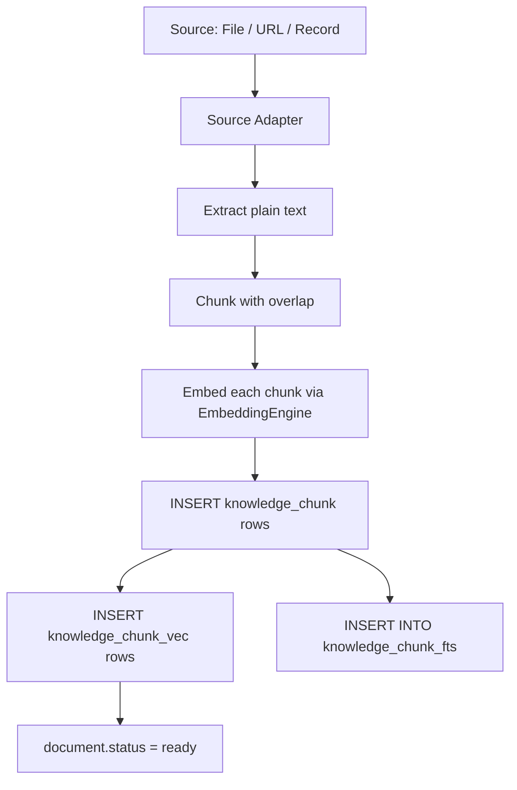

# Knowledge Store (Implementation)

**Version:** 1.2.0
**Status:** Stable
**Layer:** implementation
**Implements:** l1-knowledge-base.md

## Overview

Concrete implementation of the knowledge base subsystem: SQLite schema for collections, directories, and documents; sqlite-vec for dense vector search; FTS5 for keyword search; RRF fusion for hybrid retrieval; an async ingestion pipeline; storage-enforced authorship zones (human/agent write boundary) and a curation lifecycle (draft→reviewed→stable); an optional query-preparation seam. Realized as tier-split Rust modules exposing a `KnowledgeStore` service (§4.7) — verified faithful to this design, including schema and table names, by direct inspection; only the module placement below was ever out of date.

## Related Specifications

- [l1-knowledge-base.md](l1-knowledge-base.md) - The concept this spec implements.
- [l2-memory-store.md](l2-memory-store.md) - Memory store also uses sqlite-vec; the embedding engine is shared.
- [l2-resource-sharing.md](l2-resource-sharing.md) - `access-grants` crate enforces KB-4 access control.
- [l2-file-store.md](l2-file-store.md) - Files are the source documents; `FileId` is referenced from `document`.
- [l2-crate-topology.md](l2-crate-topology.md) - The dependency/seam-axis decomposition (contract · domain · store-local · facade) this subsystem's real module split follows — decided after this spec's original authoring (§4.7).
- [l1-candidate-windows.md](l1-candidate-windows.md) - [ADDED v1.2.0] The window contract §4.9 realizes for the vector and keyword channels (KB-19).
- [l1-state-authority.md](l1-state-authority.md) - [ADDED v1.2.0] SAU-8, the generation discipline §4.8 realizes for an embedding-model change (KB-18).
- [l1-retrieval-evaluation.md](l1-retrieval-evaluation.md) - [ADDED v1.2.0] The fixture a building generation is compared on before the switch, and the curve the §4.9 defaults are later set from.

## 1. Motivation

The memory store is per-user, conversational, and ephemeral by design. A separate knowledge store handles structured, long-lived, shared reference material that survives sessions and can be queried by multiple workers. Splitting the two keeps each concern clean and avoids embedding RAG pipeline complexity in the memory crate.

## 2. Constraints & Assumptions

- Ingest and query use the embedding model the active index generation records (model, dimension, metric); a query embedded under another identity is refused, and a model change builds a new generation beside the live one (§4.8, KB-18).
- sqlite-vec vector tables are per-database-file and all collections live in one DB file. The vector table is not partitioned today, so collection scope and readiness are applied after the vector search — a post-filter KB-19 bounds (§4.9). The pinned sqlite-vec build scans exhaustively (no approximate index), which makes a scan restricted to the eligible chunks cheaper than any window over the whole table.
- Ingestion is async and non-blocking to the caller; status is polled or subscribed via the event bus.
- Web URL sources are scraped at ingest time (one-shot); incremental re-scrape is a scheduled task.
- Authorship (`origin`) and curation (`curation`) are enforced at the store write seam, not by caller discipline: a human-zone write requires an explicit audited override, and a curation promotion to `reviewed`/`stable` requires human authorization.

## 3. Invariant Compliance (Layer 2)

| L1 Invariant | Implementation |
| --- | --- |
| KB-1 Collection isolation | Every ANN and FTS query is scoped to explicit `collection_ids`; no implicit cross-collection search. |
| KB-2 Hierarchical organisation | `knowledge_directory` table stores the tree; retrieval queries ignore directory structure. |
| KB-3 Incremental indexing | Ingestion job operates on one document; existing chunks for that document are deleted before re-insert. |
| KB-4 Access control | `access-grants` crate `has_access(Knowledge, collection_id, Permission::Read)` checked before any query. |
| KB-5 Source types | Ingestion pipeline has three source adapters: FileIngester, UrlIngester, RecordIngester. |
| KB-6 Source attribution | Each chunk row carries `document_id`, `position`, and `source_ref` (page/section/byte). |
| KB-7 Non-authoritative recall | Retrieval API returns `(text, source_ref, score)`; no assertion of correctness in the API surface. |
| KB-8 Soft deletion | `document.status = 'deleted'`; chunks excluded from all queries; GC job deletes rows + vector entries. |
| KB-9 Authorship zones | `knowledge_document.origin` (`human`/`agent`, NOT NULL). The `KnowledgeStore` write path refuses any update/replace of an `origin = 'human'` row unless an explicit `WriteOverride::HumanDirected` token (carrying an audit reference) is supplied — enforced at the single `db.rs` write seam, not by caller convention (§4.4). Orthogonal to KB-4: access-grants gate which workers reach the collection; the origin zone gates whether the agent may rewrite human material inside it. |
| KB-10 Curation lifecycle | `knowledge_document.curation` (`draft`/`reviewed`/`stable`; NULL for `origin='human'` rows; agent docs default `draft`). The store lets the agent create/revise `draft` rows freely; a transition to `reviewed`/`stable` is refused unless the caller presents human authorization (§4.4). `RetrievalRequest.min_curation` applies a trust floor at retrieval. Editorial-trust `curation` is distinct from the indexing `status` column. |
| KB-11 Query preparation | Optional `QueryPreparer` seam runs before embedding (§4.5): keyword extraction/expansion + compound-query decomposition. The prepared and raw queries are both recorded in the retrieval trace; an empty preparation falls back to the raw query (never an empty search). Sub-queries are retrieved independently and RRF-merged (§4.3). Preparation never alters `source_ref` attribution (KB-6) nor widens the access-bounded `collection_ids` set (KB-4). |
| KB-12 Deep document understanding | **Pending.** Ingestion's "extract plain text" step (§4.2) is the degraded fallback KB-12 names; the deep-understanding stage (`l1-document-understanding`) is not wired yet, and recording the reduced fidelity per document (in `meta`) is part of the same pending work — until then every document is plain-extracted. |
| KB-13 Structure-aware segmentation | **Pending.** Chunking splits on sentence boundaries with a fixed overlap (§4.2), which is KB-13's fallback; heading breadcrumbs and atomic tables/figures arrive with KB-12. Attribution (KB-6) is already preserved per chunk. |
| KB-14 Multi-representation index | The mandatory flat chunk/vector (+FTS5) index is realized; the optional knowledge-graph and summary-tree representations are not provided, which KB-14 permits. |
| KB-15 Multi-channel fused retrieval + rerank | Vector + lexical (+ per-sub-query) channels fused by RRF (§4.3); the optional reranker is not provided. Fusion never widens `collection_ids` (KB-4) and every chunk keeps its `source_ref` (KB-6). |
| KB-16 Structured-constraint separation | Not provided (a MAY): no metadata-filter predicate is extracted from the query yet; the `meta` column exists for it. |
| KB-17 Index-side query-bridging representations | Not provided (a MAY): each chunk is indexed under its own text only. |
| KB-18 Embedding generations | **Pending.** Designed in §4.8: a `knowledge_index_generation` registry recording model, dimension and metric per generation; one vector table per generation; dual-write while a generation builds or is retained; fixture comparison (RE-7) before an atomic switch; release reclaims. Today the store holds one unversioned `knowledge_chunk_vec` table, records only the dimension (`EMBEDDING_DIM`, checked on every insert and query), and the facade's `open_with_embedder` accepts any embedder — a same-dimension model swap would mix vector spaces with no error. |
| KB-19 Scoped retrieval fills or discloses | **Pending.** Designed in §4.9: the keyword channel joins scope and readiness inside the full-text query (CW-1); the vector channel scores a small eligible set exactly and otherwise sizes its window from the scope's share and widens it (CW-2); each channel returns a depth greater than `top_k` (CW-4); a bounded stop marks the result truncated (CW-3). Today both `ann_search` and `fts_search` (`crates/store-local/src/knowledge.rs`) take a fixed `max(4·top_k, top_k + 20)` window and filter it afterwards, so a collection holding a small share of the database returns short results silently. |

## 4. Detailed Design

### 4.1 Schema

```sql
[REFERENCE]
-- Collections
CREATE TABLE knowledge_collection (
    id          TEXT PRIMARY KEY,          -- col/ prefix
    owner_id    TEXT NOT NULL,
    name        TEXT NOT NULL,
    description TEXT NOT NULL DEFAULT '',
    meta        TEXT,                      -- JSON
    created_at  INTEGER NOT NULL,
    updated_at  INTEGER NOT NULL
);

-- Directory tree (optional per-collection hierarchy)
CREATE TABLE knowledge_directory (
    id            TEXT PRIMARY KEY,        -- kdir/ prefix
    collection_id TEXT NOT NULL REFERENCES knowledge_collection(id),
    parent_id     TEXT REFERENCES knowledge_directory(id),
    name          TEXT NOT NULL,
    created_at    INTEGER NOT NULL,
    updated_at    INTEGER NOT NULL,
    UNIQUE (collection_id, parent_id, name)
);
CREATE INDEX ix_kdir_collection ON knowledge_directory(collection_id);

-- Documents (one per source file/URL)
CREATE TABLE knowledge_document (
    id            TEXT PRIMARY KEY,        -- doc/ prefix
    collection_id TEXT NOT NULL REFERENCES knowledge_collection(id),
    directory_id  TEXT REFERENCES knowledge_directory(id),
    source_file_id TEXT,                   -- FileId if source is an uploaded file
    source_url    TEXT,                    -- URL if source is a web page
    name          TEXT NOT NULL,
    status        TEXT NOT NULL DEFAULT 'pending',  -- pending|indexing|ready|error|deleted (index state)
    origin        TEXT NOT NULL DEFAULT 'agent',    -- human|agent authorship zone (KB-9)
    curation      TEXT,                             -- draft|reviewed|stable (KB-10); NULL for origin='human'
    error_msg     TEXT,
    meta          TEXT,                    -- JSON: word count, language, custom tags
    created_at    INTEGER NOT NULL,
    updated_at    INTEGER NOT NULL
);
CREATE INDEX ix_kdoc_collection ON knowledge_document(collection_id);
CREATE INDEX ix_kdoc_status     ON knowledge_document(status);
CREATE INDEX ix_kdoc_curation   ON knowledge_document(collection_id, curation);

-- Chunks (split from documents)
CREATE TABLE knowledge_chunk (
    id          TEXT PRIMARY KEY,          -- chk/ prefix
    document_id TEXT NOT NULL REFERENCES knowledge_document(id),
    text        TEXT NOT NULL,
    position    INTEGER NOT NULL,          -- ordinal within document
    source_ref  TEXT,                      -- JSON: {page?, section?, byte_start?, byte_end?}
    created_at  INTEGER NOT NULL
);
CREATE INDEX ix_kchunk_doc ON knowledge_chunk(document_id);

-- FTS5 virtual table for keyword search
CREATE VIRTUAL TABLE knowledge_chunk_fts USING fts5(
    text,
    content='knowledge_chunk',
    content_rowid='rowid'
);

-- Embedding index generations (KB-18, §4.8): one row per derivation of the vector index
CREATE TABLE knowledge_index_generation (
    generation   INTEGER PRIMARY KEY,      -- monotonic
    model_id     TEXT NOT NULL,            -- embedding model identity as the embedding seam reports it
    dimension    INTEGER NOT NULL,
    metric       TEXT NOT NULL,            -- distance metric the generation's vector table uses
    state        TEXT NOT NULL,            -- building|active|retained|released
    identity_src TEXT NOT NULL,            -- recorded|assumed (a pre-generation table adopted at migration)
    comparison   TEXT,                     -- retrieval-evaluation run reference + verdict, or 'unmeasured'
    created_at   INTEGER NOT NULL,
    activated_at INTEGER,
    released_at  INTEGER
);

-- sqlite-vec virtual table, one per live generation (dense vectors)
-- Dimension comes from the generation row, not from a compile-time constant
CREATE VIRTUAL TABLE knowledge_chunk_vec_g{generation} USING vec0(
    chunk_id TEXT PRIMARY KEY,
    embedding FLOAT[{dimension}]
);
```

### 4.2 Ingestion Pipeline



**Chunking parameters (defaults, configurable per collection):**

| Parameter | Default |
| --- | --- |
| Chunk size | 512 tokens |
| Overlap | 64 tokens |
| Splitter | Sentence boundary (Unicode sentence segmentation) |

**Re-indexing a document (KB-3):**

1. Delete all `knowledge_chunk` rows for the document.
2. Delete matching `knowledge_chunk_fts` entries and the matching rows of every live generation's vector table (building, active and retained — §4.8); the fresh chunks are embedded under each of those generations' models.
3. Set `document.status = 'indexing'`.
4. Run the ingestion pipeline fresh.

### 4.3 Retrieval

```rust
[REFERENCE]
pub struct RetrievalRequest {
    pub query        : String,
    pub collection_ids: Vec<CollectionId>,
    pub top_k        : usize,             // default 5
    pub min_score    : Option<f32>,       // default 0.0
    pub min_curation : Option<Curation>,  // KB-10 trust floor; None = no filter
}

pub struct RetrievedChunk {
    pub chunk_id    : ChunkId,
    pub document_id : DocumentId,
    pub collection_id: CollectionId,
    pub text        : String,
    pub source_ref  : Option<SourceRef>,
    pub score       : f32,
}

pub struct RetrievalResult {                    // [ADDED v1.2.0] KB-19
    pub chunks    : Vec<RetrievedChunk>,
    pub truncated : Option<Truncation>,         // Some only when a hard bound stopped a channel short (CW-3)
}

pub struct Truncation {
    pub channel : Channel,                       // vector | keyword | sub-query n
    pub bound   : usize,                         // the bound that stopped it
    pub returned: usize,
}
```

**Retrieval steps:**

1. (KB-11, optional) Prepare the query via the `QueryPreparer` (§4.5): derive `retrieval_query` + any `subqueries`, falling back to the raw query when preparation yields nothing usable. With no preparer wired, use the raw query unchanged.
2. Embed the prepared (or raw) query — and each sub-query — via `EmbeddingEngine`. The query's embedding identity must equal the active generation's (§4.8); otherwise the request fails as not comparable rather than returning a ranking from another vector space.
3. Vector channel over the active generation's table, eligibility = chunks of ready, non-deleted documents in the target `collection_ids` (and the `min_curation` floor). Return a window of depth `D` per §4.9 — exact restricted scoring for a small eligible set, otherwise a window sized from the eligible share and widened.
4. Keyword channel: FTS5 search in `knowledge_chunk_fts` with the same eligibility joined inside the query, so its `LIMIT D` counts eligible chunks only (§4.9).
5. Merge the vector, keyword, and per-sub-query result sets using Reciprocal Rank Fusion (RRF, k=60).
6. Apply the `min_curation` trust floor (KB-10): drop chunks whose document `curation` is below the requested level; `origin='human'` rows (NULL curation) are treated as always-eligible authoritative sources.
7. Deduplicate by `chunk_id`, trim to `top_k`, apply `min_score` filter.
8. Return `RetrievalResult`: the chunks, and a `Truncation` only when a channel's hard bound stopped it before it filled (KB-19). A list shorter than `top_k` without a truncation mark means fewer eligible matches exist, or the caller's own `min_score` removed them.

### 4.4 Authorship Zones & Curation Lifecycle (KB-9 / KB-10)

Two orthogonal columns on `knowledge_document` govern how the agent may write, layered on the indexing `status`. Both are enforced at the store's single write seam (`db.rs`), so the boundary survives agent drift rather than living in a prompt.

**Authorship zone (KB-9).** `origin` places each document in a write-zone. Human-authored rows are agent-read-only; a write is refused unless the caller presents an explicit override — a typed token, never a default flag:

```rust
[REFERENCE]
pub enum WriteOverride {
    None,
    HumanDirected { audit_ref: AuditRef },   // user-directed correction routed through the agent
}

fn write_document(doc: &Document, ov: WriteOverride) -> Result<(), StoreError> {
    if let Some(existing) = get_document(doc.id)? {
        if existing.origin == Origin::Human && matches!(ov, WriteOverride::None) {
            return Err(StoreError::ReadOnlyZone);   // KB-9: refused at the store, not discouraged
        }
    }
    persist(doc)
}
```

`origin` is assigned from the ingestion source at document creation — an uploaded file or human-owned record is `human`, an agent-synthesized document is `agent` — not chosen by a later agent write, so the agent cannot mint a `human` row to smuggle authority. A **URL** source takes the origin of whoever added it: a page a person added to the collection is `human`; a page the agent fetched and ingested on its own initiative is `agent` with `curation = 'draft'`. Otherwise external content the agent chose would join the always-eligible authoritative set of §4.3 step 6 and pass every `min_curation` floor. The `HumanDirected` override carries an `audit_ref` so every write into a human zone is attributable on the durable audit path — the override is audited, never a silent default.

**Curation lifecycle (KB-10).** Agent-synthesized rows carry `curation` advancing `draft → reviewed → stable`. The agent owns `draft`; advancing requires human authorization presented to the store:

```rust
[REFERENCE]
fn set_curation(id: DocumentId, next: Curation, auth: Option<HumanAuth>) -> Result<(), StoreError> {
    match (next, auth) {
        (Curation::Draft, _)                             => transition(id, next),  // agent-free
        (Curation::Reviewed | Curation::Stable, Some(_)) => transition(id, next),
        (Curation::Reviewed | Curation::Stable, None)    => Err(StoreError::HumanApprovalRequired),
    }
}
```

A new agent document defaults to `curation = 'draft'`; `origin = 'human'` rows leave `curation` NULL (editorial trust is an agent-document concept). Retrieval's `min_curation` filter (§4.3) lets a high-trust query exclude provisional `draft` chunks while keeping authoritative human sources always eligible.

### 4.5 Query Preparation (KB-11)

An optional preparation step sits between the caller's request and the embedding/search. It reshapes the query to improve recall but never narrows the caller's reach:

```rust
[REFERENCE]
pub trait QueryPreparer {
    /// Returns the prepared retrieval query plus any sub-queries; may return the
    /// input unchanged. MUST NOT touch collection scope or attribution.
    fn prepare(&self, raw: &str, meta: &CollectionMeta) -> PreparedQuery;
}

pub struct PreparedQuery {
    pub retrieval_query: String,       // == raw when preparation yields nothing usable
    pub subqueries     : Vec<String>,  // empty when the query is atomic
    pub raw            : String,       // always preserved for transparency + fallback
}
```

Three guarantees, all testable:

1. **Transparent** — the prepared query and the raw query are recorded together in the retrieval trace, so a reader sees exactly what was searched; a poor preparation is diagnosable, not invisible.
2. **Fallback-floored** — an empty or failed preparation degrades to `raw`; it can improve recall but never turns a real query into an empty search.
3. **Scope-preserving** — preparation reshapes the query only. Each sub-query is retrieved independently and the results RRF-merged (§4.3); every chunk still carries its own `source_ref` (KB-6) and access stays bounded by the caller's `collection_ids` (KB-4). Preparation never widens the accessible set.

Preparation is opt-in: with no `QueryPreparer` wired, retrieval embeds the raw query directly — the degenerate, always-available path.

### 4.6 Soft Delete and GC

- `DELETE /document/:id` sets `document.status = 'deleted'`. Chunks are excluded from all queries via `JOIN knowledge_document WHERE status != 'deleted'`.
- A GC job (runs at startup and periodically) finds documents with `status = 'deleted'` older than the retention window, deletes their `knowledge_chunk`, `knowledge_chunk_vec`, and `knowledge_chunk_fts` entries, then deletes the document row.

### 4.7 Module Layout

**Today (real):** this spec's original design assumed a single dedicated `crates/knowledge-store/`
crate. `l2-crate-topology.md` (authored after this spec, 2026-07-10) later decomposed the whole
workspace on the dependency/seam axis instead (contract · domain · store-local · facade) — so
knowledge lives split across that decomposition, not in a crate of its own:

```plaintext
crates/store-local/src/knowledge.rs        // schema, SQLite queries, sqlite-vec, FTS5,
                                            // authorship-zone + curation write guards (§4.1, KB-9/10)
crates/domain/src/knowledge_access.rs      // GatedKnowledge — KB-4 access-grant check before every query
crates/domain/src/knowledge_ingest.rs      // ingestion pipeline + EmbeddingBackend seam (§4.2)
crates/domain/src/knowledge_retrieval.rs   // hybrid search + RRF fusion (§4.3)
crates/core/src/knowledge_bootstrap.rs     // facade wiring
crates/core/tests/knowledge_invariants.rs  // KB-1…KB-11 integration coverage
```

The schema (table names, columns, indices), the authorship-zone and curation write guards, and
the retrieval flow all verified faithful to §4.1–§4.6 by direct inspection — this spec's content
was never wrong, only its assumption of a single dedicated crate.

**As originally specified (superseded):**

```plaintext
crates/
└── knowledge-store/
    ├── src/
    │   ├── lib.rs            // KnowledgeStore service
    │   ├── model.rs          // Collection, Document (origin/curation), Chunk, RetrievalRequest, …
    │   ├── db.rs             // SQLite queries; authorship-zone + curation write guards (KB-9/KB-10)
    │   ├── ingest/
    │   │   ├── mod.rs
    │   │   ├── file.rs       // FileIngester
    │   │   ├── url.rs        // UrlIngester (HTTP fetch + HTML→text)
    │   │   └── record.rs     // RecordIngester (plain text / JSON)
    │   ├── query_prep.rs     // QueryPreparer seam (KB-11); no-op default
    │   ├── retrieval.rs      // query prep → hybrid search + RRF fusion + min_curation filter
    │   └── gc.rs             // soft-delete garbage collector
    ├── tests/
    │   └── integration.rs
    └── benches/
        └── retrieval_bench.rs
```

### 4.8 Embedding Generations (KB-18) `[ADDED v1.2.0]`

The vector index is a projection of `knowledge_chunk.text` (`l1-state-authority` SAU-8). Its derivation identity is the triple *(model, dimension, metric)*; the embedding seam reports the model identity alongside each vector, so the store compares identities rather than lengths.

```text
[REFERENCE]
begin_generation(model):                                   // explicit admin action (KB-3)
    g := insert knowledge_index_generation(model_id, dimension, metric, state = building)
    create knowledge_chunk_vec_g{g}
    // from now on every ingest / re-index writes vectors to: building, active, retained

backfill(g):                                               // background, resumable, idempotent by chunk_id
    for batch of ready chunks lacking a row in knowledge_chunk_vec_g{g}:
        insert embed(batch, g.model_id)
    complete when count(rows in g) == count(ready chunks)

switch(g):
    verdict := retrieval_evaluation(fixture, variants = [active, g])        // RE-7, same fixture and K
    if no fixture: verdict := 'unmeasured'                                  // recorded, never 'passed'
    if verdict regresses beyond the RE-6 threshold and the user has not directed the switch:
        keep g building-complete; report the comparison; stop
    in one transaction: active -> retained; g -> active; record comparison, activated_at

revert():  in one transaction: active -> retained; most recent retained -> active   // no re-embedding
release(g): drop knowledge_chunk_vec_g{g}; g -> released                            // writes to g stop

query(q):
    if q.embedding_identity != active.identity: fail IncomparableEmbedding{active, query}
```

- **One active generation per knowledge database.** `[DR]` The whole database shares one embedding model, matching today's single-dimension rule; per-collection models would turn every cross-collection query into a merge of incomparable scores. Collection isolation (KB-1) is unaffected — scope is eligibility (§4.9), not a model boundary.
- **Migration of the pre-generation table.** On first open of a database holding the unversioned `knowledge_chunk_vec`, it is adopted as generation 1 with the identity of the configured embedder and `identity_src = 'assumed'`; the status surface shows that the identity was assumed, not recorded.
- **Cost.** While a generation builds or a predecessor is retained, each ingested chunk is embedded once per live generation, and vector storage holds one table per live generation. Releasing the predecessor ends both.

<!-- TBD: command-surface binding for begin / switch / revert / release (CLI + TUI parity under the invocable registry), and the default retention period after which a retained generation is offered for release -->

### 4.9 Candidate Windows (KB-19) `[ADDED v1.2.0]`

Each channel returns a window of depth `D` — the input depth fusion and reranking see (CW-4) — with eligibility applied as `l1-candidate-windows` requires. Eligibility `E` is: chunk of a document in the target `collection_ids`, `status = 'ready'`, meeting `min_curation`.

**Keyword channel (CW-1).** FTS5 can evaluate eligibility inside its own query: the `MATCH` is joined to `knowledge_chunk` → `knowledge_document` with the eligibility predicate in the same statement, ordered by rank, `LIMIT D`. Exact; no post-filter and no widening.

**Vector channel (CW-2).** The vector table holds no collection or status column, so eligibility cannot be evaluated by the vector search itself:

```text
[REFERENCE]
vector_window(q, D):
    E := eligible chunk ids                     // one indexed query over chunk + document
    T := row count of the active generation's table
    F := first_window(D, |E|, T, miss)          // l1-candidate-windows §4.2
    if |E| <= F:                                // the eligible set is no larger than the window
        return exact(E, q, D)                   // primary-key lookups, same metric as the table
    loop:
        W := knn(q, k = F)
        R := [c in W where c in E]
        if |R| >= D or |W| < F: return take(R, D)
        if F >= KNN_BOUND: return exact(E, q, D)    // the restricted scan never truncates
        F := min(2·F, KNN_BOUND)
```

Because the pinned build scans exhaustively, `exact(E)` touches |E| vectors where any KNN touches all T, so the exact path is both correct and cheaper whenever the eligible set is a small share; widening exists for the large-share case, where it rarely runs.

**Defaults (estimates, CW-5).** `D = max(4·top_k, top_k + 20)` — today's constant, kept as the fusion depth rather than as a post-filter window; `miss = 0.01`; growth ×2; `KNN_BOUND` = the build's maximum KNN `k`. All are labelled estimates until the knowledge-base fixture measures recall against `D` and the switch point between exact and windowed scoring.

**Measured option (CW-6).** Declaring `collection_id` as a partition key and readiness as a metadata column of the vector table would let the engine restrict its own scan; a multi-collection query would run one search per collection and merge by distance. Adopted only if a measurement shows the restricted scan above is the bottleneck.

<!-- TBD: confirm against the pinned sqlite-vec build the maximum KNN `k` (`KNN_BOUND`) and which predicates its partition-key and metadata columns accept (equality is documented; `IN` is not confirmed) -->

## 5. Implementation Notes

1. The `EmbeddingEngine` is shared with `crates/memory-store`; import from a shared `crates/embeddings` crate (or trait object) to avoid duplicating the model-load logic.
2. Post-filtering a fixed vector window by `collection_id` returns short results for a collection holding a small share of the database; §4.9 replaces it with exact restricted scoring and a sized, widened window (KB-19). A partitioned vector table is the measured option (CW-6), not the default.
3. Web scraping in `UrlIngester` should respect `robots.txt` and rate-limit requests.
4. Mark ingestion jobs with a correlation ID so status can be polled via the document `status` field without a separate job-tracking table.
5. Authorship-zone (KB-9) and curation (KB-10) checks live at the single `db.rs` write seam, never in the ingestion adapters or the service layer, so no caller can bypass them. The `WriteOverride::HumanDirected` path records an `audit_ref`; a human-zone write with no audit reference is a bug, not a fast path.
6. Query preparation (KB-11) is a pure `QueryPreparer` seam with a no-op default; a wired preparer (keyword expansion / decomposition) is model-backed and MUST honor the fallback-to-raw floor so a preparer outage degrades recall rather than breaking retrieval.

## 7. Drawbacks & Alternatives

- **Separate ANN index per collection:** stronger KB-1 isolation and no post-filter degradation, but more tables and more complex schema migration — and, with generations (§4.8), one table per collection per live generation. The single-membership partition key of CW-6 gives the same restriction inside one table; neither is needed until §4.9's exact restricted scan is measured as the bottleneck.
- **Purge-then-rebuild on a model change:** the previous rule. Rejected by KB-18: the collection answers from nothing or from two vector spaces during the rebuild, and a worse model costs a second full rebuild to undo.
- **External vector DB (e.g., Qdrant):** better ANN at scale, but adds an operational dependency. sqlite-vec keeps the system embeddable.

## Canonical References

| Alias | Path | Purpose |
| --- | --- | --- |
| `[L1]` | `.design/main/specifications/l1-knowledge-base.md` | Invariants KB-1…KB-19. |
| `[WINDOWS]` | `.design/main/specifications/l1-candidate-windows.md` | CW-1…CW-6, the window contract §4.9 realizes. |
| `[MEMORY]` | `.design/main/specifications/l2-memory-store.md` | Shared EmbeddingEngine pattern and sqlite-vec usage. |
| `[FILES]` | `.design/main/specifications/l2-file-store.md` | FileId referenced in knowledge_document. |
| `[SHARING]` | `.design/main/specifications/l2-resource-sharing.md` | Access grant enforcement for collections. |
| `[REAL]` | `crates/store-local/src/knowledge.rs` | The real schema/store module — confirms table names and column shapes match §4.1 exactly. |

## Document History

| Version | Date | Author | Notes |
| --- | --- | --- | --- |
| 1.2.0 | 2026-10-21 | Core Team | Realizes parent `l1-knowledge-base` 1.6.0. KB-18 (§4.8): `knowledge_index_generation` registry (model, dimension, metric, state, identity source, comparison), one vector table per live generation, dual-write while building or retained, RE-7 fixture comparison before an atomic switch, revert as a switch, release reclaims; the pre-generation table adopted as generation 1 with an *assumed* identity; `[DR]` one active generation per database. KB-19 (§4.9): keyword channel joins eligibility inside the FTS5 query; vector channel scores a small eligible set exactly and otherwise sizes and widens its window, never truncating because the restricted scan is the fallback; `RetrievalResult` carries a `Truncation` mark; defaults labelled estimates. Both rows **Pending** against code: one unversioned vector table checked only by dimension, and a fixed `max(4·top_k, top_k + 20)` window filtered afterwards in both channels. §2, §4.1, §4.2 re-indexing, §4.3 steps 2–4 and 8, §5 note 2, §7 updated. |
| 1.1.2 | 2026-09-23 | Core Team | Consistency pass (2026-09-23): KB-12…KB-17 compliance rows added (KB-12/13 pending — plain extraction and sentence-window chunking are the named fallbacks; KB-14…17 optional parts not provided). URL-ingested pages had no defined origin: a page a person added is `human`, one the agent fetched on its own is `agent`/`draft` — otherwise agent-chosen web content joined the always-eligible set and bypassed every `min_curation` floor. Canonical reference range corrected. |
| 1.1.1 | 2026-09-12 | Core Team | **Module-placement correction** (Retro L2 finding, `/magic.spec main`): this spec's §4.7 assumed a single dedicated `crates/knowledge-store/` crate, minted before `l2-crate-topology.md` (2026-07-10) later decomposed the whole workspace on the dependency/seam axis instead. The subsystem was built correctly against that later decision — split across `crates/store-local/src/knowledge.rs`, `crates/domain/src/knowledge_{access,ingest,retrieval}.rs`, and `crates/core/src/knowledge_bootstrap.rs` — but §4.7 and the dead `l2-source-layout.md` citation (a spec that never covered this placement) were never updated to say so. Verified by direct inspection that the schema, table names, authorship-zone/curation guards, and retrieval flow all match §4.1–§4.6 exactly — this correction touches only the module-layout claim; no invariant, schema, or behavior description changes. |
| 1.1.0 | 2026-07-18 | Core Team | Completed Invariant Compliance to the full KB-1…KB-11 parent (`l1-knowledge-base` v1.2.0). KB-9 authorship zones (`knowledge_document.origin` + store-enforced read-only human zone with an audited `WriteOverride::HumanDirected` token, §4.4). KB-10 curation lifecycle (`knowledge_document.curation` draft→reviewed→stable, human-gated transitions, `RetrievalRequest.min_curation` trust floor, §4.4). KB-11 query preparation (`QueryPreparer` seam with fallback-to-raw floor, transparent prepared+raw recording, sub-query RRF merge, §4.5). Schema gains `origin`/`curation` columns + `ix_kdoc_curation`; retrieval flow gains the prep step + curation filter. Reconciled the stale "Pending (v1.1.0 parent)" rows — the parent has defined KB-9/KB-10 since v1.1.0 and KB-11 since v1.2.0. Promoted RFC→Stable. |
| 1.0.0 | 2026-06-25 | Core Team | Initial RFC — SQLite schema (collection/directory/document/chunk), sqlite-vec ANN, FTS5 keyword, RRF hybrid fusion, async ingestion (file/URL/record adapters), soft-delete GC, crate layout. KB-1…KB-8 compliant; KB-9/KB-10 deferred pending the parent invariants. |
