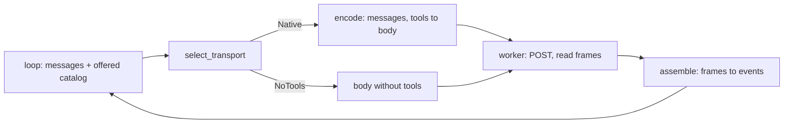

# Tool-Call Transport Realization

**Version:** 1.0.0
**Status:** Stable
**Layer:** implementation
**Implements:** l1-tool-call-transport.md

## Overview

The concrete realization of the tool-call transport in the Rust workspace: how the tools a turn may use are advertised to a model, how a tool request is decoded out of the model's reply, how a result is handed back, and what a turn does when the backend cannot carry tool calls at all. It is the missing implementation spec that `l2-agent-runtime` names as a precondition of its first tool-using slice.

It owns the **wire** and nothing above it. Which tools are offered (the runtime, from the registry's declared reach and effect), whether a call may run (the decision path), and what the loop does with a result (`l2-agent-session` §4.6) belong to their own specs. The transport takes a catalog it is handed, renders it for the backend's idiom, and turns the backend's output into logical events the loop consumes without ever seeing the wire form (TCT-1).

Nothing here is built. The tree has the beginnings of the logical events (a tool-call stream event that no code produces) and nothing else; §4.9 lists exactly what exists, what is specified here and what is Pending. The first slice (W1) carries tool calls natively over the OpenAI-compatible protocol family; the text-encoded transport is fully specified here and built in a later slice (W2), so that a backend without native support is, for now, a visible limit of the turn and not yet the "never a dead end" the concept promises.

## Related Specifications

- [l1-tool-call-transport.md](l1-tool-call-transport.md) - The parent concept: TCT-1…TCT-11, each addressed in §3.
- [l2-model-runtime.md](l2-model-runtime.md) - The inference trait, the stream contract and the loopback transport this spec extends with tool carriage (§4.2.1 there points here).
- [l2-agent-runtime.md](l2-agent-runtime.md) - The composition that wires this transport in front of the decision path; owner of the offered catalog's filters and of slice R1.
- [l2-agent-session.md](l2-agent-session.md) - The tool-call loop (§4.6), which consumes only the logical events defined here, and the session journal (§4.15), which records them.
- [l2-invocable-registry.md](l2-invocable-registry.md) - The descriptor and its binders (IB-1), from which every advertisement is rendered; binding and rejection (§4.6) turn decoded arguments into a typed result; reach and declared effect (§4.2.1) decide what is offered.
- [l1-input-binding.md](l1-input-binding.md) - IB-2…IB-5, the four rejection modes a malformed call is answered with.
- [l2-tool-security.md](l2-tool-security.md) - The tool policy that hides tools before they reach the transport (§4.5) and the framing of untrusted results the transport carries as data (§4.6).
- [l2-model-router.md](l2-model-router.md) - The model decision the transport serves; the source of a per-model declaration of tool support.
- [l2-model-error-recovery.md](l2-model-error-recovery.md) - Owns retry, rotation and fallback; the transport reports failures onto its taxonomy and never retries.
- [l1-context-provenance.md](l1-context-provenance.md) - CP-1/CP-2, the trust boundary TCT-10 is built on.
- [l1-output-contracts.md](l1-output-contracts.md) - OCT-4, the retry-budget discipline malformed-call repair follows.
- [l1-tool-composition.md](l1-tool-composition.md) - TC-2's single schema source; in this workspace that source is the registry descriptor (§4.3).
- [l1-agent-tool-ergonomics.md](l1-agent-tool-ergonomics.md) - The quality of what an advertisement says is bounded by the quality of the descriptors behind it.
- [l2-crate-topology.md](l2-crate-topology.md) - The tier rules (§4.1, §4.3) that place each piece below.

## 1. Motivation

Read from the tree on 2026-10-23, the path from a turn to a model carries no tool at any layer.

- **The request is one flat prompt.** `GenerateRequest` is a model name, one prompt string and opaque string parameters. The loopback transport sends it as a single user message (`build_request_body` in `crates/model-local/src/lib.rs`). There is no field for tool declarations and none for a structured conversation, so a tool result could not be handed back as anything but more prompt text.
- **The reply is read for text only.** The stream parser takes `choices[0].delta.content` and nothing else. The stream-event enum already names `ToolCall` (name and raw arguments, no correlation id) and `Usage`, but no code in the transport produces either. The chat turn treats a `ToolCall` as a failed turn. Without `Usage` the turn's token ceiling (`l2-agent-session` §4.2) could not see what a call cost.
- **Nothing says whether a model can call tools.** The endpoint profile's capability flags are streaming, embeddings, pull, residency control and digest reporting; the model descriptor carries name, digest, size and parameter count. Tool support is a property of an endpoint *and* a model, and neither records it.
- **No module encodes or decodes a tool call.** Not in the contract tier, not in the domain tier, not in an adapter.

Left like this, the first tool-using loop would parse the backend's tool-call JSON itself, once, inside the loop — the exact leak of wire form into the loop that TCT-1 exists to forbid — and every later backend would be a branch in that loop. This spec puts the wire behind one seam before the first caller exists.

## 2. Constraints & Assumptions

- **The core is synchronous** (`l2-crate-topology` §2). The transport adds no async runtime and no thread of its own: the existing per-request worker reads the connection, and the pure functions below run on the caller's thread.
- **Tier placement is fixed by what each piece does** (`l2-crate-topology` §4.1). Types are ports-tier. Encode, decode, schema rendering, selection and argument decoding perform no I/O and live in the domain tier, which admits `serde_json` for reading and writing text the caller hands it (§4.3 there; the consumer row for the translation modules is added by the first slice that writes them). Reading and writing the connection stays in `model-local`. No new crate is minted.
- **Loopback first.** The shipped chat endpoint is loopback only. This spec adds no egress: for a remote profile the advertisement and every tool result are part of what the call sends, covered by the same endpoint-scoped egress grant as the rest of the request (`l2-model-runtime` §4.4), and no remote profile carries tools until a later slice enables it.
- **No argument value or tool output is ever logged.** The transport's diagnostics carry wire names, sizes, counts and reasons, never the content of arguments or results (INV-7).
- **The transport advertises exactly the catalog it is handed.** It never widens it, never adds a tool the runtime did not offer and never offers one the tool policy hid.
- Statements about what exists are dated 2026-10-23 and are re-read before a slice is decomposed.
- **Assumption (forecast): native carriage first.** The first local models used are assumed to accept the OpenAI-compatible `tools` field and answer with structured calls. Runner-up: build the encoded transport first, as the concept's implementation note suggests. Override: `/magic.spec amend l2-tool-call-transport "encoded first"`. Reason: if the premise is wrong, a native-only first slice withholds tools visibly (§4.8); an unaudited text decoder as the first tool path is the injection surface TCT-10 describes.
- **Assumption (forecast): unknown support is not offered.** Where nothing establishes that a model can call tools, the catalog is withheld and the turn says how to declare support. Runner-up: offer anyway and let a refusal from the server mark the model unsupported. Override: `/magic.spec amend l2-tool-call-transport "offer when unknown"`. Reason: a server that silently ignores the field would let a model describe a tool call in prose, which reads as an action that never happened. The premise applies to W1 only: once W2 exists, unknown support selects the encoded transport (§4.4). No such occurrence has been observed or cited in this project, which is why this is a forecast premise and not a rule; the cost to the person is one declaration per model (§4.4), and the runner-up is the weaker form if that cost proves too high.

## 3. Invariant Compliance (Layer 2 only)

Each row says what is **built**, what is **Pending**, and where the design is.

| L1 Invariant | Implementation |
| --- | --- |
| TCT-1 Logical/wire separation | **Partly built.** The logical events are ports-tier types (§4.2): a message list (system, user, assistant carrying its calls, tool result) and the stream events `ToolCall` with a `call_id`, and `Reasoning`. Built: a `ToolCall` event with name and raw arguments and no `call_id`, produced by nothing. The loop and the journal hold only these; no wire name, delimiter, `tool_calls` field or server-supplied id appears above the adapter (the server's id is kept inside the transport, §4.5). A source-tree assertion pins it (§4.10). |
| TCT-2 Deterministic bidirectional translation | **Pending.** Native: a pure request builder (messages and tools to a JSON body) and a pure assembler over parsed stream frames. Encoded: a pure renderer and a pure state machine (§4.6). None holds loop state or performs I/O; the worker feeds them. Round-trip tests over a corpus of call sets (none, one, many, nested arguments, empty arguments, arguments containing delimiter look-alikes) for both transports (§4.10). |
| TCT-3 Capability-detected selection with recorded override | **Partial by design.** One pure function chooses Native, Encoded or NoTools from the profile's flag, the model's recorded support, an optional override and the offered catalog (§4.4). The choice, its reason and the profile identity are recorded on the turn. In W1 the Encoded branch does not exist, so a model without native support gets NoTools with a reason; the concept's "never a dead end" becomes true when W2 lands. Until then it is a dead end for tool use only, never for the turn, and the turn says so (§4.8). |
| TCT-4 Single schema source, transport-idiomatic advertisement | **Pending.** One function renders a transport-neutral schema from a registry descriptor (name, summary, binders); the native transport serializes it as a tool list, the encoded transport as a description block. Nothing authors a second description. In this workspace the single source TC-2 names is the descriptor and its binders (IB-1), not a toolkit's dispatcher schema (§4.3). |
| TCT-5 Reasoning isolation | **Pending.** A separate reasoning field in the reply becomes `Reasoning` events (W1); thought spans a server inlines into the reply text are lifted out by the profile's thought delimiters before the reply text is assembled and before any encoded call is parsed (W2; until then they stay in the reply text). Native calls are read only from the structured field, so a thought cannot become a call on that transport by construction (§4.5, §4.6). |
| TCT-6 Multi-call fidelity | **Pending.** Calls are accumulated per index and emitted in index order, each with its own `call_id`; the encoded decoder emits every complete span in order. Nothing is merged, dropped or reordered; dispatch order is the loop's (§4.5). |
| TCT-7 Streaming-safe incremental decode | **Pending.** Native: argument fragments accumulate by index and a call is emitted only when its message finishes; encoded: a hold-back state machine withholds anything that could be the start of a protocol token. A stream that ends or is cancelled inside a call emits no call; the first is a typed error, the second the existing `Cancelled` ending (§4.5, §4.6). |
| TCT-8 Malformed-call containment | **Pending.** Four typed outcomes — unparseable, unknown tool, wrong shape, rejected by binding — each becomes the call's result, naming the mode and location from the registry's rejection vocabulary and never echoing the offending value. Consecutive malformed calls are bounded; a spent budget ends the repair, not the process (§4.7). |
| TCT-9 Result re-injection symmetry | **Pending.** A result returns by the idiom its call left by: a tool-role message carrying the call's id (native) or a result block (encoded). The journal stores only logical messages, and every turn re-renders history for the transport selected for that turn, so a switch between turns changes bytes, never the conversation (§4.5, §4.6). |
| TCT-10 Provenance-gated decode | **Pending.** The decoder is handed the event stream of the one in-flight generation and nothing else. Native: the structured call field is not user-writable text. Encoded: every delimiter in text that did not come from the model's own channel in this generation — user text, tool results, retrieved text, earlier assistant prose — is neutralized when rendered, and only the encoder writes live delimiters, from logical calls (§4.6). A look-alike corpus pins it (§4.10). |
| TCT-11 Advertisement is a projection; validation is canonical | **Pending; binds little today.** Binder-derived schemas are flat objects, so the default profile reduces nothing but description length, and a tool whose entry exceeds the profile's size cap is withheld rather than cut into an invalid shape. Calls are always validated by the registry's binding against the canonical binder list. The profile's identity and a content-bound identity of the advertised catalog are recorded per turn. Verification after the server's own conversion is a probe owed by the first slice that enables a provider (§4.3.1). |

> This table is complete: every TCT invariant has a row.

## 4. Detailed Design

### 4.1 Placement

```plaintext
crates/
├── contract/      logical events and request shape (ports tier): messages, tool schema,
│                  call/reasoning stream events, tool-support fact, selection and override types
├── domain/        pure translation (no I/O): schema rendering, wire-name table, selection,
│                  argument-text decoding, encoded render and decode state machine
├── model-local/   the wire (adapter): native request body, stream-frame parsing, profile flags
└── core/          composition: the turn builds the request, the loop consumes the events
```

Dependencies point inward as everywhere (`l2-crate-topology` §4.1). The domain tier depends on the contract types and on `serde_json`; it never names an HTTP type. `model-local` depends on the contract and calls the domain tier's pure functions; the facade wires both.

### 4.2 The logical model

`[REFERENCE]` — shapes, not code:

```text
Message =
    System(text)
  | User(text)
  | Assistant { text, calls: list of ToolCallRequest }     // calls empty for a plain reply
  | ToolResult { call_id, name, output: text, outcome }    // outcome: Ok | Refused | Failed

ToolCallRequest { call_id, name, arguments: text }          // arguments: the model's JSON text, undecoded

StreamEvent (existing) gains:
  ToolCall { call_id, name, arguments }                     // call_id is new
  Reasoning(text)                                           // new; never reply text, never decoded
  // Token, Usage, Done, Error unchanged; Usage becomes produced

GenerateRequest (existing) gains:
  messages: list of Message          // empty = the request is `prompt`, as today
  tools:    list of ToolSchema       // empty = no tool is offered
  transport_override: optional Native | Encoded | Off      // Off = the person asked for no tools
  next_call_ordinal: integer   // first ordinal the transport mints for this request: highest journaled + 1
Rule: `prompt` and `messages` are alternatives. A request that sets both is answered with
      Error(Unsupported) by the adapter; it never guesses which was meant.
```

- **Additive on purpose.** The chat turn, the nodus bridge and context compaction keep sending `prompt` and are unaffected apart from naming the new fields at their four construction sites; three exhaustive matches on the stream event (chat turn, bridge, compaction) gain an arm for `Reasoning`.
- **`call_id` is minted by the transport**, once per tool call in emission order across the whole turn (a turn is one user message and every model call and tool call it needs, `l2-agent-session` §2), as `c1`, `c2`, … continuing from the highest ordinal already journaled in the session, which the loop passes in with the request. Ids are therefore session-unique and journaled exactly as minted; the loop never rewrites one. A server-supplied id is kept inside the transport as the call's wire id only for the life of one response and is echoed on the result message the server requires within the same exchange; it is never trusted as an identity, because a server or a model can repeat one. History is re-rendered from the journal on every request, and there the wire id of a past call is its logical `call_id`.
- **Reasoning** is recorded in the journal as its own block and is not re-sent to the model in later requests unless the profile says its server needs it (default: not re-sent).
- **Usage** is decoded from the final frame's usage field and emitted. The turn's token ceiling needs it; today nothing emits it.
- **Arguments stay text at the seam.** The transport hands the loop the model's JSON as the model wrote it. Turning text into typed arguments is §4.7, a separate step with its own typed failures.

### 4.3 The advertised catalog

The runtime hands the transport the **offered catalog**: the registry descriptors that are agent-reachable, shipped, within the declared-effect and sink rules of the slice, and not hidden by the tool policy. The transport builds from it, once per turn, an **advertised catalog**:

```text
[REFERENCE]
render_catalog(offered, profile) -> AdvertisedCatalog
  for each descriptor:
    schema    := render_schema(descriptor)                 // the one render function (TCT-4)
    wire_name := derive_wire_name(descriptor.id)
    if wire_name is not representable or collides:  withhold(descriptor, reason)
    if size(schema) > profile.max_entry_bytes:      withhold(descriptor, schema_too_large)
  table := wire_name -> descriptor.id                      // per turn; an index, never the authority
  identity := content hash of the canonical schemas, in a fixed order
  return { entries, table, withheld, profile_id, identity }
```

- **One render function, from the binders.** The summary becomes the tool's description. Each binder becomes a named property of one flat object: a text or named-text binder a string; integer an integer; float a number; boolean and flag a boolean (a flag is never required); a repeatable named binder an array of strings; an enumerated text binder a string restricted to its values. An optional binder is not required. Positional versus named is a command-line fact the model never sees. The shipped binder carries a name, a kind and an optional marker only — `l2-invocable-registry` §4.2 says a binder has a bounded description, the contract type has none — so the advertisement says what each property is called and its type and nothing about what it means, until binders gain one (Pending; a quality limit of every advertisement, not a correctness one, `l1-agent-tool-ergonomics`).
- **Wire names are derived, checked and looked up — never parsed back.** A name is accepted when it uses only letters, digits, `_` and `-` and fits the profile's length cap (profile data; 64 by default for the OpenAI-compatible family). The derivation drops the core qualifier, joins any other qualifier with `--`, and writes each `.` of the tail as `__`: `core:board.list` is `board__list`, `myext:hello` is `myext--hello`. The table is built per turn; an entry whose derived name is unrepresentable or already taken is **withheld, not truncated or renamed**, and the core's entry wins a collision, as the registry's bare-form rule does. A call arriving with a name not in the table is an unknown tool (§4.7). Because the table is an index, a call still resolves through the registry when it runs, so a tool withdrawn mid-turn is refused even though its schema was advertised (`l2-agent-session` §4.6).
- **The catalog is built once and kept for the turn.** This keeps the prompt prefix stable for the server's cache (`l2-agent-session` §4.6, KV-cache stability); additions take effect at the next turn boundary, withdrawals at once. The one exception is a self-healing activation (`l2-agent-session` §4.6): the activated tool gets a table entry, with a wire name derived under the same rules, so the re-executed call resolves; the advertised catalog, its identity and the prompt prefix stay unchanged until the next turn boundary.
- **What the model is told it has is recorded**: the profile identity, the catalog identity and the withheld list with reasons go on the turn's record (§4.4).

#### 4.3.1 The advertisement profile (TCT-11)

An **advertisement profile** is data on the endpoint profile: an identity, a size cap per entry, a description-length cap, a depth cap, a reference budget and whether a root union is allowed. The OpenAI-compatible family ships one, `flat-v1`, fixed for the life of the process and reported with its identity.

Binder-derived schemas are flat — depth one, no shared definitions, no root union, no examples — so `flat-v1` reduces nothing but descriptions and the withholding rule above; the caps exist so the first consumer that imposes a limit finds a seam, not a rewrite. The four rules of TCT-11 hold as follows. Calls are validated against the canonical binder list by the registry's binding, whatever the advertisement said. A projection never advertises a property the binders do not declare, since it is built from them. No advertisement carries an example. Compatibility after the server's own conversion — the chat template that turns the tool list into the model's prompt — is verified by a probe against the real server where the server offers a way to read the rendered prompt; that probe is owed by the first slice that enables a provider for tools <!-- TBD: owner is the W1 task that enables the first provider profile for tools; trigger is that task's decomposition; until then no provider is enabled -->.

### 4.4 Capability, selection and the recorded transport

Tool support is a fact about an **endpoint and a model**, and two flags carry it:

```text
[REFERENCE]
Profile capability  tool_calls: bool     // this profile's adapter can carry native tool calls on its
                                         // protocol family at all (set by the code that implements it)
Model fact          tool_calling: Supported | Unsupported | Unknown
                                         // in the model descriptor, from `describe`
Override            Native | Encoded | Off                  // per request; from the person's model setting (below)

select_transport(profile, model_fact, override, offered) -> Native | Encoded | NoTools{reason}
  if offered is empty:                    NoTools{nothing_offered}
  if override == Off:                     NoTools{declined_by_override}
  if override == Native:                  profile.tool_calls ? Native : NoTools{profile_cannot_carry}
  if override == Encoded:                 W2 built ? Encoded : NoTools{encoded_not_built}
  // no override: native when both the adapter and the model allow it
  if profile.tool_calls and model_fact == Supported:  Native
  // otherwise the fallback, whose reason depends on what was missing
  if W2 built:                            Encoded
  if not profile.tool_calls:              NoTools{profile_cannot_carry}
  if model_fact == Unsupported:           NoTools{model_unsupported}
  else (Unknown):                         NoTools{support_unknown}
```

Before W2 is built the last three lines are the whole answer for a model that is not natively supported; after W2 they are unreachable, because the encoded transport takes every case native cannot.

- **Unknown is not Supported.** The OpenAI-compatible model-listing shape has no standard field for tool support, so that family reports Unknown. A person's declaration does not change the fact; it sets the request override, and `native` makes the Native branch apply whatever the fact says. A provider with a native show endpoint may report support; which providers do is verified in the task that builds the probe, not asserted here <!-- TBD: owner is the W1 task that builds the support probe; trigger is that task's decomposition -->.
- **Where the person declares it.** In the per-model **model setting** that `l2-agent-runtime` R0 adds (the setting that replaces the required `--model`): an optional tool-support entry per model, with the values *native*, *encoded* and *off*, which become the request's override. This spec owns the three values and what each does here; the setting's storage, name and commands belong to R0's model-setting spec, which does not exist yet <!-- TBD: owner is the R0 model-setting spec; trigger is its authoring, before R1 is decomposed; until it exists a model's support can be established only by a provider probe, so R1 cannot offer a tool on a provider that has none -->. `session act` has no binder for it: a tool-support choice is a setting about a model, not an argument of a turn.
- **The profile flag is set by what is built.** `tool_calls` is true only for the OpenAI-compatible family in W1. The native-protocol family's generate call, as read, posts a chat-shaped body to its generate path (`/api/generate`) and reads the same framing as the compatible one (`run_generate_worker`), so it is not yet a distinct wire shape and carries no tools. Selection happens upstream of the adapter, so a request that still arrives with tools at a profile whose flag is false is answered with `Error(Unsupported)`, the contract's honest "not supported", and never with tools silently dropped.
- **The decision is recorded.** The turn's journal gains a non-context entry of the extensible `custom` type (`l2-agent-session` §4.15) under a core-owned custom type name, `tool_transport`, carrying `transport` (`native`, `encoded` or `none`; `none` is the NoTools result), `transport_reason` (the §4.8 reason when `transport` is `none`, absent otherwise), the profile identity, the catalog identity, `tools_offered` (the number of tools advertised to the model; zero whenever `transport` is `none`) and `tools_withheld` (the withheld list).
- **The settled record** of the verb that started the turn carries `transport`, `transport_reason`, `tools_offered` and `tools_withheld` under the same names; the two identities are journal-only (`l2-agent-session`, the tool-using turn).
- **The journal has no entry type for calls, results or reasoning yet:** calls and results are content blocks of the assistant and tool-result messages the taxonomy already names, reasoning a block of the assistant message that context reconstruction leaves out of the next request, and the reader exposing any of them is Pending <!-- TBD: owner is the W1 task that writes the first tool turn to a journal; trigger is its decomposition; the block shapes are added to l2-agent-session §4.15 by that task's spec amendment -->.
- **Selection is per turn**, keyed to the backend the router chose for that turn, which a later turn may change (TCT-3).

### 4.5 The native transport (W1)

For the OpenAI-compatible family:



- **Request.** `messages` replaces the single user message: system, user, assistant (with its calls as `tool_calls` entries, each with the wire id), and tool (with `tool_call_id` set to the call's wire id, or to the minted id when the server supplied none). `tools` is the advertised catalog as function declarations (name, description, parameters as an object with properties and a required list). `stream` stays on, and usage is requested in the form the profile names, so the final frame carries it where the server can.
- **Reply.** Text from `delta.content` is `Token`. A reasoning field, whichever name the profile lists for the server, is `Reasoning`. `delta.tool_calls` entries are accumulated by their `index`: the first fragment carries the name and any wire id, later ones append argument text. Some servers send a call whole in one frame and some in fragments; one assembler handles both.
- **Materialization.** A call is emitted only when its message finishes (the finish reason, the end marker or a clean end of stream), in index order, as `ToolCall` events with minted ids (TCT-6, TCT-7). A call whose name never arrived is emitted with an empty name and answered as an unknown tool (§4.7). An index gap, and a stream that ends inside a message with calls pending, are `MalformedStream`, never a short call. A cancelled stream emits `Cancelled` and no call.
- **Inline thoughts are not handled in W1.** A server that writes its reasoning into the reply text keeps it there until W2, which lifts the profile's thought delimiters out of the `Token` stream for every transport (§4.6). The reasoning field some servers send separately is handled in W1 (above). This is a stated limit, not a silent one: tool calls on this transport are read only from the structured field, so inline thought text can leak into a reply but can never become a call.
- **Result.** A `ToolResult` message renders as a tool-role message. The output is the loop's already-framed text (`l2-tool-security` §4.6); the transport does not alter it.
- **Failures** map onto the existing `InferenceError` taxonomy and are never retried here (`l2-model-runtime` §4.5). A client error from a server that rejects the `tools` field is a `ClientError` like any other; the recovery layer may learn from it, the transport does not.
- **Provider quirks are data.** Field names for reasoning, the finish marker and the usage field belong to the endpoint profile; each provider's deviations are captured as recorded-stream fixtures, not assumed.

### 4.6 The encoded transport (W2, designed here)

For any backend that accepts a system preamble and returns text. Specified now so TCT-2 and TCT-10 have a design; built after W1.

- **Delimiters are profile data**, with these defaults: a call is `<tool_call>` + one JSON object `{"name": …, "arguments": {…}}` + `</tool_call>`; a result is `<tool_result id="c1" name="…">` + text + `</tool_result>`; a thought is `<think>` … `</think>`.
- **Advertisement.** A description block appended to the system message: for each tool its wire name, description and parameter list rendered from the same schema value as the native tool list, then the instruction to emit calls as above and nothing after them.
- **A delimiter inside a call's arguments survives.** The encoder writes every `<` inside the call's JSON text as JSON's own Unicode escape for the less-than character (a backslash, `u`, then `003c`), which is valid JSON and round-trips to the same arguments, so a legitimate argument that contains a delimiter never ends the span early; the decoder ends a call only at a raw closing delimiter.

**Decode is a state machine over the `Token` stream, not a pattern over the final string:**

```text
[REFERENCE]
state OUTSIDE:   on text: scan for the longest suffix that is a proper prefix of any delimiter;
                 emit everything before it as Token, hold the suffix
                 on `<think>` : -> THOUGHT          (thought text becomes Reasoning, never scanned)
                 on `<tool_call>` : -> CALL
state THOUGHT:   accumulate to `</think>` -> OUTSIDE
state CALL:      accumulate to `</tool_call>`; then parse the JSON object:
                 not an object / no name / arguments not an object -> emit ToolCall{ call_id: next, name: its name or empty,
                 arguments: the raw text of the `arguments` value when present, otherwise empty text
                 (never the envelope), or the span's raw text when the span is not a JSON object }
                 and let §4.7 answer it (unparseable, absent binder, or unknown tool)
                 else emit ToolCall{ call_id: next, name, arguments: its JSON text } -> OUTSIDE
stream end inside CALL or THOUGHT:  MalformedStream (reason `unterminated`), no call emitted
cancel:          drop every buffer; emit Cancelled
```

A held suffix that never completes a delimiter is released as text when the next character rules it out, so a half-written `<tool_c` never flashes as content and a `<` in ordinary prose is not lost.

- **Neutralization on the way in (TCT-10).** Every delimiter string occurring in text that is not the model's own live output of this generation — the user's text, a tool result, retrieved text, an earlier assistant message's prose — is neutralized when the request is rendered (its opening character written as the character reference `&lt;`). Only the encoder writes live delimiters, and only from logical calls and results; an earlier call is re-rendered from its logical record, not copied from text the model once wrote.
- **Results and history** render as result blocks following their calls. A session whose earlier turns were native and whose later turn is encoded (or the reverse) renders the same logical history in the new idiom (TCT-9).

### 4.7 From decoded call to typed result

The transport stops at a `ToolCallRequest`. Turning it into a result the model can repair from takes four steps, each with its own typed outcome and none a crash or a silent drop (TCT-8):

| Step | Fails as | The call's result says |
| --- | --- | --- |
| The wire name is looked up in the turn's table | **Unknown tool** | the name is not available, with the names that are (`l2-agent-session` §4.6's not-found result and its one self-healing attempt) |
| The arguments text is read as one JSON object | **Unparseable** (rejection mode *malformed*, location: the whole argument) | the arguments were not a JSON object |
| Each key is matched to a binder and its value to the binder's kind (a flag true is the flag, false is absent; an array to a repeatable binder) | **Wrong shape** (*ill-shaped* at the key, or *absent* for a missing required binder) | which property, and what was expected |
| The registry's binding runs (`l2-invocable-registry` §4.6) | **Rejected** (the binder's own mode and location) | the same, from the registry |

The fourth step is the registry's, unchanged; the first three are this spec's and reuse the registry's rejection vocabulary so the model hears one language. A result **never echoes the offending value**: it carries mode, location and expectation only, since the value is model output that may carry untrusted content. The call is not run for any of the four. Each is bound as a refusal in the receipt like any other stage's, at the position `l2-agent-runtime` §4.2 gives them (step 1 at resolve, steps 2 to 4 after the tool policy), so the person sees it too.

Repair is the model calling again with the result in context. **One counter, not two:** a malformed call is a refusal like any other and is counted by the refusal tracker (`l2-agent-autonomy` §4.5), whose consecutive cap of three per action family is the repair budget; the family of a malformed call is the resolved tool's id when its wire name is in the table, and the single family `unresolved-call` when it is not (unknown tool, empty name). At the cap the tracker's rule applies unchanged — the next call is routed to a human approval and the model is told to stop retrying that tool; on a slice or surface with no approval channel that routing resolves as a visible refusal (AG-9), counted in the turn's `refused`. This spec adds no second counter or second consequence. Each repair round also consumes a turn iteration, so the turn ceiling bounds it from outside (OCT-4, ORC-7) <!-- TBD: tune with field data; owner is the W1 task that builds the loop's repair path; trigger is the first recorded-stream corpus -->.

### 4.8 A backend that cannot carry tool calls

When selection returns NoTools, the turn **still runs**: the request carries no tools, the model answers as a chat turn does, and nothing is hidden about it.

| Reason | Means | What the person and the journal are told |
| --- | --- | --- |
| `nothing_offered` | No tool passes the runtime's filters for this turn | zero offered; no other notice |
| `declined_by_override` | The person's setting says no tools for this model | tools withheld by setting |
| `profile_cannot_carry` | This endpoint's protocol family has no tool carriage built | the endpoint named |
| `model_unsupported` | The server reports the model cannot call tools | the model named; W2 would use the encoded transport |
| `support_unknown` | Nothing establishes it either way | how to declare support for the model |
| `encoded_not_built` | The override asked for the encoded transport before W2 exists | that it is not built |

Each entry of the withheld list names a **class** and a reason. A class is an `EffectClass` value (`write`, `destructive`, `network`, `install`) or a sink mark (`Process`, `Delegate`, `StandingInstruction`). The list holds every class that has at least one shipped agent-reachable verb and is not offered this turn, each with its reason (for example not offered by this runtime slice, confinement unavailable, provenance carriage absent; the runtime's offer rules supply them, `l2-agent-runtime` §4.5). It never names an individual tool the tool policy hid, whose existence the policy keeps from the model and from the record. An entry the transport itself withholds (an unrepresentable or colliding name, an oversize schema) names the tool, since it was offered. If the model emits a tool call anyway — a server that returns calls it was not offered — the call is an unknown tool (§4.7) and refused visibly; it is neither run nor dropped. Refusing the whole turn instead was considered and rejected in §5: the person can still get an answer, and the record states plainly that no tool was available.

### 4.9 What exists and what is Pending

Read from the tree on 2026-10-23:

| Piece | State |
| --- | --- |
| `ToolCall {name, arguments}` stream event | Exists; no `call_id`; no producer |
| `Usage` stream event | Exists; no producer |
| `Reasoning` stream event, `messages` and `tools` on the request, the override, the tool-support fact | Pending |
| Profile `tool_calls` flag | Pending |
| Native request body with messages and tools; assembler for `delta.tool_calls`; usage decode | Pending (the body is one user message; the parser reads `delta.content` only) |
| Schema rendering, wire-name table, selection, argument-text decoding | Pending (no module) |
| Encoded transport | Pending; designed in §4.6 |
| The chat turn's refusal of a `ToolCall` | Exists, and stays correct for the tool-less verb |

Two slices realize the design, independent of the runtime's R-slices except where stated:

- **W1 — native carriage.** Everything above marked native, plus selection, the catalog, argument decoding and the turn record. It is what `l2-agent-runtime` R1 waits on. It enables no provider by itself: the first provider profile enabled for tools carries its probes (§4.3.1, §4.4).
- **W2 — the encoded transport**, with inline-thought lifting for any server. Not a precondition of any R-slice; it makes the concept's "never a dead end" true.

### 4.10 Verification

- **Round-trip corpus** (TCT-2): for both transports, a set of logical call sets survives encode then decode, including none, many, empty and nested arguments, and arguments that contain delimiter look-alikes.
- **Recorded-stream fixtures** (TCT-6, TCT-7): captured streams from each enabled provider — whole call in one frame, fragmented arguments, parallel calls, reasoning field, usage frame, truncation mid-call, cancellation mid-call — replayed through the assembler. Captured from real servers, never invented.
- **Selection table** (TCT-3): every combination of profile flag, model fact, override and offered-empty yields the §4.4 result, including the W1 and W2 columns.
- **Catalog** (TCT-4, TCT-11): a descriptor with an unrepresentable or colliding derived name is withheld with its reason; an oversize entry is withheld, not cut; the catalog identity changes when and only when a canonical schema changes.
- **One seam** (TCT-1): a source-tree assertion that no module outside the contract types, the domain translation modules and `model-local` names a wire field, a delimiter or a server id.
- **Provenance** (TCT-10): a look-alike corpus placed in user text, in a tool result and in retrieved text yields no call on either transport.
- **No-tools corpus** (§4.8): each reason produces its record and notice; a call arriving with no tools offered is refused, not run.
- **Malformed corpus** (TCT-8): each of the four failures produces its result without echoing the value; the repair budget ends the repair.

## 5. Drawbacks & Alternatives

- **A new spec, not an amendment of `l2-model-runtime`.** Considered and rejected. That spec realizes a different parent (the serving contract), its compliance table is keyed by MR-n, and most of this design is pure domain logic that its transport-and-connectivity scope has no place for. It gains a short pointer section instead, so the inference trait and the tool carriage stay readable together.
- **Native first leaves a non-native model without tools in the first slice.** Accepted and stated (§4.8): the concept's fallback is specified (§4.6) and scheduled (W2), and the first tool path is not an unaudited text decoder.
- **Unknown support withholds tools,** so a first-time user must declare support for a model that supports it. The cost is one declaration; the alternative is a model narrating tool calls it never made.
- **The request is extended, not replaced.** Two ways to say a one-message conversation (`prompt`, or `messages` with one entry) exist side by side, guarded by the refusal rule. A sum type would make the ambiguity unrepresentable at the price of touching every caller of the chat path for no behaviour change; revisit when the chat turn itself moves to messages.
- **Server-supplied call ids are not trusted.** The cost is a second id kept inside the transport; the benefit is that a repeated or forged id cannot confuse correlation (TCT-9).
- **Derived wire names are not opaque hashes.** A hash would always fit the charset and never collide, and would also strip the meaning the model uses to choose a tool. Withholding the rare unrepresentable name is the smaller loss.
- **Refusing the turn when no tools can be carried** was considered. It keeps the verb's contract strict (tools or nothing) and costs the person an answer they could have had. The record's explicit zero and reason carry the same honesty without the loss.
- **Alternative — let the loop parse backend tool-call JSON.** Rejected by the concept (TCT-1): it puts the wire in the loop and re-opens the injection hole TCT-10 closes.
- **Alternative — a general chat-completions client crate.** Rejected: the dependency policy asks for the standard library first, and the loopback transport already owns the connection; what is missing is the shapes and the translation, not another client.

## Canonical References

| Alias | Path | Purpose |
| --- | --- | --- |
| `[CONCEPT]` | `.design/main/specifications/l1-tool-call-transport.md` | The invariants this spec realizes |
| `[CONTRACT]` | `crates/contract/src/lib.rs` | The request, the stream events and the capability facts this spec extends |
| `[WIRE]` | `crates/model-local/src/lib.rs` | The request body, the stream parser and the profile flags |
| `[CHAT]` | `crates/domain/src/session/chat.rs` | The only consumer of the stream today; its tool refusal stays |
| `[REGISTRY]` | `.design/main/specifications/l2-invocable-registry.md` | Descriptors, binders and binding the advertisement and the typed results are built on |
| `[RUNTIME]` | `.design/main/specifications/l2-agent-runtime.md` | The composition that wires the transport and owns the offered catalog |
| `[SESSION]` | `.design/main/specifications/l2-agent-session.md` | The loop and the journal that consume and record the logical events |
| `[MODEL-RUNTIME]` | `.design/main/specifications/l2-model-runtime.md` | The inference trait and stream contract |

## Document History

| Version | Date | Notes |
| --- | --- | --- |
| 1.0.0 | 2026-10-23 | Initial spec, written to settle the first of the three questions `l2-agent-runtime` left to its first tool-using slice: no implementation spec realized `l1-tool-call-transport`. Grounded in the tree: the request is one prompt, the loopback body one user message, the parser reads reply text only, the stream-event enum names `ToolCall` and `Usage` that nothing produces, and neither the profile nor the model descriptor says whether tools can be called. Decided: a new implementation spec rather than an amendment of `l2-model-runtime`; the logical model as ports-tier types with a minted `call_id`; an additive request (`messages`, `tools`, override); advertisements rendered from the registry descriptor's binders with derived, checked, table-looked-up wire names; tool support as a profile flag plus a three-valued model fact, with unknown not offered; selection recorded per turn; native carriage first (W1) over the OpenAI-compatible family, the encoded transport fully specified and built later (W2); typed malformed-call results using the registry's rejection vocabulary and never echoing the value; a backend that cannot carry tools gets a turn with no tools and a stated reason. Every TCT-n has a compliance row, TCT-11 included, each marked built or Pending. Post-Update Review: spec-critic by a fresh pass (round one FAIL with two blockers and eleven should-fix items, all applied; round two PASS, three should-fix items applied), then prompt-engineer by a fresh pass (FAIL on five composition findings and eight smaller ones, all applied); the fresh passes were not the authoring pass. Promoted to Stable on that result. |
